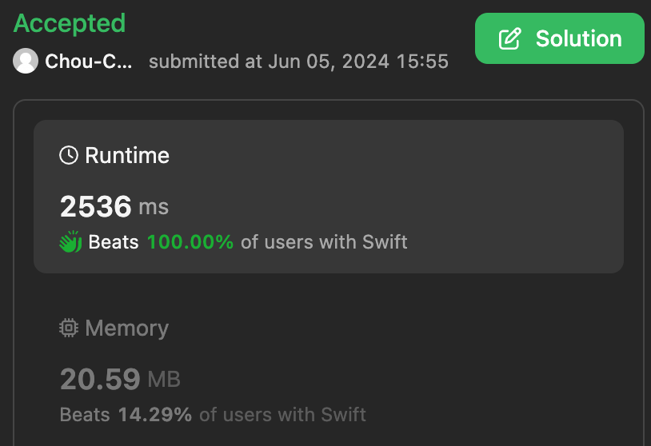

# Runtime 2536ms Solution

**Author:** ChouChien
**Votes:** 0
**Link:** [https://leetcode.com/problems/maximum-sum-of-subsequence-with-non-adjacent-elements/solutions/5262569/](https://leetcode.com/problems/maximum-sum-of-subsequence-with-non-adjacent-elements/solutions/5262569/)

---

I'm not good at English, so please bear with me.

# Intuition
<!-- Describe your first thoughts on how to solve this problem. -->
Record the max value of each position be selected, and the max value of the last two position is current result.

# Approach
<!-- Describe your approach to solving the problem. -->
- Negative number is useless, and I need one array is editable for every query, so use $$realNums$$.
- Use dp for recording current number be selected, leading 3 zero is just to facilitate calculation.
- Calculate for every query, new query just affect result backward.
- Avoid TLE, four consecutive 0's would be break loop, it doesn't affect result backward.

# Complexity
- Time complexity: O(n * m)
<!-- Add your time complexity here, e.g. $$O(n)$$ -->

- Space complexity: O(n)
<!-- Add your space complexity here, e.g. $$O(n)$$ -->




# Code
```
class Solution {
    func maximumSumSubsequence(_ nums: [Int], _ queries: [[Int]]) -> Int {
        let mudulo = 1000000007
        let numsCount = nums.count
        var realNums = nums.map { $0 > 0 ? $0 : 0 }
        var dp: [Int] = Array(repeating: 0, count: numsCount+3)
        for i in 0 ..< numsCount {
            dp[i+3] = realNums[i] + max(dp[i], dp[i+1])
        }
        var result: Int = 0
        var countNoDiff: Int
        var tmp: Int
        for query in queries {
            if query[1] > 0 || realNums[query[0]] > 0 {
                countNoDiff = 0
                realNums[query[0]] = query[1] > 0 ? query[1] : 0
                for i in query[0] ..< numsCount {
                    tmp = realNums[i] + max(dp[i], dp[i+1])
                    if dp[i+3] == tmp {
                        countNoDiff += 1
                        if countNoDiff > 3 {
                            break
                        }
                    } else {
                        countNoDiff = 0
                    }
                    dp[i+3] = tmp
                }
            }
            result = (result + max(dp[numsCount+2], dp[numsCount+1])) % mudulo
        }
        return result
    }
}
```