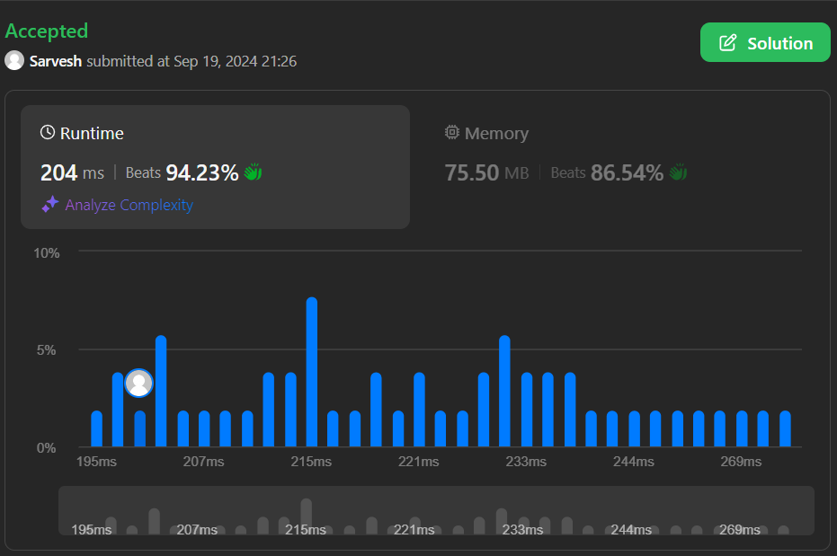

# Beats 94% Easy approach O(nlog(n)) Time Complexity, O(1) Space Complexity

**Author:** sarveshbhosale111
**Votes:** 1
**Link:** [https://leetcode.com/problems/count-days-without-meetings/solutions/5809990/](https://leetcode.com/problems/count-days-without-meetings/solutions/5809990/)

---

# Intuition
<!-- Describe your first thoughts on how to solve this problem. -->
The first thing that came into my find looking at this problem was I have to subtract days from the total meeting days and that would give me the remaing free days but there were some meetings overlapping so i had to first merge the intervals and then it was just the matter of subtracting meeting days from the total days
# Approach
<!-- Describe your approach to solving the problem. -->


- First thing to do is sort the meeting with respect to the start day
- keep track of min start and max end day 
- keep increasing the interval window till end is not less then next intervals start day
- Once we find that case subtract the days of interval from the total days
- Return the remaining days

# Complexity
- Time complexity: O(nlog(n))
<!-- Add your time complexity here, e.g. $$O(n)$$ -->

- Space complexity:O(1)
<!-- Add your space complexity here, e.g. $$O(n)$$ -->

# Code
```javascript []
/**
 * @param {number} days
 * @param {number[][]} meetings
 * @return {number}
 */
var countDays = function (days, meetings) {
    meetings.sort((a, b) => a[0] - b[0])
    let res = days
    let start = meetings[0][0]
    let end = meetings[0][1]
    for (let [from, to] of meetings) {
        if (end >= to) continue
        if (end >= from) {
            end = to
            continue
        }
        res -= end - start + 1
        start = from
        end = to
    }
    return res - (end - start + 1)
};
```