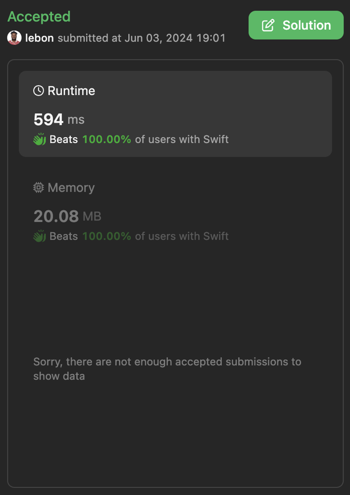

# ✅ Detailed Explanation of Swift implementation

**Author:** lebon
**Votes:** 1
**Link:** [https://leetcode.com/problems/find-subarray-with-bitwise-or-closest-to-k/solutions/5253927/](https://leetcode.com/problems/find-subarray-with-bitwise-or-closest-to-k/solutions/5253927/)

---

# Intuition
The problem involves finding the minimum difference between a given integer `k` and the AND result of subarrays within the list `nums`. Observing that the AND result of a subarray decreases as the subarray size increases, a sliding window approach can be effectively utilized to manage the subarrays and compute the AND results efficiently.

# Approach
1. **Initialize Variables**:
   - `result` to store the minimum difference, initialized to a large value (`Int.max`).
   - `mask` to keep track of the AND result of the current subarray, initialized to all bits set to 1 (30-bit).
   - `left` to serve as the left pointer of the sliding window.
   - `frequency` array to count the number of unset bits (0 bits) in the current subarray.

2. **Sliding Window**:
   - Iterate over the array using a `right` pointer.
   - For each number at the `right` pointer, update the `frequency` of unset bits and adjust the `mask` accordingly.
   - Update the minimum difference between `k` and `mask`.

3. **Shrink the Window**:
   - If `mask` is less than `k`, incrementally move the `left` pointer to shrink the window.
   - For each number at the `left` pointer, update the `frequency` of unset bits and restore the `mask` if necessary.
   - Check and update the minimum difference again after each modification.

4. **Return Result**:
   - After processing all elements, return the minimum difference stored in `result`.

# Complexity
- **Time complexity**: $$O(n \\cdot m)$$, where $$n$$ is the number of elements in the `nums` array and $$m$$ (fixed to 30) is the number of bits we are iterating over. In the worst case, for each element in the array, we check all 30 bits.
- **Space complexity**: $$O(m)$$, for the `frequency` array, which stores counts for up to 30 bits.




```swift []
class Solution {
    func minimumDifference(_ nums: [Int], _ k: Int) -> Int {
        // Frequency array to count the number of unset bits in the current subarray
        var frequency = Array(repeating: 0, count: 30)
        
        // Initialize the result with the maximum possible integer value
        var result = Int.max
        
        // Mask initialized with all bits set to 1 (30-bit all 1's)
        var mask = (1 << 30) - 1
        
        // Left pointer of the sliding window
        var left = 0
        
        // Iterate over each element with the right pointer of the sliding window
        for right in 0..<nums.count {
            // Update frequency of unset bits and adjust mask
            for bitPosition in 0..<30 {
                if (nums[right] & (1 << bitPosition)) == 0 {
                    if frequency[bitPosition] == 0 {
                        mask ^= (1 << bitPosition)
                    }
                    frequency[bitPosition] += 1
                }
            }
            
            // Update the result with the current minimum difference
            result = min(result, abs(mask - k))
            
            // Shrink the subarray from the left if the mask is less than k
            while left < right && mask < k {
                for bitPosition in 0..<30 {
                    if (nums[left] & (1 << bitPosition)) == 0 {
                        frequency[bitPosition] -= 1
                        if frequency[bitPosition] == 0 {
                            mask ^= (1 << bitPosition)
                        }
                    }
                }
                // Move the left pointer to the right
                left += 1
                
                // Update the result with the current minimum difference
                result = min(result, abs(mask - k))
            }
        }
        
        // Return the final minimum difference
        return result
    }
}
```