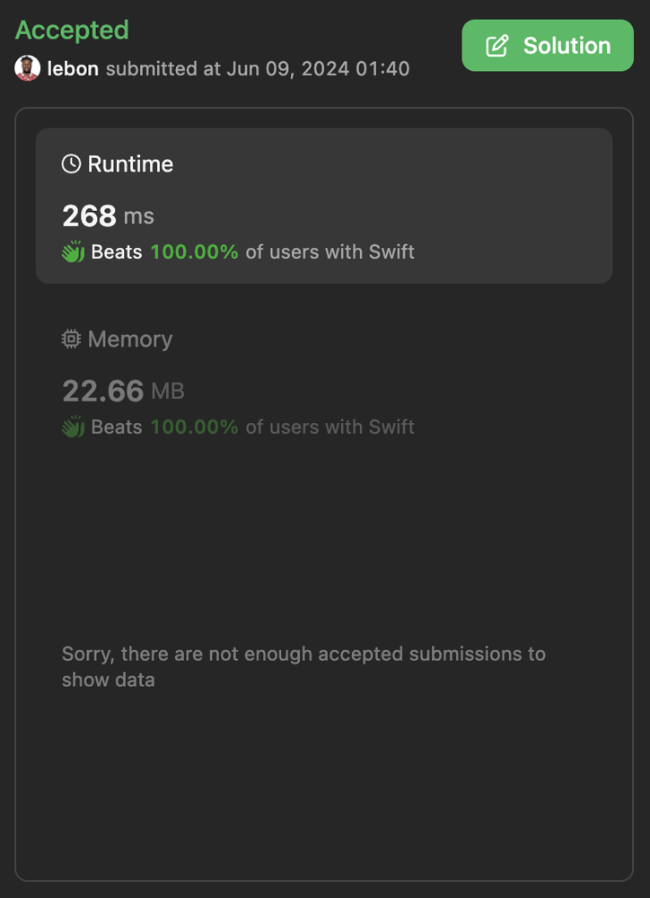

# ✅ Detailed explanation using swift

**Author:** lebon
**Votes:** 0
**Link:** [https://leetcode.com/problems/find-the-maximum-length-of-a-good-subsequence-ii/solutions/5281583/](https://leetcode.com/problems/find-the-maximum-length-of-a-good-subsequence-ii/solutions/5281583/)

---

# Intuition
The problem aims to find the longest subsequence of an array that can be partitioned into at most `k` different values. The idea is to use dynamic programming to track the maximum length of subsequences ending with each unique number in the array for different values of `k`.

# Approach
1. **Dynamic Programming Array Initialization**: We use an array of dictionaries `dp` where each dictionary at index `i` tracks the lengths of subsequences for the value of `i` partitions. We also maintain an array `maxLengths` to store the maximum length of subsequences for each value from `0` to `k`.

2. **Iterate Through the Array**: For each number in the array, we update the `dp` and `maxLengths` arrays.

3. **Update DP and Maximum Lengths**: For each value of `i` from `k` to `0`:
   - Calculate the current length of the subsequence ending with the number.
   - Determine the new length by either extending the current subsequence or starting a new one by extending the maximum length from `i-1` partitions.
   - Update the `dp` dictionary for the current value of `i` with the new length.
   - Update the `maxLengths` array to store the maximum length for the current value of `i`.

4. **Return the Result**: The maximum length for `k` partitions is stored in `maxLengths[k]`.

# Complexity
- **Time complexity**:
The time complexity is  $$O(n \\cdot k)$$, where $$n$$ is the length of the array, because we iterate through each element and for each element, we update the `dp` and `maxLengths` arrays for each value of `i` from `k` to `0`.

- **Space complexity**:
The space complexity is $$O(n + k)$$, where $$n$$ is the length of the array and $$k$$ is the number of partitions, due to the storage required for the `dp` array of dictionaries and the `maxLengths` array.





# Code
```swift []
class Solution {
    func maximumLength(_ array: [Int], _ k: Int) -> Int {
        // Initialize an array of dictionaries to store the length of subsequences
        var dp = Array(repeating: [Int: Int](), count: k + 1)
        
        // Initialize an array to store the maximum length of subsequences for each possible value of k
        var maxLengths = Array(repeating: 0, count: k + 1)
        
        // Iterate through each number in the array
        for number in array {
            // Iterate backwards from k to 0 to update the dp and maxLengths arrays
            for i in stride(from: k, through: 0, by: -1) {
                // Get the current length of the subsequence ending with 'number' for the given 'i'
                let currentLength = dp[i][number, default: 0]
                
                // Calculate the new length of the subsequence
                let newLength = max(currentLength + 1, (i > 0 ? maxLengths[i - 1] + 1 : 0))
                
                // Update the dp dictionary for the given 'i' with the new length
                dp[i][number] = newLength
                
                // Update the maximum length for the given 'i'
                maxLengths[i] = max(maxLengths[i], newLength)
            }
        }
        
        // Return the maximum length of subsequences for k
        return maxLengths[k]
    }
}

```