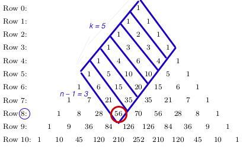

# Python 3 || 1 line, Pascal's Triangle  || T/S: 99% / 97%

**Author:** Spaulding_
**Votes:** 50
**Link:** [https://leetcode.com/problems/find-the-n-th-value-after-k-seconds/solutions/5282015/](https://leetcode.com/problems/find-the-n-th-value-after-k-seconds/solutions/5282015/)

---

Here's a proof without words, using Example 1 in the Problem Description:


(*Image edited June 9 to address comments*)

```
class Solution:
    def valueAfterKSeconds(self, n: int, k: int) -> int:

        return comb(k+n-1,n-1) %1_000_000_007
        
```
[https://leetcode.com/problems/find-the-n-th-value-after-k-seconds/submissions/1282409657/](https://leetcode.com/problems/find-the-n-th-value-after-k-seconds/submissions/1282409657/)

Time complexity is *O*(*min*(*k*, *n*)) and space complexity is *O*(1).


___
(*June 15 addendum*)

There's been two or three *WLB* comments below that grouse the `math.comb` method makes the time complexity greater than *O*(*min*(*k*, *n*)).

So here's equivalent python code without the  `math.comb` method:

```
class Solution:
    def valueAfterKSeconds(self, n: int, k: int, ans = 1) -> int:

        for i in range(min(k, n-1)):
            ans = ans * (k+n-1 - i)//(i+1)

        return ans  %1_000_000_007
```
I think it's clear that time complexity is *O*(*min*(*k*, *n*)).

[https://leetcode.com/problems/find-the-n-th-value-after-k-seconds/submissions/1289469202/](https://leetcode.com/problems/find-the-n-th-value-after-k-seconds/submissions/1289469202/)
______
