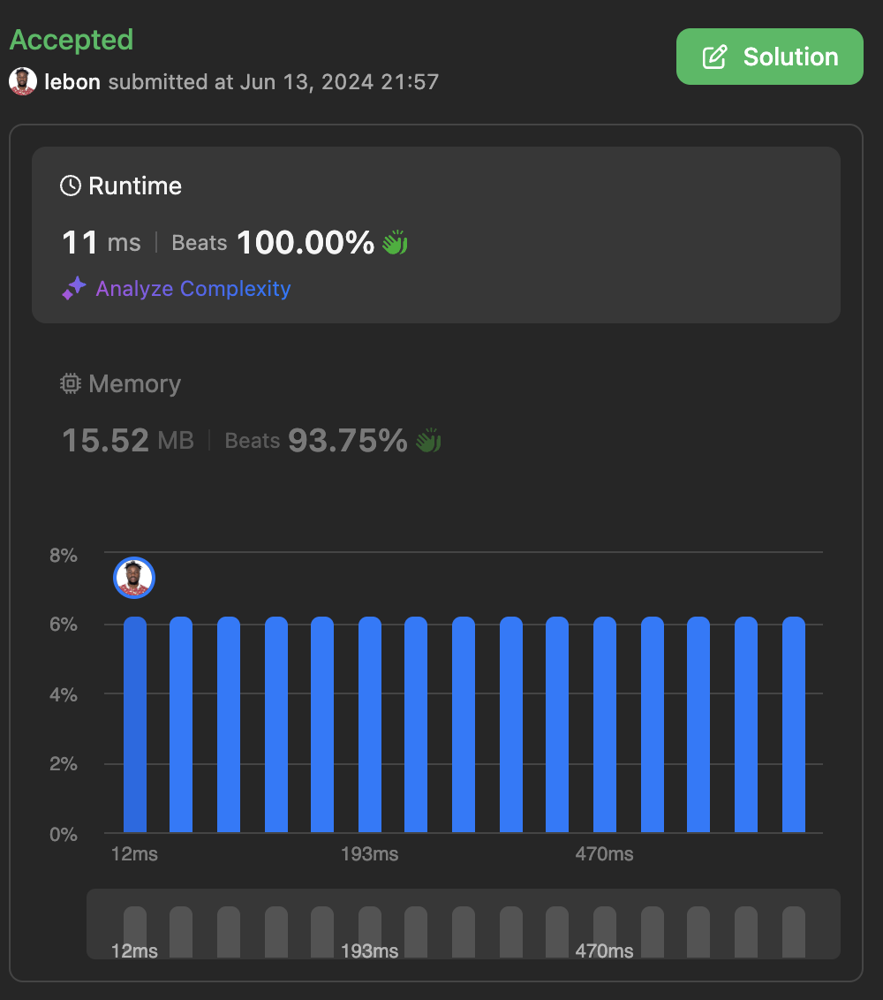

# ✅ Easy to understand approach

**Author:** lebon
**Votes:** 0
**Link:** [https://leetcode.com/problems/maximum-total-reward-using-operations-i/solutions/5309246/](https://leetcode.com/problems/maximum-total-reward-using-operations-i/solutions/5309246/)

---


## Intuition
<!-- Describe your first thoughts on how to solve this problem. -->

The problem requires us to maximize the total reward by choosing unmarked indices where the reward value is greater than the current total reward. The rewards can be considered as available only if they can contribute to increasing the total reward. This suggests that we need to consider the largest rewards first to maximize the total reward quickly.

## Approach
<!-- Describe your approach to solving the problem. -->

1. **Initialization and Input Check**:
   - Find the maximum value in the `rewardValues` array.
   - If there is only one reward value, return it immediately as it is the only option.

2. **Availability Array**:
   - Create an array `isAvailable` of boolean values to track which reward values are available. Initialize this array to `true`.

3. **Mark the Reward Values**:
   - Iterate through the `rewardValues` and mark the corresponding positions in the `isAvailable` array as `false` to indicate the presence of these reward values.

4. **Collect Available Rewards**:
   - Create an array `availableRewards` to store the reward values that are available based on the `isAvailable` array.

5. **Calculate Maximum Reward Combination**:
   - Iterate over the `availableRewards` array to calculate the maximum reward combination possible. Use a temporary availability array `tempAvailability` to track the possible combinations.
   - Update the maximum reward combination (`maxRewardCombination`) based on the possible reward values.

6. **Return Result**:
   - Return the sum of the maximum value and the second largest reward combination as the result.

## Complexity

- **Time Complexity**: The time complexity is $$O(n \\log n)$$ primarily due to the sorting step of the reward values. The subsequent operations involve iterating through the array, which is $$O(n)$$.
  
- **Space Complexity**: The space complexity is $$O(n)$$ for the availability arrays and the list of available rewards. This accounts for the additional storage required to keep track of the availability of reward values and to store the available rewards.




## Code
```swift []
class Solution {
    func maxTotalReward(_ rewardValues: [Int]) -> Int {
        // Find the maximum value in rewardValues
        let maxValue = rewardValues.max()!
        
        // If there is only one reward value, return it
        if rewardValues.count == 1 {
            return rewardValues[0]
        }
        
        // Initialize an array to track availability of reward values
        var isAvailable = [Bool](repeating: true, count: maxValue + 1)
        
        // Mark the reward values in the availability array
        for rewardValue in rewardValues {
            if isAvailable[rewardValue] {
                isAvailable[rewardValue] = false
            }
        }
        
        // Collect the reward values in an array
        var availableRewards = [Int]()
        for i in 1...maxValue {
            if !isAvailable[i] {
                availableRewards.append(i)
            }
        }
        
        var currentIndex = 0
        let numberOfRewards = availableRewards.count
        
        // If there is only one available reward, return it
        if numberOfRewards == 1 {
            return availableRewards[0]
        }
        
        var tempAvailability = isAvailable
        var maxRewardCombination = 0
        
        // Check reward values up to half of maxValue
        if availableRewards[0] <= maxValue / 2 {
            for i in availableRewards[0]...maxValue / 2 {
                if !tempAvailability[i] { continue }
                
                while currentIndex < numberOfRewards && availableRewards[currentIndex] < i {
                    currentIndex += 1
                }
                
                for one in 1...currentIndex {
                    let previousReward = availableRewards[currentIndex - one]
                    if i < (previousReward << 1) {
                        if !tempAvailability[i - previousReward] {
                            tempAvailability[i] = false
                            break
                        }
                    } else {
                        break
                    }
                }
            }
        }
        
        var secondLargestReward = availableRewards[numberOfRewards - 2]
        currentIndex = 1
        
        // Calculate the maximum reward combination
        for i in 2...numberOfRewards {
            let currentReward = availableRewards[numberOfRewards - i]
            while currentIndex < currentReward && currentIndex + currentReward < maxValue {
                if !tempAvailability[currentIndex] && currentIndex + currentReward > secondLargestReward {
                    secondLargestReward = currentIndex + currentReward
                }
                currentIndex += 1
            }
            if currentIndex >= currentReward {
                break
            }
        }
        
        // Return the sum of the maximum value and the second largest reward combination
        return maxValue + secondLargestReward
    }
}

```