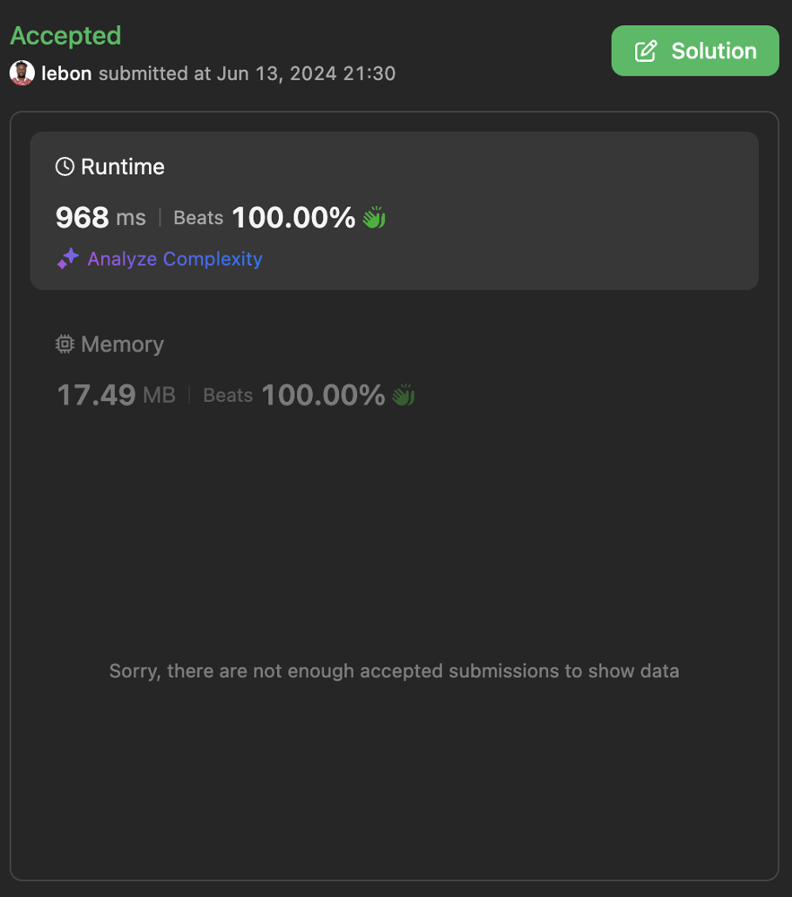

# ✅ Easy To Understand Explanation

**Author:** lebon
**Votes:** 0
**Link:** [https://leetcode.com/problems/maximum-total-reward-using-operations-ii/solutions/5309170/](https://leetcode.com/problems/maximum-total-reward-using-operations-ii/solutions/5309170/)

---

# Intuition
<!-- Describe your first thoughts on how to solve this problem. -->
The problem requires us to find the maximum total reward we can collect by selectively adding rewards to our total if they exceed the current total reward. This hints at the need to efficiently manage and track possible reward sums to maximize our total. A bit manipulation approach allows us to efficiently manage and update these sums.

# Approach
<!-- Describe your approach to solving the problem. -->
1. **Sort and Deduplicate Rewards**: First, sort the reward values and remove duplicates to simplify the processing.
2. **BitSet Initialization**: Use a bitset to track possible reward sums. Initialize the bitset to track a sum of 0.
3. **Mask Management**: Use a mask to manage the current bitmask, ensuring we only consider valid rewards.
4. **Update Possible Sums**: For each reward, update the bitset by shifting the bits to account for adding the current reward to all previously tracked sums.
5. **Find Closest Possible Sum**: After processing all rewards, find the largest possible sum that is valid according to the bitset.
6. **Calculate Total Reward**: The maximum total reward is the sum of the largest reward and the closest possible sum found.

# Complexity
- **Time complexity**:
<!-- Add your time complexity here, e.g. $$O(n)$$ -->
The time complexity is $$O(n \\log n)$$ due to the sorting step, where n is the number of rewards.

- **Space complexity**:
<!-- Add your space complexity here, e.g. $$O(n)$$ -->
The space complexity is $$O(n)$$ for storing the bitset and auxiliary variables.



# Code
```swift []
class Solution {
    func maxTotalReward(_ rewards: [Int]) -> Int {
        // Create a bitset for tracking possible reward sums
        var possibleSums = BitSet(50000)
        possibleSums.set(0)
        
        // Sort the rewards in ascending order
        let sortedRewards = rewards.sorted()
        
        // Initialize variables
        var mask = BitSet(50000)
        var closestPossibleSum = sortedRewards.last! - 1
        var maskPosition = 0
        
        // Iterate through the rewards
        for i in 0..<sortedRewards.count - 1 {
            let currentReward = sortedRewards[i]
            
            // Update the mask until it covers the current reward
            while maskPosition < currentReward {
                mask.set(maskPosition)
                maskPosition += 1
            }
            
            // Update the possible sums with the current reward
            possibleSums |= (possibleSums & mask) << currentReward
        }
        
        // Find the largest possible sum less than or equal to the largest reward
        while !possibleSums[closestPossibleSum] {
            closestPossibleSum -= 1
        }
        
        // Return the total reward by adding the largest reward to the closest possible sum
        return sortedRewards.last! + closestPossibleSum
    }
}

// BitSet implementation in Swift
struct BitSet {
    private var bits: [UInt64]
    
    init(_ size: Int) {
        bits = [UInt64](repeating: 0, count: (size + 63) / 64)
    }
    
    mutating func set(_ index: Int) {
        bits[index / 64] |= 1 << (index % 64)
    }
    
    subscript(index: Int) -> Bool {
        return (bits[index / 64] & (1 << (index % 64))) != 0
    }
    
    static func |=(lhs: inout BitSet, rhs: BitSet) {
        for i in 0..<lhs.bits.count {
            lhs.bits[i] |= rhs.bits[i]
        }
    }
    
    static func &(lhs: BitSet, rhs: BitSet) -> BitSet {
        var result = lhs
        for i in 0..<lhs.bits.count {
            result.bits[i] &= rhs.bits[i]
        }
        return result
    }
    
    static func <<(lhs: BitSet, shift: Int) -> BitSet {
        var result = lhs
        let wordShift = shift / 64
        let bitShift = shift % 64
        
        if wordShift > 0 {
            for i in stride(from: result.bits.count - 1, through: wordShift, by: -1) {
                result.bits[i] = result.bits[i - wordShift]
            }
            for i in 0..<wordShift {
                result.bits[i] = 0
            }
        }
        
        if bitShift > 0 {
            for i in stride(from: result.bits.count - 1, to: 0, by: -1) {
                result.bits[i] <<= bitShift
                if i > 0 {
                    result.bits[i] |= result.bits[i - 1] >> (64 - bitShift)
                }
            }
            result.bits[0] <<= bitShift
        }
        
        return result
    }
}
```