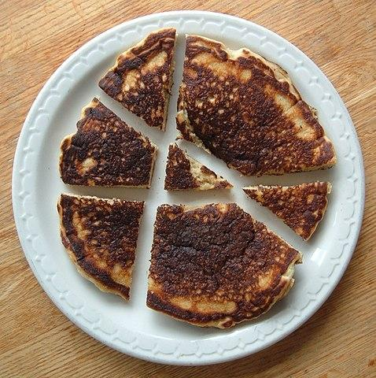

# 🚩 one-liner ^^

**Author:** andrii_khlevniuk
**Votes:** 1
**Link:** [https://leetcode.com/problems/the-number-of-ways-to-make-the-sum/solutions/5306467/](https://leetcode.com/problems/the-number-of-ways-to-make-the-sum/solutions/5306467/)

---

**time: `O(1)`; space: `O(1)`**
**c++:**
```
int numberOfWays(long long n) 
{   
	return (1+n/2*(n/2+1)/2)%1000000007;
}
```
**python:**
```
class Solution:
    def numberOfWays(self, n):
        return (1+n//2*(n//2+1)//2)%1000000007;
```
**javascript:**
```
var numberOfWays = (n) => 1+Math.floor(Math.floor(n/2)*(Math.floor(n/2)+1)/2)%1000000007;
```

**The sequence**
The solution forms the following sequence:
```1, 1, 2, 2, 4, 4, 7, 7, 11, 11, 16, 16, 22, 22... ```
that is just the [Central polygonal numbers](https://oeis.org/A000124) sequence aka "The Lazy Caterer's sequence":
```1, 2, 4, 7, 11, 16, 22... ```
but **each number is repeated twice**. The Lazy Caterer's sequence describes the maximum number of pieces of a disk (a pancake or pizza is usually used to describe the situation) that can be made with a given number of straight cuts.  [Here's](https://en.wikipedia.org/wiki/Lazy_caterer%27s_sequence) a wiki article about it.




Central polygonal numbers are given by the formula (triangular numbers + `1`)
```
a(n) = 1+n*(n+1)/2
```
so to obtain the solution of our problem we just need to substitute `n/2` in the formula above.

**Why?**

Suppose that `f(n)` (number of  valid partitions of number n) is the solution to our problem. I want to prove the relation
```
f(n) = n/2 + f(n-2)      (\u2022)
```
The initial conditions are
```
f(1) = 1;                (\u2022\u2022)            
f(2) = 2;
```

With the help of the recurrence(\u2022) and initial conditions(\u2022\u2022) we can build the sequence
```
f(3) = 3/2 + f(1) = 1+1 = 2;
f(4) = 4/2 + f(2) = 2+2 = 4;
f(5) = 5/2 + f(3) = 2+2 = 4;
f(6) = 6/2 + f(4) = 3+4 = 7;
f(7) = 7/2 + f(5) = 3+4 = 7;
...
```
Moreover, the solution of this recurrence is `f(n)=g(n/2)` where `g(n)` is the central polygonal number(CPN). The CPNs follow the following recurence relation
```
g(m) = m + g(m-1)
```
that implies (\u2022)
```
f(n) = g(n/2) = n/2 + g(n/2-1) = n/2 + g((n-2)/2) = n/2 + f(n-2)
```
As the `g(n)` could be solved for and expressed as
```
g(n) = 1 + n(n+1)/2
```
the solution for our problem will be
```
f(n) = g(n/2) = 1 + (n/2)(n/2+1)/2
```
as it satisfies the recurrence relation(\u2022) and the initial conditions(\u2022\u2022)
```
f(1) = 1 + (1/2)*(1/2+1)/2 = 1;
f(2) = 1 + (2/2)*(2/2+1)/2 = 2;
```

Let\u2019s prove (\u2022)
In the further proof I'll show that
```
f(n)   =       n/2              +    f(n-2)
		  	  #partitions          #partitions
			  with                  with
			  #ones<=1		        #ones>1
```
For example for `n=3` we have partitions
```
{ { 1, 1, 1, 1 }, { 2, 1, 1 }, { 2, 2 }, { 4 } } = { { 2, 2 }, { 4 } } + { { 1, 1, 1, 1 }, { 2, 1, 1 } }
--------------------------4---------------------    --------2---------    ----------------2-------------
                 f(4)                            =         4/2         +                f(4-2)
```

**PROOF**
Suppose we can decompose number `n-2>0` into `D={d_i}`. 
For example, for `n-2=4` we have
```
D = { { 1, 1, 1, 1}, { 2, 1, 1 }, { 2, 2 }, { 4 } };
|D| = f(n-2)
```

Suppose we now add `2` to `n-2`. We can generate partitions for `n` by prepending `{1,1}` to each of `d_i`.
This will exhaust all partitions of `n` that **have two or more ones** in it. 
```
D\u2019 = { { 1, 1, 1, 1, 1, 1 }, { 2, 1, 1, 1, 1 }, { 2, 2, 1, 1 }, { 4, 1, 1 } }. 
|D\u2019| = |D| = f(n-2).
```

Now we have to count partitions **that have zero or one of ones** and prove that there are exactly `n/2` of those. BTW, which one of the two options above is the case actually depends on the parity of `n`. If n is odd we have to have one one in every such partition (for parity reasons) and if `n` is even we have to have zero ones.

Suppose that we have partitioned the number into `0` or `1` of ones and therefore we are "left with" `n/2` twos some of which can be merged into fours and sixes. Ignore ones, from now on they are fixed.

Some number of twos can be merged into some number of sixes. Actually if there are `m=n/2` twos then there are `1+m/3` different combinations of twos and sixes.

For example, for `m=7` there are `1+m/3=3` partitions
```
{ 2,2,2,2,2,2,2 } - 0 sixes and 7 twos;
{   6,  2,2,2,2 } - 1 sixes and 4 twos;
{   6,    6,  2 } - 2 sixes and 1 twos
```
We can enumerate such partitions by pairs of `(#sixes, #twos)`:
```
{ (0, n), (1, n-3), \u2026, (m/3-1, 3+m%3), (m/3, m%3) }.
```
But **each** of such partitions "splits" into different partitions because we can remerge some remaining twos into `0` or `1` (if possible) or `2`(if possible) fours. More precisely, if the partition has the number of twos
```
> 3  it splits into 3 partitions;
= 3  it splits into 2 partitions;
= 2  it splits into 2 partitions;
= 1  it splits into 1 partition (doesn\u2019t split at all);
= 0  it splits into 1 partition (doesn\u2019t split at all).
```

For example, partition `{6, 2, 2, 2, 2}` splits into
```
{ 6, 2, 2, 2, 2 } 1 six and 0 fours and 4 twos;
{ 6,   4,  2, 2 } 1 six and 1 fours and 2 twos;
{ 6,   4,    4  } 1 six and 2 fours and 0 twos;
```
generating three different partitions.

As another example, partition `{6, 2, 2}` splits into 
```
{ 6, 2, 2 } 1 six and 0 fours and 2 twos;
{ 6,   4  } 1 six and 1 fours and 0 twos;
```
generating two different partitions.

Now let's prove that the total number of such partitions (different `(#sixes, #twos)` pairs + splitting of the each pair) is equal to `m`.

Note that `m%3` can be `0` or `1` or `2`:
> * If `m%3=0 (m=3*x , x>0)` we have
>```
>(0, n),  (1, n-3),  \u2026,  (m/3-1, 3),  (m/3, 0)
>\u2014\u2014\u2014\u2014\u2014\u2014\u2014------------x---------------  ---1----
>\u2014\u2014\u2014\u2014\u2014\u2014\u2014----x-1-------   -----1-----  ---1----
>    each splits in 3      splits in 2 splits in 1       \u03A3 partitions = 3*(x-1)+3 = m 
>```
> * If `m%3=1 (m=3*x+1, x>=0)`  we have
>```
>(0, n), (1, n-3),   \u2026,   (m/3-1, 4),  (m/3, 1)
>\u2014\u2014\u2014\u2014\u2014\u2014\u2014\u2014------------x---------------   -\u2014-1---
>           each splits in 3             splits in 1     \u03A3 partitions = 3*x+1 = m 
>```
> * If `m%3=2 (m=3*x+2, x>=0)` we have
>```
>(0, n), (1, n-3), \u2026, (m/3-1, 5), (m/3, 2)
>\u2014\u2014\u2014\u2014\u2014\u2014-\u2014---------x-------\u2014\u2014\u2014\u2014\u2014-  \u2014--\u20141---
>        each splits in 3          splits in 2           \u03A3 partitions = 3*x+2 = m 
>```

So every time we have `m` partitions that are made of twos, sixes and fours. But `m=n/2` so, the total number of partitions of number `n` is connected to the total number of partitions of number `n-2` via recurence relation (\u2022):  `f(n) = n/2+f(n-2)`. 
**QED**

So the proof above works for {1*, 2*, 4, 4, 6*} because:
* 2 is a multiple of 1 and 4 and 6 are multiples of 2;
* 6 = **3** * 2 and at the same time there could be **3** (albeit some edgecases) options for four to be present in the partition (0, 1, or 2).

Question: [Cake number](https://en.wikipedia.org/wiki/Cake_number) sequence is the 3D analogue of the lazy caterer's sequence. How can we generate them using partitions ? And generally what other interesting sequences(with doubling or maybe tripling of the members) can we generate with such partitions ?
So far, I've found these sequences
```
SCHEME                 p(n)                         OEIS
{1*}                   1
{1*, 2*}               1 + n/2
{1*, 3*}               1 + n/3                      A008620
{1*, 2*, 4*}           1 + n/2 + (n/2)(n/2)/4       2 * A087811
{1*, 2*, 6*}           1    +    (n/2)(n/2+5)/6     2 * \u02DCA001840
{1*, 2*, 4, 6*}        1    +    (n/2)(n/2+3)/3     2 * A007980
{1*, 2*, 4, 4, 6*}     1    +    (n/2)(n/2+1)/2     2 * A000124
{1*, 2*, 8*}           (n/2+3)^2/8                  2 * A130519
{1*, 5*, 10*}          1 + n/5 + (n/5)(n/5)/4       2 * A087811
{1*, 2*, 3*, 4*}       1 - 7*n/144.0 + n/4/4.0 + n/3/3.0 + (n+1)/4/4.0 + (n+5)*(n/2)/8.0 + n^2/24.0 + n^3/144.0    A001400
{1*, 2*, 4*, 6, 8*}   (n/2+4)(2(n/2+2)(n/2+2)-n/2+4)/48  2 * A173722 
```

**Similar problems:**
[322. Coin Change](https://leetcode.com/problems/coin-change/discuss/5492970/dp)
[518. Coin Change II](https://leetcode.com/problems/coin-change-ii/discuss/5487668/ok)
[2915. Length of the Longest Subsequence That Sums to Target](https://leetcode.com/problems/length-of-the-longest-subsequence-that-sums-to-target/discuss/5492962/dp)
[3183. The Number of Ways to Make the Sum](https://leetcode.com/problems/the-number-of-ways-to-make-the-sum/discuss/5306467/one-liner)
[300. Longest Increasing Subsequence](https://leetcode.com/problems/longest-increasing-subsequence/discuss/1288420/dp)