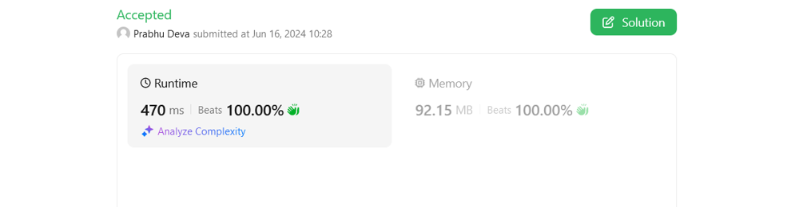

# Beats 100% Runtime O(n) & 100% Memory O(1)

**Author:** Prabhu_Deva
**Votes:** 1
**Link:** [https://leetcode.com/problems/count-pairs-that-form-a-complete-day-ii/solutions/5320352/](https://leetcode.com/problems/count-pairs-that-form-a-complete-day-ii/solutions/5320352/)

---




# Intuition
    1. We need to find no of pairs that can form a complete day i.e day % 24 == 0; So we can keep track of count for each reminder and find the pairs count.
    
    2. Initially i used Dictionary which consumed O(n) space. Since we are going to add values between 0 to 23, I used an array which consumes O(1) space.
<!-- Describe your first thoughts on how to solve this problem. -->

# Approach
1. The foreach loop iterates through each hour and increments the index that corresponds to remainder when divided by 24. Index will be between 0 to 23.

2. Special cases for remainders 0 and 12 are handled separately since they can form pairs with themselves.
This formula (n * (n - 1)) / 2 calculates the number of ways to pick 2 items from n items without regard to order.

3. A for loop runs from 1 to 11, which covers all possible pairings.
For each index i, it checks if there is a corresponding remainder that can form a complete day with it (i.e., 24 - i).
If such a remainder exists, it multiplies the frequency of the current remainder (counts[i]) with the frequency of its complement (counts[24-i]) and adds this to the count.
<!-- Describe your approach to solving the problem. -->

# Complexity
- Time complexity: O(n)
<!-- Add your time complexity here, e.g. $$O(n)$$ -->

- Space complexity: O(1)
<!-- Add your space complexity here, e.g. $$O(n)$$ -->

# Code
```
public class Solution {
    public long CountCompleteDayPairs(int[] hours) {
        long count = 0;
        var counts = new int[24];       
        
        foreach(int hour in hours){
            counts[hour%24]++;
        } 

        count += (long)counts[0] *((long)counts[0] -1)/2;
        count += (long)counts[12] *((long)counts[12] -1)/2;
        
        for(int i=1; i<12; i++){            
            if(counts[24-i] > 0){
                count += counts[i] * counts[24-i];
            }
        }
        
        return count;
    }
}
```