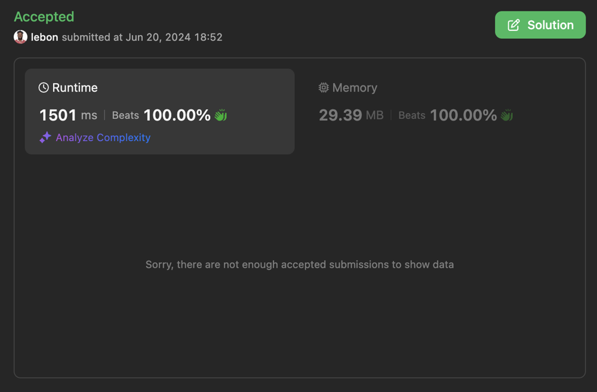

# Cracking Peak Queries: ✅ Efficient Solution with BIT Magic

**Author:** lebon
**Votes:** 0
**Link:** [https://leetcode.com/problems/peaks-in-array/solutions/5342553/](https://leetcode.com/problems/peaks-in-array/solutions/5342553/)

---

# Intuition
When I first saw this problem, I realized that identifying peaks in the array is essential. A peak is an element that is greater than its neighbors. Once peaks are identified, we can use a data structure to efficiently query and update the number of peaks as the array is modified.

# Approach
1. **Initialization**:
    - Use a Binary Indexed Tree (BIT) to keep track of the number of peaks.
    - Iterate through the array and mark initial peaks in the BIT.

2. **Helper Functions**:
    - `bitRange`: Generates a range of indices to update or query the BIT.
    - `prefixSum`: Computes the prefix sum up to a given index using the BIT.
    - `add`: Updates the BIT at a specific index with a given value.
    - `isPeak`: Determines if an element at a given index is a peak.

3. **Query Processing**:
    - For query type 1 `[1, l, r]`: Compute the number of peaks in the range `[l, r)` by querying the BIT.
    - For query type 2 `[2, i, val]`: Update the value at index `i` and adjust the BIT if the peak status changes for the affected elements.

# Complexity
- **Time complexity***:
  - Initializing the BIT takes $$O(n)$$.
  - Each query operation (both type 1 and type 2) takes $$O(\\log n)$$.
  - Thus, if there are $$q$$ queries, the overall time complexity is $$O((n + q) \\log n)$$.

- **Space complexity**:
  - The space complexity is $$O(n)$$ due to the storage required for the BIT.



# Code
``` swift []
class Solution {
    func countOfPeaks(_ array: [Int], _ queries: [[Int]]) -> [Int] {
        var bit = [Int](repeating: 0, count: array.count + 1)
        var result = [Int]()
        var array = array

        // Helper function to get the range for the Binary Indexed Tree
        func bitRange(_ p: Int, _ down: Bool) -> [Int] {
            var range = [Int]()
            var p = p
            while p >= 0 && p < bit.count {
                range.append(p)
                p = down ? (p & (p + 1)) - 1 : p | (p + 1)
            }
            return range
        }

        // Helper function to get prefix sum from BIT
        func prefixSum(_ p: Int) -> Int {
            return bitRange(p, true).reduce(0) { $0 + bit[$1] }
        }

        // Helper function to update BIT
        func add(_ p: Int, _ value: Int) {
            for idx in bitRange(p, false) {
                bit[idx] += value
            }
        }

        // Helper function to check if an index is a peak
        func isPeak(_ i: Int) -> Bool {
            return i > 0 && i + 1 < array.count && array[i - 1] < array[i] && array[i] > array[i + 1]
        }

        // Initialize BIT with initial peaks
        for i in 1..<array.count - 1 {
            if isPeak(i) {
                add(i, 1)
            }
        }

        // Process each query
        for query in queries {
            switch query[0] {
            case 1:
                // Query type 1: count peaks in range [l, r)
                let l = query[1], r = query[2]
                result.append(l < r ? prefixSum(r - 1) - prefixSum(l) : 0)
            case 2:
                // Query type 2: update the value at index i
                let i = query[1], newValue = query[2]
                let previousStates = [isPeak(i - 1), isPeak(i), isPeak(i + 1)]
                array[i] = newValue
                for p in 0..<previousStates.count {
                    if previousStates[p] != isPeak(i + p - 1) {
                        add(i + p - 1, previousStates[p] ? -1 : 1)
                    }
                }
            default:
                continue
            }
        }

        return result
    }
}


```