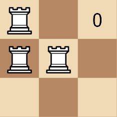
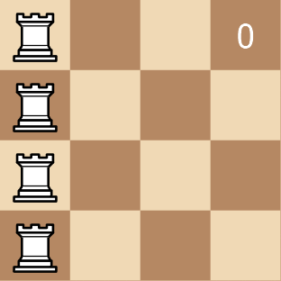

# [3189. Minimum Moves to Get a Peaceful Board](https://leetcode.com/problems/minimum-moves-to-get-a-peaceful-board/)

| Category | Difficulty | Likes | Dislikes |
| :------: | :--------: | :---: | :------: |
| Algorithms | Medium | 60 | 13 |

**Tags:** [`array`](https://leetcode.com/tag/array), [`greedy`](https://leetcode.com/tag/greedy), [`sorting`](https://leetcode.com/tag/sorting), [`counting-sort`](https://leetcode.com/tag/counting-sort)

## Description

Given a 2D array `rooks` of length `n`, where `rooks[i] = [x_i, y_i]` indicates the position of a rook on an `n x n` chess board. Your task is to move the rooks **1 cell **at a time vertically or horizontally (to an *adjacent* cell) such that the board becomes **peaceful**.

A board is **peaceful** if there is **exactly** one rook in each row and each column.

Return the **minimum** number of moves required to get a *peaceful board*.

**Note** that **at no point** can there be two rooks in the same cell.

 

**Example 1:**

**Input:** rooks = [[0,0],[1,0],[1,1]]

**Output:** 3

**Explanation:**

**Example 2:**

**Input:** rooks = [[0,0],[0,1],[0,2],[0,3]]

**Output:** 6

**Explanation:**

 

**Constraints:**

	- `1 <= n == rooks.length <= 500`

	- `0 <= x_i, y_i <= n - 1`

	- The input is generated such that there are no 2 rooks in the same cell.

---

**Links:** [Submissions](https://leetcode.com/problems/minimum-moves-to-get-a-peaceful-board/) | [Solutions](https://leetcode.com/problems/minimum-moves-to-get-a-peaceful-board/)
