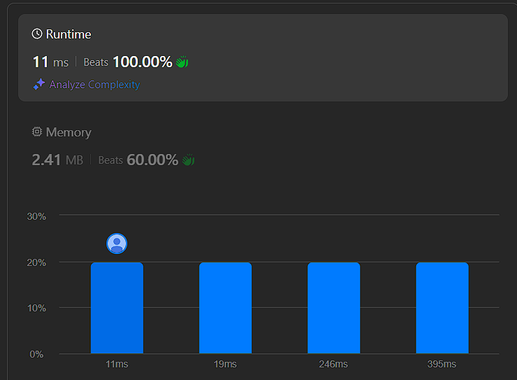

# rust 100% solution

**Author:** sovlynn
**Votes:** 0
**Link:** [https://leetcode.com/problems/count-the-number-of-inversions/solutions/5364545/](https://leetcode.com/problems/count-the-number-of-inversions/solutions/5364545/)

---



# Intuition
```
dp[i][j]=if(array[0..end_i] has specific requirement and j!=end_i){
        0
    }else{
        sum(dp[i-1][j-i..j])
    }
```

# Complexity
- Time complexity:
$O(n^3)$ for small $n$, $O(n)$ for large $n$

- Space complexity:
$O(n^3)$ for small $n$, $O(n)$ for large $n$

# Code
```
const MOD:i32=1000000007;
use std::cmp::{max, min};

impl Solution {
    pub fn number_of_permutations(n: i32, requirements: Vec<Vec<i32>>) -> i32 {
        let n=n as usize;
        let mut req_map=vec![-1; n];
        for x in &requirements{
            if x[1]>x[0]*(x[0]+1)/2{return 0;}
            req_map[x[0] as usize]=x[1];
        }
        let m=req_map[n-1] as usize;
        let mut dp=vec![vec![0; m+1]; n];
        dp[0][0]=1;
        for i in 1..n{
            let mut sum=0;
            let tm=min(m, i*(i+1)/2);
            for j in 0..=tm{
                sum+=dp[i-1][j];
                sum%=MOD;
                if j>=i+1{sum-=dp[i-1][j-i-1]};
                while sum<0{sum+=MOD;}
                sum%=MOD;
                if req_map[i]<0||req_map[i] as usize==j{
                    dp[i][j]=sum;
                }
            }
        }
        dp[n-1][req_map[n-1] as usize]
    }
}
```