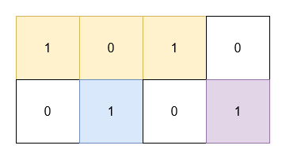

# [3197. Find the Minimum Area to Cover All Ones II](https://leetcode.com/problems/find-the-minimum-area-to-cover-all-ones-ii/)

| Category | Difficulty | Likes | Dislikes |
| :------: | :--------: | :---: | :------: |
| Algorithms | Hard | 395 | 67 |

**Tags:** [`array`](https://leetcode.com/tag/array), [`matrix`](https://leetcode.com/tag/matrix), [`enumeration`](https://leetcode.com/tag/enumeration)

**Companies:** `amazon`, `microsoft`, `salesforce`

## Description

You are given a 2D **binary** array `grid`. You need to find 3 **non-overlapping** rectangles having **non-zero** areas with horizontal and vertical sides such that all the 1's in `grid` lie inside these rectangles.

Return the **minimum** possible sum of the area of these rectangles.

**Note** that the rectangles are allowed to touch.

 

**Example 1:**

**Input:** grid = [[1,0,1],[1,1,1]]

**Output:** 5

**Explanation:**

	- The 1's at `(0, 0)` and `(1, 0)` are covered by a rectangle of area 2.

	- The 1's at `(0, 2)` and `(1, 2)` are covered by a rectangle of area 2.

	- The 1 at `(1, 1)` is covered by a rectangle of area 1.

**Example 2:**

**Input:** grid = [[1,0,1,0],[0,1,0,1]]

**Output:** 5

**Explanation:**

	- The 1's at `(0, 0)` and `(0, 2)` are covered by a rectangle of area 3.

	- The 1 at `(1, 1)` is covered by a rectangle of area 1.

	- The 1 at `(1, 3)` is covered by a rectangle of area 1.

 

**Constraints:**

	- `1 <= grid.length, grid[i].length <= 30`

	- `grid[i][j]` is either 0 or 1.

	- The input is generated such that there are at least three 1's in `grid`.

---

**Links:** [Submissions](https://leetcode.com/problems/find-the-minimum-area-to-cover-all-ones-ii/) | [Solutions](https://leetcode.com/problems/find-the-minimum-area-to-cover-all-ones-ii/)
