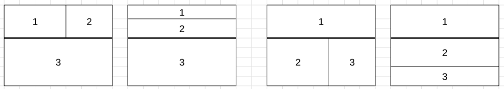
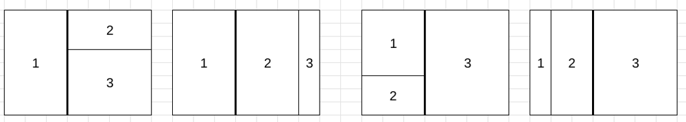

# Greedy Partitioning

**Author:** votrubac
**Votes:** 14
**Link:** [https://leetcode.com/problems/find-the-minimum-area-to-cover-all-ones-ii/solutions/5355656/](https://leetcode.com/problems/find-the-minimum-area-to-cover-all-ones-ii/solutions/5355656/)

---

Super disappointing for an 8-point problem. Not much intuition, just coding grind.

For any three rectangles, there is always a horizonal or a vertical line that separate one rectangle from the others.

We need a few helper functions:
- Minimum area of one rectangle (`min1`) covering a sub-grid (defined by bottom, left, top, right).
	- Same as in [3195. Find the Minimum Area to Cover All Ones I](https://leetcode.com/problems/find-the-minimum-area-to-cover-all-ones-i/)
- Minimum area of two non-overlapping rectangles divided by a vertical line (`min2v`).
- Minimum area of two non-overlapping rectangles divided by a horizongal line (`min2h`).

We cut the grid vertically, and cover top with two squares and bottom with one, and vice versa.



> Note that case 2 and 4 are identical, so we only need to cover 3 cases here.

Then, we cut the grid horizontally, and cover left with two squares and right with one, and vice versa.



> Again, case 2 and 4 are also identical here.

**C++**
We can memoise `min1`; I tried it but it increased runtime for this problem constraint. It would be useful if the grid is larger.  
```cpp
int min1(vector<vector<int>>& g, int b, int l, int t, int r) { // bottom, left, top, right
    int _b = 30, _l = 30, _t = 0, _r = 0;
    for (int i = b; i < t; ++i)
        for (int j = l; j < r; ++j)
            if (g[i][j]) {
                _b = min(_b, i);
                _l = min(_l, j);
                _t = max(_t, i);
                _r = max(_r, j);                    
            }
    return (_t - _b + 1) * (_r - _l + 1);
}
int min2v(vector<vector<int>>& g, int b, int l, int t, int r) {
    int res = INT_MAX;
    for (int i = b + 1; i <= t; ++i)
        res = min(res, min1(g, b, l, i, r) + min1(g, i, l, t, r));
    return res;
}
int min2h(vector<vector<int>>& g, int b, int l, int t, int r) {
    int res = INT_MAX;
    for (int j = l + 1; j <= r; ++j)
        res = min(res, min1(g, b, l, t, j) + min1(g, b, j, t, r));
    return res;
}    
int minimumSum(vector<vector<int>>& g) {
    int res = INT_MAX, m = g.size(), n = g[0].size();
    for (int i = 1; i <= m; ++i)
        res = min({res, min1(g, 0, 0, i, n) + min2h(g, i, 0, m, n), 
                        min1(g, i, 0, m, n) + min2h(g, 0, 0, i, n), 
                        min1(g, i, 0, m, n) + min2v(g, 0, 0, i, n)});
    for (int j = 1; j <= n; ++j)
        res = min({res, min1(g, 0, 0, m, j) + min2v(g, 0, j, m, n), 
                        min1(g, 0, j, m, n) + min2v(g, 0, 0, m, j), 
                        min1(g, 0, j, m, n) + min2h(g, 0, 0, m, j)});           
    return res;
}
```