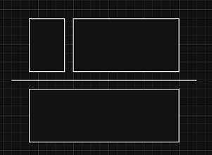
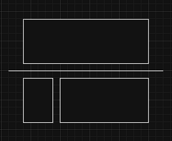
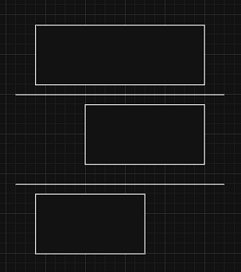
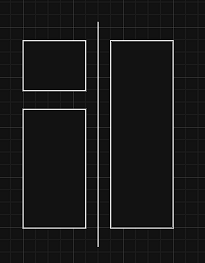
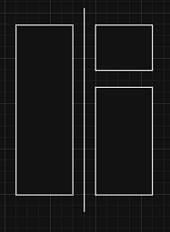
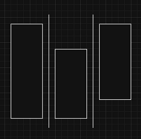

# rust 0ms solution with graph

**Author:** sovlynn
**Votes:** 0
**Link:** [https://leetcode.com/problems/find-the-minimum-area-to-cover-all-ones-ii/solutions/5369706/](https://leetcode.com/problems/find-the-minimum-area-to-cover-all-ones-ii/solutions/5369706/)

---


And there are still ways to optimize.

# Intuition
There are only size different methods of placing rectangles.






And try them one by one.

I know my code is ugly, my code was simple until I dicided to optimize a little.

# Complexity
- Time complexity:
$$O(n^2\\log(n))$$

- Space complexity:
$$O(n^2)$$

# Code
```
use std::collections::HashSet;
use std::cmp::{min, max};

impl Solution {
    pub fn minimum_sum(grid: Vec<Vec<i32>>) -> i32 {
        let (m, n)=(grid.len(), grid[0].len());

        let mut rows=Vec::new();
        for i in 0..m{
            let mut tmp=(i, Vec::new());
            for j in 0..n{
                if grid[i][j]!=0{
                    tmp.1.push(j);
                }
            }
            if tmp.1.len()>0{rows.push(tmp);}
        }

        let mut cols=Vec::new();
        for j in 0..n{
            let mut tmp=(j, Vec::new());
            for i in 0..m{
                if grid[i][j]!=0{
                    tmp.1.push(i);
                }
            }
            if tmp.1.len()>0{cols.push(tmp);}
        }

        let mut row_diff=vec![(0, 0); rows.len()];
        let mut diff=(n, 0);
        for i in 0..rows.len(){
            diff.0=min(diff.0, rows[i].1[0]);
            diff.1=max(diff.1, *rows[i].1.last().unwrap());
            row_diff[i].0=diff.1-diff.0+1;
        }
        diff=(n, 0);
        for i in (0..rows.len()).rev(){
            diff.0=min(diff.0, rows[i].1[0]);
            diff.1=max(diff.1, *rows[i].1.last().unwrap());
            row_diff[i].1=diff.1-diff.0+1;
        }

        let mut col_diff=vec![(0, 0); cols.len()];
        diff=(m, 0);
        for i in 0..cols.len(){
            diff.0=min(diff.0, cols[i].1[0]);
            diff.1=max(diff.1, *cols[i].1.last().unwrap());
            col_diff[i].0=diff.1-diff.0+1;
        }
        diff=(m, 0);
        for i in (0..cols.len()).rev(){
            diff.0=min(diff.0, cols[i].1[0]);
            diff.1=max(diff.1, *cols[i].1.last().unwrap());
            col_diff[i].1=diff.1-diff.0+1;
        }

        let mut res=m*n;
        for i in 0..rows.len()-1{
            let mut upper=(rows[i].0-rows[0].0+1)*row_diff[i].0;
            let mut downer=(rows.last().unwrap().0-rows[i+1].0+1)*row_diff[i+1].1;

            let mut up_diff_left=Vec::new();
            let mut down_diff_left=Vec::new();
            let mut diff=((m, 0), (m, 0));
            for j in 0..cols.len(){
                let c=&cols[j].1;
                let s=c.binary_search(&rows[i].0);
                match s{
                    Ok(sc)=>{
                        diff.0.0=min(diff.0.0, c[0]);
                        diff.0.1=max(diff.0.1, c[sc]);
                        up_diff_left.push((cols[j].0, diff.0.1-diff.0.0+1));
                        if sc+1<c.len(){
                            diff.1.0=min(diff.1.0, c[sc+1]);
                            diff.1.1=max(diff.1.1, *c.last().unwrap());
                            down_diff_left.push((cols[j].0, diff.1.1-diff.1.0+1));
                        }
                    },
                    Err(sc)=>{
                        if sc>0{
                            diff.0.0=min(diff.0.0, c[0]);
                            diff.0.1=max(diff.0.1, c[sc-1]);
                            up_diff_left.push((cols[j].0, diff.0.1-diff.0.0+1));
                        }
                        if sc<c.len(){
                            diff.1.0=min(diff.1.0, c[sc]);
                            diff.1.1=max(diff.1.1, *c.last().unwrap());
                            down_diff_left.push((cols[j].0, diff.1.1-diff.1.0+1));
                        }
                    }
                }
            }
            let mut up_diff_right=Vec::new();
            let mut down_diff_right=Vec::new();
            diff=((m, 0), (m, 0));
            for j in (0..cols.len()).rev(){
                let c=&cols[j].1;
                let s=c.binary_search(&rows[i].0);
                match s{
                    Ok(sc)=>{
                        diff.0.0=min(diff.0.0, c[0]);
                        diff.0.1=max(diff.0.1, c[sc]);
                        up_diff_right.push((cols[j].0, diff.0.1-diff.0.0+1));
                        if sc+1<c.len(){
                            diff.1.0=min(diff.1.0, c[sc+1]);
                            diff.1.1=max(diff.1.1, *c.last().unwrap());
                            down_diff_right.push((cols[j].0, diff.1.1-diff.1.0+1));
                        }
                    },
                    Err(sc)=>{
                        if sc>0{
                            diff.0.0=min(diff.0.0, c[0]);
                            diff.0.1=max(diff.0.1, c[sc-1]);
                            up_diff_right.push((cols[j].0, diff.0.1-diff.0.0+1));
                        }
                        if sc<c.len(){
                            diff.1.0=min(diff.1.0, c[sc]);
                            diff.1.1=max(diff.1.1, *c.last().unwrap());
                            down_diff_right.push((cols[j].0, diff.1.1-diff.1.0+1));
                        }
                    }
                }
            }
            
            let mut up_sep=m*n;
            for j in 0..up_diff_left.len()-1{
                let jj=up_diff_left.len()-2-j;
                up_sep=min(up_sep, up_diff_left[j].1*(up_diff_left[j].0-up_diff_left[0].0+1)+up_diff_right[jj].1*(up_diff_right[0].0-up_diff_right[jj].0+1));
            }
            let mut down_sep=m*n;
            for j in 0..down_diff_left.len()-1{
                let jj=down_diff_left.len()-2-j;
                down_sep=min(down_sep, down_diff_left[j].1*(down_diff_left[j].0-down_diff_left[0].0+1)+down_diff_right[jj].1*(down_diff_right[0].0-down_diff_right[jj].0+1));
            }
            res=min(res, min(up_sep+downer, down_sep+upper));

            let mut diff=(n, 0);
            let mut down_sep_h=m*n;
            for ii in i+1..rows.len()-1{
                diff.0=min(diff.0, rows[ii].1[0]);
                diff.1=max(diff.1, *rows[ii].1.last().unwrap());
                down_sep_h=min(down_sep_h, (diff.1-diff.0+1)*(rows[ii].0-rows[i+1].0+1)+row_diff[ii+1].1*(rows.last().unwrap().0-rows[ii+1].0+1));
            }
            res=min(res, down_sep_h+upper);
        }

        for j in 0..cols.len()-1{
            let mut lefter=(cols[j].0-cols[0].0+1)*col_diff[j].0;
            let mut righter=(cols.last().unwrap().0-cols[j+1].0+1)*col_diff[j+1].1;

            let mut left_diff_up=Vec::new();
            let mut right_diff_up=Vec::new();
            let mut diff=((n, 0), (n, 0));
            for i in 0..rows.len(){
                let r=&rows[i].1;
                let s=r.binary_search(&cols[j].0);
                match s{
                    Ok(sc)=>{
                        diff.0.0=min(diff.0.0, r[0]);
                        diff.0.1=max(diff.0.1, r[sc]);
                        left_diff_up.push((rows[i].0, diff.0.1-diff.0.0+1));
                        if sc+1<r.len(){
                            diff.1.0=min(diff.1.0, r[sc+1]);
                            diff.1.1=max(diff.1.1, *r.last().unwrap());
                            right_diff_up.push((rows[i].0, diff.1.1-diff.1.0+1));
                        }
                    },
                    Err(sc)=>{
                        if sc>0{
                            diff.0.0=min(diff.0.0, r[0]);
                            diff.0.1=max(diff.0.1, r[sc-1]);
                            left_diff_up.push((rows[i].0, diff.0.1-diff.0.0+1));
                        }
                        if sc<r.len(){
                            diff.1.0=min(diff.1.0, r[sc]);
                            diff.1.1=max(diff.1.1, *r.last().unwrap());
                            right_diff_up.push((rows[i].0, diff.1.1-diff.1.0+1));
                        }
                    }
                }
            }
            let mut left_diff_down=Vec::new();
            let mut right_diff_down=Vec::new();
            diff=((n, 0), (n, 0));
            for i in (0..rows.len()).rev(){
                let r=&rows[i].1;
                let s=r.binary_search(&cols[j].0);
                match s{
                    Ok(sc)=>{
                        diff.0.0=min(diff.0.0, r[0]);
                        diff.0.1=max(diff.0.1, r[sc]);
                        left_diff_down.push((rows[i].0, diff.0.1-diff.0.0+1));
                        if sc+1<r.len(){
                            diff.1.0=min(diff.1.0, r[sc+1]);
                            diff.1.1=max(diff.1.1, *r.last().unwrap());
                            right_diff_down.push((rows[i].0, diff.1.1-diff.1.0+1));
                        }
                    },
                    Err(sc)=>{
                        if sc>0{
                            diff.0.0=min(diff.0.0, r[0]);
                            diff.0.1=max(diff.0.1, r[sc-1]);
                            left_diff_down.push((rows[i].0, diff.0.1-diff.0.0+1));
                        }
                        if sc<r.len(){
                            diff.1.0=min(diff.1.0, r[sc]);
                            diff.1.1=max(diff.1.1, *r.last().unwrap());
                            right_diff_down.push((rows[i].0, diff.1.1-diff.1.0+1));
                        }
                    }
                }
            }
            
            let mut left_sep=m*n;
            for i in 0..left_diff_up.len()-1{
                let ii=left_diff_up.len()-2-i;
                left_sep=min(left_sep, left_diff_up[i].1*(left_diff_up[i].0-left_diff_up[0].0+1)+left_diff_down[ii].1*(left_diff_down[0].0-left_diff_down[ii].0+1));
            }
            let mut right_sep=m*n;
            for i in 0..right_diff_up.len()-1{
                let ii=right_diff_up.len()-2-i;
                right_sep=min(right_sep, right_diff_up[i].1*(right_diff_up[i].0-right_diff_up[0].0+1)+right_diff_down[ii].1*(right_diff_down[0].0-right_diff_down[ii].0+1));
            }
            res=min(res, min(left_sep+righter, right_sep+lefter));

            let mut diff=(m, 0);
            let mut right_sep_v=m*n;
            for jj in j+1..cols.len()-1{
                diff.0=min(diff.0, cols[jj].1[0]);
                diff.1=max(diff.1, *cols[jj].1.last().unwrap());
                right_sep_v=min(right_sep_v, (diff.1-diff.0+1)*(cols[jj].0-cols[j+1].0+1)+col_diff[jj+1].1*(cols.last().unwrap().0-cols[jj+1].0+1));
            }
            res=min(res, right_sep_v+lefter);
        }
        res as i32
    }
}   
```