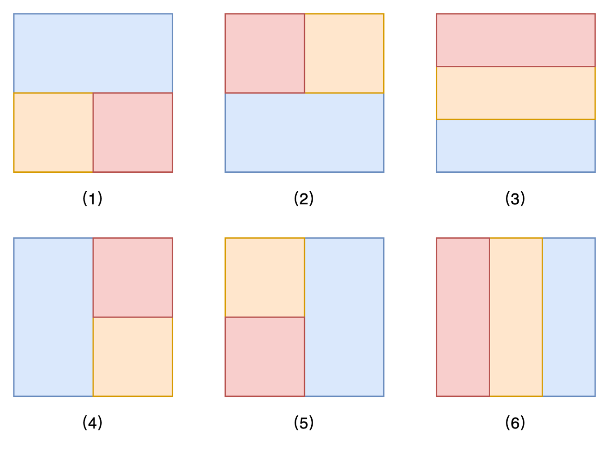

# Official Solution

**Link:** [https://leetcode.com/problems/find-the-minimum-area-to-cover-all-ones-ii/solution/](https://leetcode.com/problems/find-the-minimum-area-to-cover-all-ones-ii/solution/)

---

### Approach: Enumerate

#### Intuition

We can divide the $\textit{grid}$ into three non-overlapping sections and treat each section as a separate instance of the problem [「3195. Find the Minimum Area to Cover All Ones I」](https://leetcode.com/problems/find-the-minimum-area-to-cover-all-ones-i/description/).

As shown in the figure above, there are $6$ possible cases. For cases $(1), (2), (4),$ and $(5)$, we can enumerate the intersections of the three parts. For cases $(3)$ and $(6)$, we can enumerate the rows and columns being cut. The time complexity in these scenarios is $O(nm)$, $O(n^2)$, or $O(m^2)$.

Since $(1), (2), (3)$ rotated counterclockwise by $90$ degrees correspond to $(4), (5), (6)$, we only need to consider the original array and the two arrays rotated $90$ degrees, enumerating the first three cases separately.

#### Implementation

<iframe src="https://leetcode.com/playground/L4VdGZ3c/shared" frameBorder="0" width="100%" height="500" name="L4VdGZ3c"></iframe>

#### Complexity Analysis

Let $n$ be the number of rows in the $\textit{grid}$ and $m$ be the number of columns.

- Time complexity: $O(n^2 \cdot m^2)$.
  
  We divide the grid into three parts for processing. The time complexity of each part is $O(n \cdot m)$, $O(n^2)$, or $O(m^2)$. When combined, the overall complexity becomes $O(n^2 \cdot m^2)$.

- Space complexity: $O(n \cdot m)$.
  
  We need to store the three divided parts.
  
---