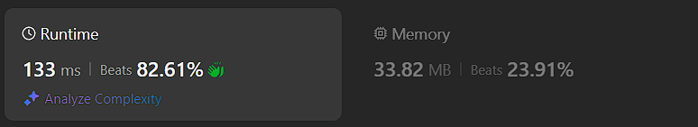

# Kotlin. Beats 82% (133 ms). Static cache of sums.

**Author:** mobdev778
**Votes:** 1
**Link:** [https://leetcode.com/problems/maximum-height-of-a-triangle/solutions/5405575/](https://leetcode.com/problems/maximum-height-of-a-triangle/solutions/5405575/)

---



# Code
```
class Solution {
    fun maxHeightOfTriangle(red: Int, blue: Int): Int {
        val min = Math.min(red, blue)
        var i = 0
        while (sums[i] <= min) i++
        if (sums[i] <= Math.max(red, blue)) i++
        return i
    }

    companion object {
        val s = IntArray(2)
        var balls = 1
        val sums = IntArray(512) {
            s[it and 1] += balls++
            s[it and 1]
        }
    }
}
```