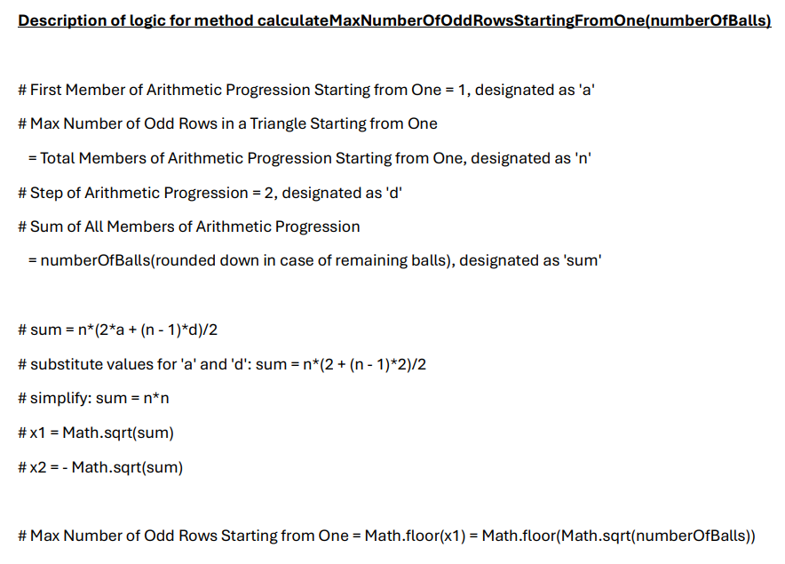
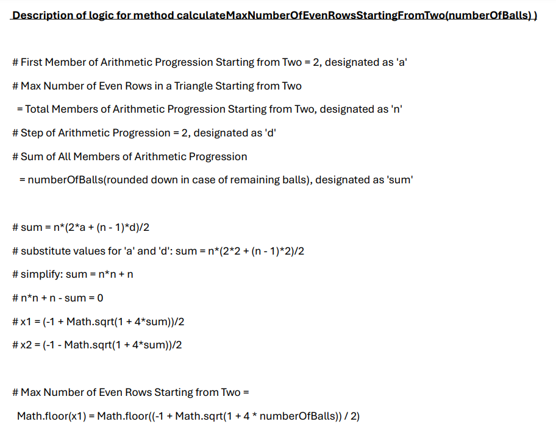

# Java | JavaScript | TypeScript | C++ | C# | Kotlin | Go Solution.

**Author:** LachezarTsK
**Votes:** 0
**Link:** [https://leetcode.com/problems/maximum-height-of-a-triangle/solutions/5714899/](https://leetcode.com/problems/maximum-height-of-a-triangle/solutions/5714899/)

---




```Java []
public class Solution {

    public int maxHeightOfTriangle(int red, int blue) {
        return Math.max(calculateMaxHeightOfTriangle(red, blue), calculateMaxHeightOfTriangle(blue, red));
    }

    private int calculateMaxNumberOfOddRowsStartingFromOne(int numberOfBalls) {
        return (int) Math.sqrt(numberOfBalls);
    }

    private int calculateMaxNumberOfEvenRowsStartingFromTwo(int numberOfBalls) {
        return (int) ((-1 + Math.sqrt(1 + 4 * numberOfBalls)) / 2);
    }

    private int calculateMaxHeightOfTriangle(int firstColor, int secondColor) {
        int numberOfRowsWithFirstColorStaringFromOne = calculateMaxNumberOfOddRowsStartingFromOne(firstColor);
        int numberOfRowsWithSecondColorStartingFromTwo = calculateMaxNumberOfEvenRowsStartingFromTwo(secondColor);

        if (numberOfRowsWithFirstColorStaringFromOne <= numberOfRowsWithSecondColorStartingFromTwo) {
            return numberOfRowsWithFirstColorStaringFromOne * 2;
        }
        return 2 * numberOfRowsWithSecondColorStartingFromTwo + 1;
    }
}
```
```JavaScript []
/**
 * @param {number} red
 * @param {number} blue
 * @return {number}
 */
var maxHeightOfTriangle = function (red, blue) {
    return Math.max(calculateMaxHeightOfTriangle(red, blue), calculateMaxHeightOfTriangle(blue, red));
};

/**
 * @param {number} numberOfBalls
 * @return {number}
 */
function calculateMaxNumberOfOddRowsStartingFromOne(numberOfBalls) {
    return Math.floor(Math.sqrt(numberOfBalls));
}

/**
 * @param {number} numberOfBalls
 * @return {number}
 */
function calculateMaxNumberOfEvenRowsStartingFromTwo(numberOfBalls) {
    return Math.floor((-1 + Math.sqrt(1 + 4 * numberOfBalls)) / 2);
}

/**
 * @param {number} firstColor
 * @param {number} secondColor
 * @return {number}
 */
function calculateMaxHeightOfTriangle(firstColor, secondColor) {
    const numberOfRowsWithFirstColorStaringFromOne = calculateMaxNumberOfOddRowsStartingFromOne(firstColor);
    const numberOfRowsWithSecondColorStartingFromTwo = calculateMaxNumberOfEvenRowsStartingFromTwo(secondColor);

    if (numberOfRowsWithFirstColorStaringFromOne <= numberOfRowsWithSecondColorStartingFromTwo) {
        return numberOfRowsWithFirstColorStaringFromOne * 2;
    }
    return 2 * numberOfRowsWithSecondColorStartingFromTwo + 1;
}
```
```TypeScript []
function maxHeightOfTriangle(red: number, blue: number): number {
    return Math.max(calculateMaxHeightOfTriangle(red, blue), calculateMaxHeightOfTriangle(blue, red));
};

function calculateMaxNumberOfOddRowsStartingFromOne(numberOfBalls: number): number {
    return Math.floor(Math.sqrt(numberOfBalls));
}

function calculateMaxNumberOfEvenRowsStartingFromTwo(numberOfBalls: number): number {
    return Math.floor((-1 + Math.sqrt(1 + 4 * numberOfBalls)) / 2);
}

function calculateMaxHeightOfTriangle(firstColor: number, secondColor: number): number {
    const numberOfRowsWithFirstColorStaringFromOne = calculateMaxNumberOfOddRowsStartingFromOne(firstColor);
    const numberOfRowsWithSecondColorStartingFromTwo = calculateMaxNumberOfEvenRowsStartingFromTwo(secondColor);

    if (numberOfRowsWithFirstColorStaringFromOne <= numberOfRowsWithSecondColorStartingFromTwo) {
        return numberOfRowsWithFirstColorStaringFromOne * 2;
    }
    return 2 * numberOfRowsWithSecondColorStartingFromTwo + 1;
}
```
```C++ []
#include <cmath>
#include <complex>
#include <algorithm>
using namespace std;

class Solution {

public:
    int maxHeightOfTriangle(int red, int blue) const {
        return max(calculateMaxHeightOfTriangle(red, blue), calculateMaxHeightOfTriangle(blue, red));
    }

private:
    int calculateMaxNumberOfOddRowsStartingFromOne(int numberOfBalls) const {
        return sqrt(numberOfBalls);
    }

    int calculateMaxNumberOfEvenRowsStartingFromTwo(int numberOfBalls) const {
        return (-1 + (sqrt(1 + 4 * numberOfBalls))) / 2;
    }

    int calculateMaxHeightOfTriangle(int firstColor, int secondColor) const {
        int numberOfRowsWithFirstColorStaringFromOne = calculateMaxNumberOfOddRowsStartingFromOne(firstColor);
        int numberOfRowsWithSecondColorStartingFromTwo = calculateMaxNumberOfEvenRowsStartingFromTwo(secondColor);

        if (numberOfRowsWithFirstColorStaringFromOne <= numberOfRowsWithSecondColorStartingFromTwo) {
            return numberOfRowsWithFirstColorStaringFromOne * 2;
        }
        return 2 * numberOfRowsWithSecondColorStartingFromTwo + 1;
    }
};
```
```C# []
using System;


public class Solution
{
    public int MaxHeightOfTriangle(int red, int blue)
    {
        return Math.Max(CalculateMaxHeightOfTriangle(red, blue), CalculateMaxHeightOfTriangle(blue, red));
    }

    private int CalculateMaxNumberOfOddRowsStartingFromOne(int numberOfBalls)
    {
        return (int)(Math.Sqrt(numberOfBalls));
    }

    private int CalculateMaxNumberOfEvenRowsStartingFromTwo(int numberOfBalls)
    {
        return (int)((-1 + Math.Sqrt(1 + 4 * numberOfBalls)) / 2);
    }

    private int CalculateMaxHeightOfTriangle(int firstColor, int secondColor)
    {
        int numberOfRowsWithFirstColorStaringFromOne = CalculateMaxNumberOfOddRowsStartingFromOne(firstColor);
        int numberOfRowsWithSecondColorStartingFromTwo = CalculateMaxNumberOfEvenRowsStartingFromTwo(secondColor);

        if (numberOfRowsWithFirstColorStaringFromOne <= numberOfRowsWithSecondColorStartingFromTwo)
        {
            return numberOfRowsWithFirstColorStaringFromOne * 2;
        }
        return 2 * numberOfRowsWithSecondColorStartingFromTwo + 1;
    }
}
```
```Kotlin []
import kotlin.math.sqrt
import kotlin.math.max

class Solution {

    fun maxHeightOfTriangle(red: Int, blue: Int): Int {
        return max(calculateMaxHeightOfTriangle(red, blue), calculateMaxHeightOfTriangle(blue, red))
    }

    private fun calculateMaxNumberOfOddRowsStartingFromOne(numberOfBalls: Int): Int {
        return (sqrt(numberOfBalls.toDouble())).toInt()
    }

    private fun calculateMaxNumberOfEvenRowsStartingFromTwo(numberOfBalls: Int): Int {
        return ((-1 + sqrt(1.0 + 4 * numberOfBalls)) / 2).toInt()
    }

    private fun calculateMaxHeightOfTriangle(firstColor: Int, secondColor: Int): Int {
        val numberOfRowsWithFirstColorStaringFromOne = calculateMaxNumberOfOddRowsStartingFromOne(firstColor)
        val numberOfRowsWithSecondColorStartingFromTwo = calculateMaxNumberOfEvenRowsStartingFromTwo(secondColor)

        if (numberOfRowsWithFirstColorStaringFromOne <= numberOfRowsWithSecondColorStartingFromTwo) {
            return numberOfRowsWithFirstColorStaringFromOne * 2
        }
        return 2 * numberOfRowsWithSecondColorStartingFromTwo + 1
    }
}
```
```Go []
package main

import (
    "fmt"
    "math"
)

func maxHeightOfTriangle(red int, blue int) int {
    return max(calculateMaxHeightOfTriangle(red, blue), calculateMaxHeightOfTriangle(blue, red))
}

func calculateMaxNumberOfOddRowsStartingFromOne(numberOfBalls int) int {
    return int(math.Sqrt(float64(numberOfBalls)))
}

func calculateMaxNumberOfEvenRowsStartingFromTwo(numberOfBalls int) int {
    return int((-1 + int(math.Sqrt(1+4*(float64)(numberOfBalls)))) / 2)
}

func calculateMaxHeightOfTriangle(firstColor int, secondColor int) int {
    numberOfRowsWithFirstColorStaringFromOne := calculateMaxNumberOfOddRowsStartingFromOne(firstColor)
    numberOfRowsWithSecondColorStartingFromTwo := calculateMaxNumberOfEvenRowsStartingFromTwo(secondColor)

    if numberOfRowsWithFirstColorStaringFromOne <= numberOfRowsWithSecondColorStartingFromTwo {
        return numberOfRowsWithFirstColorStaringFromOne * 2
    }
    return 2*numberOfRowsWithSecondColorStartingFromTwo + 1
}
```


