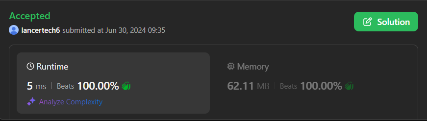

# ✅Beats 100% -Explained with [ Video ] -C++/Java/Python/JS - Odd Even Toggle Parity

**Author:** lancertech6
**Votes:** 107
**Link:** [https://leetcode.com/problems/find-the-maximum-length-of-valid-subsequence-i/solutions/5389419/](https://leetcode.com/problems/find-the-maximum-length-of-valid-subsequence-i/solutions/5389419/)

---



# YouTube Video Explanation:

<!-- ### To watch the video please click on "Watch On Youtube" option  available the left bottom corner of the thumbnail. -->

**If you want a video for this question please write in the comments**


<!-- https://youtu.be/Gt9mP2rl8Ts -->


**\uD83D\uDD25 Please like, share, and subscribe to support our channel's mission of making complex concepts easy to understand.**

Subscribe Link: https://www.youtube.com/@leetlogics/?sub_confirmation=1

*Subscribe Goal: 2400 Subscribers*
*Current Subscribers: 2357*

Follow me on Instagram : https://www.instagram.com/divyansh.nishad/

---

# Intuition
<!-- Describe your first thoughts on how to solve this problem. -->
To find the length of the longest valid subsequence in an array `nums`, we need to consider the condition for a valid subsequence:
- For a subsequence `sub`, the sum of each pair of consecutive elements should have the same parity (either all even or all odd).

This condition means we can have three possible types of valid subsequences:
1. **All elements are even.**
2. **All elements are odd.**
3. **Elements alternate between odd and even.**

# Approach
<!-- Describe your approach to solving the problem. -->
1. **Initialize Counters**:
    - `odd`: Counts the number of odd elements in the array.
    - `even`: Counts the number of even elements in the array.
    - `both`: Counts the number of elements in a subsequence where the parity alternates between consecutive elements.

2. **Iterate Through the Array**:
    - Track the parity of the current element using `num % 2`.
    - Update the `odd` or `even` counter based on the parity of the current element.
    - Update the `both` counter to keep track of alternating parity. This involves toggling the expected parity (`c`) after each element that matches the current expected parity.

3. **Return the Maximum Count**:
    - The length of the longest valid subsequence is the maximum of the three counters (`odd`, `even`, and `both`).

# Complexity
- **Time Complexity**: \\(O(n)\\)
  - We iterate through the array once to count the number of odd, even, and alternating elements.
- **Space Complexity**: \\(O(1)\\)
  - We use a constant amount of extra space for the counters and the parity tracking variable.


Sure, let's create a step-by-step explanation using tables to help illustrate the logic of finding the longest valid subsequence. We'll use the given examples and break down the process.

# Step by Step Explanation

**Step 1: Initialize Counters**

We initialize three counters:
- `odd`: Counts the number of odd elements.
- `even`: Counts the number of even elements.
- `both`: Counts the number of elements in an alternating parity subsequence.
- `c`: Tracks the expected parity for the alternating subsequence (starts with the parity of the first element).

### Example 1: nums = [1, 2, 3, 4]

| Index | Element (`num`) | Parity (`num % 2`) | Even Count (`even`) | Odd Count (`odd`) | Both Count (`both`) | Expected Parity (`c`) | Update Explanation                         |
|-------|-----------------|--------------------|---------------------|-------------------|----------------------|-----------------------|--------------------------------------------|
| 0     | 1               | 1                  | 0                   | 1                 | 1                    | 0                     | First element is odd, start counting `both`.|
| 1     | 2               | 0                  | 1                   | 1                 | 2                    | 1                     | Matches expected parity, toggle `c`.        |
| 2     | 3               | 1                  | 1                   | 2                 | 3                    | 0                     | Matches expected parity, toggle `c`.        |
| 3     | 4               | 0                  | 2                   | 2                 | 4                    | 1                     | Matches expected parity, toggle `c`.        |

**Result:** The longest valid subsequence is `[1, 2, 3, 4]` with length `4`.

### Example 2: nums = [1, 2, 1, 1, 2, 1, 2]

| Index | Element (`num`) | Parity (`num % 2`) | Even Count (`even`) | Odd Count (`odd`) | Both Count (`both`) | Expected Parity (`c`) | Update Explanation                         |
|-------|-----------------|--------------------|---------------------|-------------------|----------------------|-----------------------|--------------------------------------------|
| 0     | 1               | 1                  | 0                   | 1                 | 1                    | 0                     | First element is odd, start counting `both`.|
| 1     | 2               | 0                  | 1                   | 1                 | 2                    | 1                     | Matches expected parity, toggle `c`.        |
| 2     | 1               | 1                  | 1                   | 2                 | 3                    | 0                     | Matches expected parity, toggle `c`.        |
| 3     | 1               | 1                  | 1                   | 3                 | 3                    | 0                     | Does not match expected parity, no toggle.  |
| 4     | 2               | 0                  | 2                   | 3                 | 4                    | 1                     | Matches expected parity, toggle `c`.        |
| 5     | 1               | 1                  | 2                   | 4                 | 5                    | 0                     | Matches expected parity, toggle `c`.        |
| 6     | 2               | 0                  | 3                   | 4                 | 6                    | 1                     | Matches expected parity, toggle `c`.        |

**Result:** The longest valid subsequence is `[1, 2, 1, 2, 1, 2]` with length `6`.

### Example 3: nums = [1, 3]

| Index | Element (`num`) | Parity (`num % 2`) | Even Count (`even`) | Odd Count (`odd`) | Both Count (`both`) | Expected Parity (`c`) | Update Explanation                         |
|-------|-----------------|--------------------|---------------------|-------------------|----------------------|-----------------------|--------------------------------------------|
| 0     | 1               | 1                  | 0                   | 1                 | 1                    | 0                     | First element is odd, start counting `both`.|
| 1     | 3               | 1                  | 0                   | 2                 | 1                    | 0                     | Does not match expected parity, no toggle.  |

**Result:** The longest valid subsequence is `[1, 3]` with length `2`.

### Final Result Calculation

After iterating through the entire array, we determine the length of the longest valid subsequence by taking the maximum of `even`, `odd`, and `both` counts.

**General Table for Calculation:**

| Index | Element (`num`) | Parity (`num % 2`) | Even Count (`even`) | Odd Count (`odd`) | Both Count (`both`) | Expected Parity (`c`) | Update Explanation                         |
|-------|-----------------|--------------------|---------------------|-------------------|----------------------|-----------------------|--------------------------------------------|
| 0     |                 |                    |                     |                   |                      |                       |                                            |
| 1     |                 |                    |                     |                   |                      |                       |                                            |
| ...   | ...             | ...                | ...                 | ...               | ...                  | ...                   | ...                                        |
| n-1   |                 |                    |                     |                   |                      |                       |                                            |


# Code
```java []
class Solution {
    public int maximumLength(int[] nums) {
        int c = nums[0] % 2, odd = 0, even = 0, both = 0;
        for (int num : nums) {
            if (num % 2 == 0) {
                even++;
            } else {
                odd++;
            }
            if (num % 2 == c) {
                both++;
                c = 1 - c;  // Toggle the parity
            }
        }
        return Math.max(both, Math.max(even, odd));
    }
}
```
```C++ []
class Solution {
public:
    int maximumLength(vector<int>& nums) {
        int c = nums[0] % 2, odd = 0, even = 0, both = 0;
        for (int num : nums) {
            if (num % 2 == 0) {
                even++;
            } else {
                odd++;
            }
            if (num % 2 == c) {
                both++;
                c = 1 - c;  // Toggle the parity
            }
        }
        return max(both, max(even, odd));
    }
};
```
```Python []
class Solution(object):
    def maximumLength(self, nums):
        c = nums[0] % 2
        odd = even = both = 0
        for num in nums:
            if num % 2 == 0:
                even += 1
            else:
                odd += 1
            if num % 2 == c:
                both += 1
                c = 1 - c  # Toggle the parity
        return max(both, even, odd)
        
```
```JavaScript []
/**
 * @param {number[]} nums
 * @return {number}
 */
var maximumLength = function(nums) {
    let c = nums[0] % 2, odd = 0, even = 0, both = 0;
    for (let num of nums) {
        if (num % 2 === 0) {
            even++;
        } else {
            odd++;
        }
        if (num % 2 === c) {
            both++;
            c = 1 - c;  // Toggle the parity
        }
    }
    return Math.max(both, even, odd);
};
```

