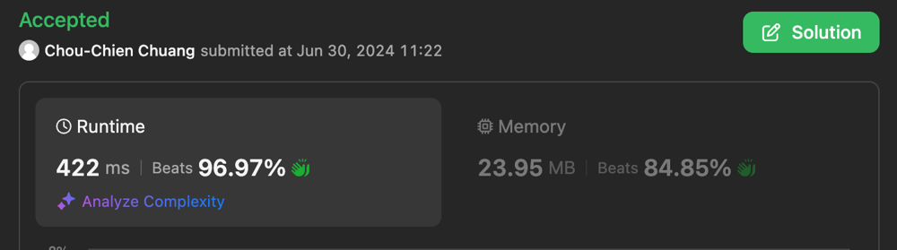

# Runtime 422ms Solution

**Author:** ChouChien
**Votes:** 0
**Link:** [https://leetcode.com/problems/find-the-maximum-length-of-valid-subsequence-i/solutions/5412835/](https://leetcode.com/problems/find-the-maximum-length-of-valid-subsequence-i/solutions/5412835/)

---

Sorry for my poor English.

# Intuition
<!-- Describe your first thoughts on how to solve this problem. -->
The result must be [odd, odd, ..., odd], [odd, even, odd, ...], [even, odd, even, odd, ...], or [even, even, ..., even], so use four variables record these results for final answer.

# Approach
<!-- Describe your approach to solving the problem. -->
Just use for loop to record the result of four situation, and finally return the max one.

# Complexity
- Time complexity: O(n)
<!-- Add your time complexity here, e.g. $$O(n)$$ -->

- Space complexity: O(1)
<!-- Add your space complexity here, e.g. $$O(n)$$ -->




# Code
```
class Solution {
    func maximumLength(_ nums: [Int]) -> Int {
        let numsCount = nums.count
        var allOdd: Int = 0
        var allEven: Int = 0
        var oddFirstAlt: Int = 0
        var eventFirstAlt: Int = 0
        for num in nums {
            if num % 2 == 0 {
                allEven += 1
                if oddFirstAlt % 2 == 0 {
                    oddFirstAlt += 1
                }
                if eventFirstAlt % 2 == 1 {
                    eventFirstAlt += 1
                }
            } else {
                allOdd += 1
                if oddFirstAlt % 2 == 1 {
                    oddFirstAlt += 1
                }
                if eventFirstAlt % 2 == 0 {
                    eventFirstAlt += 1
                }
            }
        }
        return max(allOdd, allEven, oddFirstAlt, eventFirstAlt)
    }
}
```