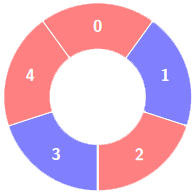
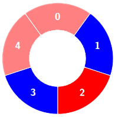
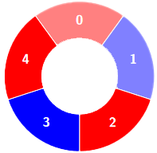
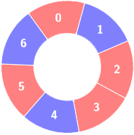
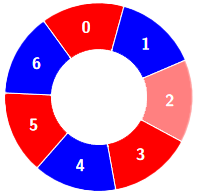

# [3208. Alternating Groups II](https://leetcode.com/problems/alternating-groups-ii/)

| Category | Difficulty | Likes | Dislikes |
| :------: | :--------: | :---: | :------: |
| Algorithms | Medium | 755 | 72 |

**Tags:** [`array`](https://leetcode.com/tag/array), [`sliding-window`](https://leetcode.com/tag/sliding-window)

**Companies:** `google`, `microsoft`, `samsara`

## Description

There is a circle of red and blue tiles. You are given an array of integers `colors` and an integer `k`. The color of tile `i` is represented by `colors[i]`:

	- `colors[i] == 0` means that tile `i` is **red**.

	- `colors[i] == 1` means that tile `i` is **blue**.

An **alternating** group is every `k` contiguous tiles in the circle with **alternating** colors (each tile in the group except the first and last one has a different color from its **left** and **right** tiles).

Return the number of **alternating** groups.

**Note** that since `colors` represents a **circle**, the **first** and the **last** tiles are considered to be next to each other.

 

**Example 1:**

**Input:** colors = [0,1,0,1,0], k = 3

**Output:** 3

**Explanation:**

****

Alternating groups:

**Example 2:**

**Input:** colors = [0,1,0,0,1,0,1], k = 6

**Output:** 2

**Explanation:**

****

Alternating groups:

**Example 3:**

**Input:** colors = [1,1,0,1], k = 4

**Output:** 0

**Explanation:**

 

**Constraints:**

	- `3 <= colors.length <= 10^5`

	- `0 <= colors[i] <= 1`

	- `3 <= k <= colors.length`

---

**Links:** [Submissions](https://leetcode.com/problems/alternating-groups-ii/) | [Solutions](https://leetcode.com/problems/alternating-groups-ii/)
