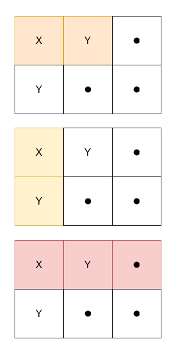

# [3212. Count Submatrices With Equal Frequency of X and Y](https://leetcode.com/problems/count-submatrices-with-equal-frequency-of-x-and-y/)

| Category | Difficulty | Likes | Dislikes |
| :------: | :--------: | :---: | :------: |
| Algorithms | Medium | 159 | 26 |

**Tags:** [`array`](https://leetcode.com/tag/array), [`matrix`](https://leetcode.com/tag/matrix), [`prefix-sum`](https://leetcode.com/tag/prefix-sum)

**Companies:** `microsoft`

## Description

Given a 2D character matrix `grid`, where `grid[i][j]` is either `'X'`, `'Y'`, or `'.'`, return the number of submatrices that contain:

	- `grid[0][0]`

	- an **equal** frequency of `'X'` and `'Y'`.

	- **at least** one `'X'`.

 

**Example 1:**

**Input:** grid = [["X","Y","."],["Y",".","."]]

**Output:** 3

**Explanation:**

****

**Example 2:**

**Input:** grid = [["X","X"],["X","Y"]]

**Output:** 0

**Explanation:**

No submatrix has an equal frequency of `'X'` and `'Y'`.

**Example 3:**

**Input:** grid = [[".","."],[".","."]]

**Output:** 0

**Explanation:**

No submatrix has at least one `'X'`.

 

**Constraints:**

	- `1 <= grid.length, grid[i].length <= 1000`

	- `grid[i][j]` is either `'X'`, `'Y'`, or `'.'`.

---

**Links:** [Submissions](https://leetcode.com/problems/count-submatrices-with-equal-frequency-of-x-and-y/) | [Solutions](https://leetcode.com/problems/count-submatrices-with-equal-frequency-of-x-and-y/)
