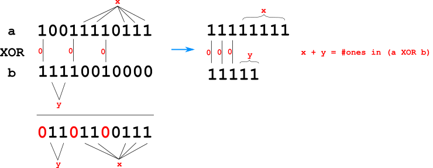

# ok ^^

**Author:** andrii_khlevniuk
**Votes:** 0
**Link:** [https://leetcode.com/problems/count-triplets-with-even-xor-set-bits-ii/solutions/5501999/](https://leetcode.com/problems/count-triplets-with-even-xor-set-bits-ii/solutions/5501999/)

---

**time: `O(N)`; space: `O(1)`**



The parity of the `#[bits of a XOR b]` is the same as the parity of `#[bits of  a] + #[bits of b]`. Why?
Because as some of the ones of `a` match with ones of `b` they 'annihilate' resulting zeros in the output. The other ones result ones in the output.  Thus the `#ones in the output` equals the `#[ones in a] + #[ones in b] - 2 * #[number of matches]`.
But
* even number minus even number is still even;
* odd number minus even number is still odd.

Thus the parity of the sum of bits in `a` and in `b` is the same as the parity of the number of bits of `a^b`.

```
long long tripletCount(vector<int>& a, vector<int>& b, vector<int>& c)
{
	long long A[2]{}, B[2]{}, C[2]{};
	for(const auto & a : a) ++A[__builtin_popcount(a)%2];
	for(const auto & b : b) ++B[__builtin_popcount(b)%2];
	for(const auto & c : c) ++C[__builtin_popcount(c)%2];
	return A[0]*B[0]*C[0] + A[0]*B[1]*C[1] + A[1]*B[0]*C[1] + A[1]*B[1]*C[0]; 
}
```