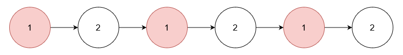

# [3217. Delete Nodes From Linked List Present in Array](https://leetcode.com/problems/delete-nodes-from-linked-list-present-in-array/)

| Category | Difficulty | Likes | Dislikes |
| :------: | :--------: | :---: | :------: |
| Algorithms | Medium | 1061 | 49 |

**Tags:** [`array`](https://leetcode.com/tag/array), [`hash-table`](https://leetcode.com/tag/hash-table), [`linked-list`](https://leetcode.com/tag/linked-list)

**Companies:** `google`, `amazon`, `facebook`, `microsoft`

## Description

You are given an array of integers `nums` and the `head` of a linked list. Return the `head` of the modified linked list after **removing** all nodes from the linked list that have a value that exists in `nums`.

 

**Example 1:**

**Input:** nums = [1,2,3], head = [1,2,3,4,5]

**Output:** [4,5]

**Explanation:**

****

Remove the nodes with values 1, 2, and 3.

**Example 2:**

**Input:** nums = [1], head = [1,2,1,2,1,2]

**Output:** [2,2,2]

**Explanation:**

Remove the nodes with value 1.

**Example 3:**

**Input:** nums = [5], head = [1,2,3,4]

**Output:** [1,2,3,4]

**Explanation:**

****

No node has value 5.

 

**Constraints:**

	- `1 <= nums.length <= 10^5`

	- `1 <= nums[i] <= 10^5`

	- All elements in `nums` are unique.

	- The number of nodes in the given list is in the range `[1, 10^5]`.

	- `1 <= Node.val <= 10^5`

	- The input is generated such that there is at least one node in the linked list that has a value not present in `nums`.

---

**Links:** [Submissions](https://leetcode.com/problems/delete-nodes-from-linked-list-present-in-array/) | [Solutions](https://leetcode.com/problems/delete-nodes-from-linked-list-present-in-array/)
