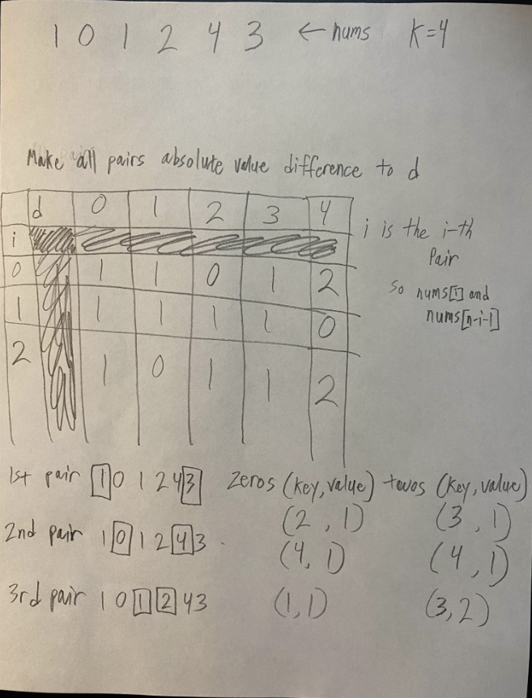
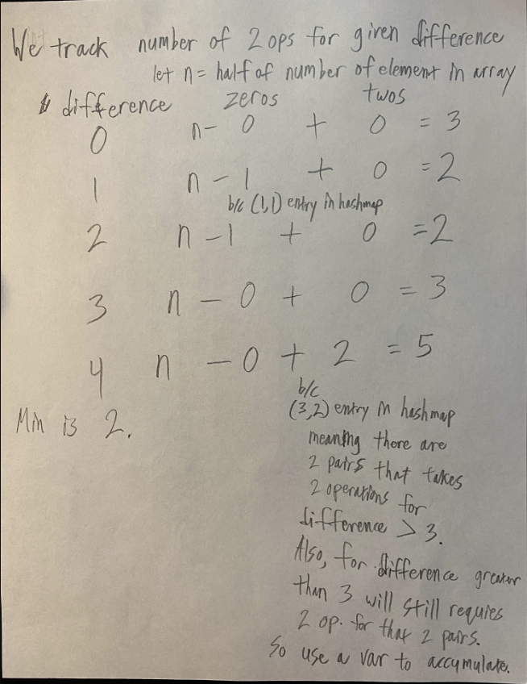
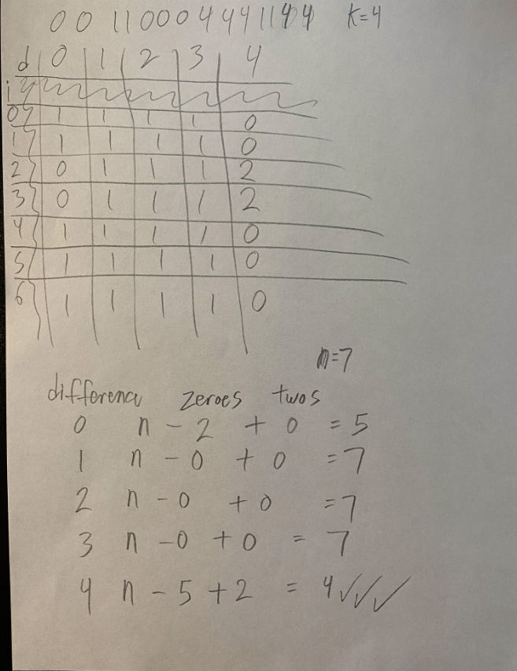

# TC: O(n) SOLUTION - EXPLAINED WITH PICTURES - Biweekly Contest 135

**Author:** Whusyki
**Votes:** 7
**Link:** [https://leetcode.com/problems/minimum-array-changes-to-make-differences-equal/solutions/5507259/](https://leetcode.com/problems/minimum-array-changes-to-make-differences-equal/solutions/5507259/)

---

# Intuition
By nature intuition, we want to do brute force with O(n^2) run time. However, that will exceed TLE. So, how do we reduce it? Problem lies how to reduce O(n * k) to O(n) where reducing O(k) to O(1) basically.

# Approach
(Diagrams are down below fyi)

Two HashMap: Zeros and Twos

Zeros are saying it takes 0 operations. So given a pair, we put the difference as key and value as in how many zero moves for given difference the key value.

Twos are saying it takes 2 operations the minimum. So given a pair, can we say that difference larger than some number requires 2 moves. 

Examples: Given k = 4 and a pair 1, 1

We put zeros hashMap with key 0 and value whatever key 0 contains previously + 1; 0 is saying difference = 0 takes 0 operations.

Then we know size larger than 3 will take 2 operations, so we put key 3 and value whatever key 3 contains previously + 1; So now this is saying any difference larger than 3, we know it takes 2 operations.

In the end, we know that for sure any situation can be done in total length / 2 operations. So we start that value.

We initialize a variable that saying how many additional operation we need to add because it takes two operations. So if we know there is x pair that requires 2 operations for difference larger than 1, we increment that variable by x. The reason why we increment for x because in the future, these number of pairs still need 2 operations, they won't ever go back down to 1.

Then we for loop from difference 0 to k inclusive, we use the formula (nums.length / 2) - number of pairs that give difference that use 0 operations + additional operations required since two moves which is x we initialized it.

Find the minimum will get you the answer.

Below are some diagrams to help you follow along my explanation.



The table I made at the top is saying in the i-th pair, for difference 0 to k inclusive, what is the minimum operation. As you can see for i = 0 and 2, it takes 2 operations to get a difference of 4.

Below the tables are how I iterate each pair and insert the zeros and twos hashMap.

The next image shows you how to calculate with the formula.



We iterate each by saying let's make all pair a difference with 0, then we do by all pair a difference with 1, and so on to k.

In each iteration, formula is saying assume all pairs require 1 operation, so we get n (aka half of number of total elements in the array) and subtract all pair that already has the difference where it requires 0 operations and we do that by hashMap zeros. Then we have to add 1 additional operations for any pairs that requires 2 moves to make that difference. We do that for difference of 0 to k inclusive. Then the answer is the minimum.

Notes: For twos, you must count all pairs from difference and all smaller difference. This is because let's say there is a pair that requires two operations to get difference 2, then later on let's say we on difference of 7. There is no key in the twos hashMap, but that doesn't mean we add 0, bc we know earlier there is a pair that requires 2 operations for difference 2, then that pair will need 2 operations for difference 3, 4, and so on which includes 7. So, we can just fix this by a variable that accumulates the number of pairs require two operations.

Another example that shows an edge case where moving two operations is better than moving rest by 1 operation.




# Complexity
- Time complexity:
O(2n) for two for loops which reduce to O(n)

- Space complexity:
O(2n) for 2 hashMap worst case which reduce to O(n)

# Code
```
class Solution {
    public int minChanges(int[] nums, int k) {
        int n = nums.length;
        Map<Integer, Integer> zeros = new HashMap<>();
        Map<Integer, Integer> twos = new HashMap<>();
        for (int i = 0; i < nums.length / 2; i++){
            zeros.put(Math.abs(nums[i] - nums[n-i-1]), zeros.getOrDefault(Math.abs(nums[i] - nums[n-i-1]), 0) + 1);
            int two = 0;
            if (nums[n-i-1] > nums[i]){
                int v = Math.max(nums[n-i-1] - 0, k - nums[i]);
                two = Math.max(two, v);
            } else {
                int v = Math.max(nums[i] - 0, k- nums[n-i-1]);
                two = Math.max(two, v);
            }
            twos.put(two, twos.getOrDefault(two, 0) + 1);
        }
        int ans = nums.length/2;

        //The accumulated variable that keeps track
        //number of pairs that require two operations
        int twoInterval = 0;
        for (int i = 0; i <= k; i++){
            if (twos.containsKey(i-1)){
                twoInterval += twos.get(i-1);
            }
            int total = nums.length/2;
            if (zeros.containsKey(i)){
                total -= zeros.get(i);
            }
            total += twoInterval;
            ans = Math.min(ans, total);
        }
        return ans;
    }
}
```