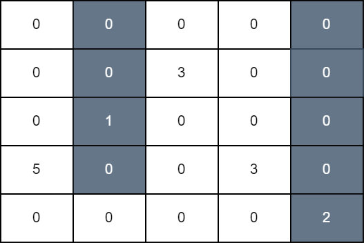

# [3225. Maximum Score From Grid Operations](https://leetcode.com/problems/maximum-score-from-grid-operations/)

| Category | Difficulty | Likes | Dislikes |
| :------: | :--------: | :---: | :------: |
| Algorithms | Hard | 79 | 11 |

**Tags:** [`array`](https://leetcode.com/tag/array), [`dynamic-programming`](https://leetcode.com/tag/dynamic-programming), [`matrix`](https://leetcode.com/tag/matrix), [`prefix-sum`](https://leetcode.com/tag/prefix-sum)

**Companies:** `hrt`

## Description

You are given a 2D matrix `grid` of size `n x n`. Initially, all cells of the grid are colored white. In one operation, you can select any cell of indices `(i, j)`, and color black all the cells of the `j^th` column starting from the top row down to the `i^th` row.

The grid score is the sum of all `grid[i][j]` such that cell `(i, j)` is white and it has a horizontally adjacent black cell.

Return the **maximum** score that can be achieved after some number of operations.

 

**Example 1:**

**Input:** grid = [[0,0,0,0,0],[0,0,3,0,0],[0,1,0,0,0],[5,0,0,3,0],[0,0,0,0,2]]

**Output:** 11

**Explanation:**

In the first operation, we color all cells in column 1 down to row 3, and in the second operation, we color all cells in column 4 down to the last row. The score of the resulting grid is `grid[3][0] + grid[1][2] + grid[3][3]` which is equal to 11.

**Example 2:**

**Input:** grid = [[10,9,0,0,15],[7,1,0,8,0],[5,20,0,11,0],[0,0,0,1,2],[8,12,1,10,3]]

**Output:** 94

**Explanation:**

We perform operations on 1, 2, and 3 down to rows 1, 4, and 0, respectively. The score of the resulting grid is `grid[0][0] + grid[1][0] + grid[2][1] + grid[4][1] + grid[1][3] + grid[2][3] + grid[3][3] + grid[4][3] + grid[0][4]` which is equal to 94.

 

**Constraints:**

	- `1 <= n == grid.length <= 100`

	- `n == grid[i].length`

	- `0 <= grid[i][j] <= 10^9`

---

**Links:** [Submissions](https://leetcode.com/problems/maximum-score-from-grid-operations/) | [Solutions](https://leetcode.com/problems/maximum-score-from-grid-operations/)
