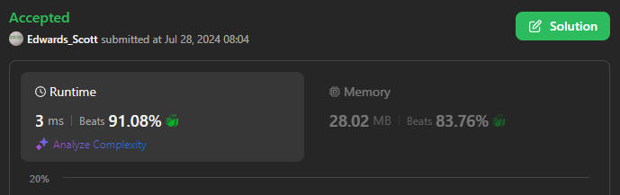

# 💢☠💫Easiest👾Faster✅💯 Lesser🧠 🎯 C++✅Python3🐍✅Java✅C✅Python🐍✅C#✅💥🔥💫Explained☠💥🔥 Beats 💯

**Author:** Edwards310
**Votes:** 4
**Link:** [https://leetcode.com/problems/find-if-digit-game-can-be-won/solutions/5558623/](https://leetcode.com/problems/find-if-digit-game-can-be-won/solutions/5558623/)

---

# Intuition


```C++ []
// Start Of Anuj Bhati aka Edwards310's Template...
#include <bits/stdc++.h>
using namespace std;

#define FOR(a, b, c) for (int a = b; a < c; a++)
#define FOR1(a, b, c) for (int a = b; a <= c; ++a)
#define Rep(i, n) FOR(i, 0, n)
// end of Anuj Bhati's aka Edwards310's Template
class Solution {
public:
    bool canAliceWin(vector<int>& nums) {
        int singleDigitSum = 0, doubleDigitSum = 0;
        Rep(i, nums.size()){
            int x = nums[i];
            int size = 0;
            while(x){
                size++;
                x /= 10;
            }
            if(size == 1)
                singleDigitSum += nums[i];
            else
                doubleDigitSum += nums[i];
        }
        if(singleDigitSum > doubleDigitSum or doubleDigitSum > singleDigitSum)
            return true;
        return false;
    }
};
```
```python3 []
class Solution:
    def canAliceWin(self, nums: List[int]) -> bool:
        single = sum(x for x in nums if x >= 1 and x <= 9)
        double = sum(y for y in nums if y >= 10)
        return True if(single > double or double > single) else False
```
```C# []
public class Solution {
    public bool CanAliceWin(int[] nums) {
        var single_sum = 0;
        var double_sum = 0;
        foreach(var num in nums){
            if(num >= 0 && num <= 9)
                single_sum += num;
            else
                double_sum += num;
        }
        return single_sum != double_sum;
    }
}
```
```javascript []
/**
 * @param {number[]} nums
 * @return {boolean}
 */
var canAliceWin = function(nums) {
    let singleNum = 0, doubleNum = 0;
    for(let num of nums){
        if(num >= 1 && num <= 9)
            singleNum += num;
        else
            doubleNum += num;
    }
    if(singleNum > doubleNum || doubleNum > singleNum)
        return true;
    return false;
};
```
```python []
class Solution(object):
    def canAliceWin(self, nums):
        """
        :type nums: List[int]
        :rtype: bool
        """
        single_num = sum(num for num in nums if num >= 0 and num <= 9)
        double_num = sum(num for num in nums if num > 9)
        return True if single_num > double_num or double_num > single_num else False 
```
```Java []
class Solution {
    public boolean canAliceWin(int[] nums) {
        int single_sum = 0, double_sum = 0;
        for(int x : nums){
            if(x >= 1 && x <= 9)
                single_sum += x;
            else
                double_sum += x;
        }
        return (single_sum > double_sum || double_sum > single_sum) ? true : false;
    }
}
```
```C []
bool canAliceWin(int* nums, int numsSize) {
    int single = 0, double_sum = 0;
    for(int y = 0; y < numsSize; ++y){
        if(nums[y] >= 0 && nums[y] <= 9)
            single += nums[y];
        else
            double_sum += nums[y];
    }
    return single!= double_sum;
}
```
<!-- Describe your first thoughts on how to solve this problem. -->

# Approach
<!-- Describe your approach to solving the problem. -->

# Complexity
- Time complexity:
<!-- Add your time complexity here, e.g. $$O(n)$$ -->
     O(N)
- Space complexity:
<!-- Add your space complexity here, e.g. $$O(n)$$ -->
     O(1)
# Code
```
bool canAliceWin(int* nums, int numsSize) {
    int single = 0, double_sum = 0;
    for(int y = 0; y < numsSize; ++y){
        if(nums[y] >= 0 && nums[y] <= 9)
            single += nums[y];
        else
            double_sum += nums[y];
    }
    return single!= double_sum;
}
```

