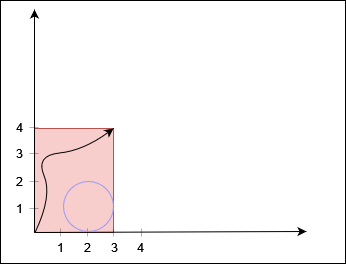
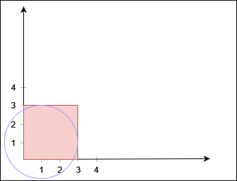

# [3235. Check if the Rectangle Corner Is Reachable](https://leetcode.com/problems/check-if-the-rectangle-corner-is-reachable/)

| Category | Difficulty | Likes | Dislikes |
| :------: | :--------: | :---: | :------: |
| Algorithms | Hard | 119 | 38 |

**Tags:** [`array`](https://leetcode.com/tag/array), [`math`](https://leetcode.com/tag/math), [`depth-first-search`](https://leetcode.com/tag/depth-first-search), [`breadth-first-search`](https://leetcode.com/tag/breadth-first-search), [`union-find`](https://leetcode.com/tag/union-find), [`geometry`](https://leetcode.com/tag/geometry)

**Companies:** `amazon`

## Description

You are given two positive integers `xCorner` and `yCorner`, and a 2D array `circles`, where `circles[i] = [x_i, y_i, r_i]` denotes a circle with center at `(x_i, y_i)` and radius `r_i`.

There is a rectangle in the coordinate plane with its bottom left corner at the origin and top right corner at the coordinate `(xCorner, yCorner)`. You need to check whether there is a path from the bottom left corner to the top right corner such that the **entire path** lies inside the rectangle, **does not** touch or lie inside **any** circle, and touches the rectangle **only** at the two corners.

Return `true` if such a path exists, and `false` otherwise.

 

**Example 1:**

**Input:** xCorner = 3, yCorner = 4, circles = [[2,1,1]]

**Output:** true

**Explanation:**

The black curve shows a possible path between `(0, 0)` and `(3, 4)`.

**Example 2:**

**Input:** xCorner = 3, yCorner = 3, circles = [[1,1,2]]

**Output:** false

**Explanation:**

No path exists from `(0, 0)` to `(3, 3)`.

**Example 3:**

**Input:** xCorner = 3, yCorner = 3, circles = [[2,1,1],[1,2,1]]

**Output:** false

**Explanation:**

No path exists from `(0, 0)` to `(3, 3)`.

**Example 4:**

**Input:** xCorner = 4, yCorner = 4, circles = [[5,5,1]]

**Output:** true

**Explanation:**

 

**Constraints:**

	- `3 <= xCorner, yCorner <= 10^9`

	- `1 <= circles.length <= 1000`

	- `circles[i].length == 3`

	- `1 <= x_i, y_i, r_i <= 10^9`

---

**Links:** [Submissions](https://leetcode.com/problems/check-if-the-rectangle-corner-is-reachable/) | [Solutions](https://leetcode.com/problems/check-if-the-rectangle-corner-is-reachable/)
