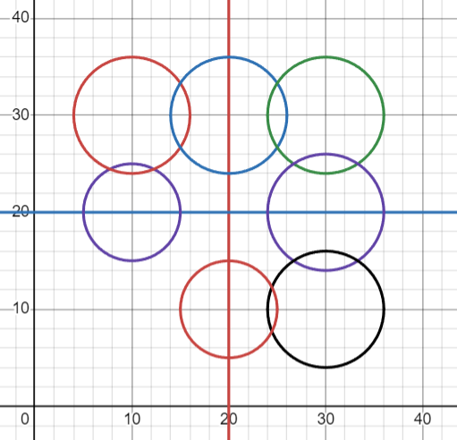

# Wrong Solutions getting accepted! (Edge Case Given)🕵️

**Author:** AnujJadhav
**Votes:** 24
**Link:** [https://leetcode.com/problems/check-if-the-rectangle-corner-is-reachable/solutions/5546536/](https://leetcode.com/problems/check-if-the-rectangle-corner-is-reachable/solutions/5546536/)

---

# Edge Case:

X = 20
Y = 20
circles = [[10,20,5],[10,30,6],[20,30,6],[30,30,6],[30,20,6],[30,10,6],[20,10,5]]

Here is a diagram:

We can see that there is a path from (0, 0) to (20, 20)

But the answer retured by the Online Judge is `false`
