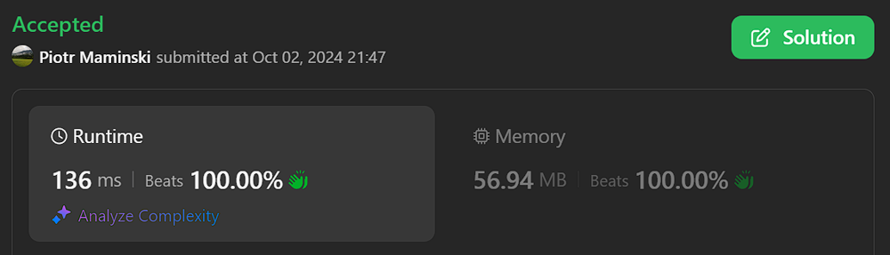

# Beats 99% | ✅ Working - 02.10.2024

**Author:** Piotr_Maminski
**Votes:** 3
**Link:** [https://leetcode.com/problems/check-if-the-rectangle-corner-is-reachable/solutions/5862348/](https://leetcode.com/problems/check-if-the-rectangle-corner-is-reachable/solutions/5862348/)

---

# Code
```python3 []
class Solution:
    def canReachCorner(self, xCorner: int, yCorner: int, circles: list[list[int]]) -> bool:
        edges = [0] * len(circles)
        isInside = [False] * len(circles)
        
        for i in range(len(circles)):
            x, y, r = circles[i]
            isInside[i] = (x <= xCorner and y <= yCorner)
            
            # Check if circle intersects with start or end point
            if x * x + y * y <= r * r or (x - xCorner) * (x - xCorner) + (y - yCorner) * (y - yCorner) <= r * r:
                return False
            
            # Check horizontal edges
            if (y - r <= 0 and y + r >= 0 and x <= xCorner) or (x + r >= xCorner and x - r <= xCorner and y <= yCorner):
                edges[i] = 1
                
            # Check vertical edges
            if (x - r <= 0 and x + r >= 0 and y <= yCorner) or (y + r >= yCorner and y - r <= yCorner and x <= xCorner):
                edges[i] += 2
                
            if edges[i] == 3:
                return False
        
        seens = [False] * len(circles)
        for i in range(len(circles)):
            if not seens[i] and self.dfs(circles, seens, edges, isInside, xCorner, yCorner, i) == 3:
                return False
        
        return True
    
    def dfs(self, circles: list[list[int]], seens: list[bool], edges: list[int], 
            isInside: list[bool], xCorner: int, yCorner: int, i: int) -> int:
        seens[i] = True
        res = edges[i]
        x, y, r = circles[i]
        
        for j in range(len(circles)):
            if seens[j]:
                continue
                
            x1, y1, r1 = circles[j]
            dX = x - x1
            dY = y - y1
            dR = r + r1
            
            if (dX * dX + dY * dY <= dR * dR and 
                (isInside[i] or isInside[j] or (x + x1 <= 2 * xCorner and y + y1 <= 2 * yCorner))):
                res |= self.dfs(circles, seens, edges, isInside, xCorner, yCorner, j)
                if res == 3:
                    return res
        
        return res
```
```cpp []
class Solution {
public:
    bool canReachCorner(int xCorner, int yCorner, vector<vector<int>>& circles) {
        int n = circles.size();
        vector<int> edges(n, 0);
        vector<bool> isInside(n, false);
        
        for (int i = 0; i < n; i++) {
            long long x = circles[i][0];
            long long y = circles[i][1];
            long long r = circles[i][2];
            
            isInside[i] = (x <= xCorner && y <= yCorner);
            
            // Check if circle intersects with start or end point
            if (x * x + y * y <= r * r || 
                (x - xCorner) * (x - xCorner) + (y - yCorner) * (y - yCorner) <= r * r) {
                return false;
            }
            
            // Check horizontal edges
            if ((y - r <= 0 && y + r >= 0 && x <= xCorner) || 
                (x + r >= xCorner && x - r <= xCorner && y <= yCorner)) {
                edges[i] = 1;
            }
            
            // Check vertical edges
            if ((x - r <= 0 && x + r >= 0 && y <= yCorner) || 
                (y + r >= yCorner && y - r <= yCorner && x <= xCorner)) {
                edges[i] += 2;
            }
            
            if (edges[i] == 3) {
                return false;
            }
        }
        
        vector<bool> seens(n, false);
        for (int i = 0; i < n; i++) {
            if (!seens[i] && dfs(circles, seens, edges, isInside, xCorner, yCorner, i) == 3) {
                return false;
            }
        }
        
        return true;
    }
    
private:
    int dfs(vector<vector<int>>& circles, vector<bool>& seens, vector<int>& edges,
            vector<bool>& isInside, int xCorner, int yCorner, int i) {
        seens[i] = true;
        int res = edges[i];
        long long x = circles[i][0];
        long long y = circles[i][1];
        long long r = circles[i][2];
        
        for (int j = 0; j < circles.size(); j++) {
            if (seens[j]) continue;
            
            long long x1 = circles[j][0];
            long long y1 = circles[j][1];
            long long r1 = circles[j][2];
            long long dX = x - x1;
            long long dY = y - y1;
            long long dR = r + r1;
            
            if (dX * dX + dY * dY <= dR * dR && 
                (isInside[i] || isInside[j] || (x + x1 <= 2 * xCorner && y + y1 <= 2 * yCorner))) {
                res |= dfs(circles, seens, edges, isInside, xCorner, yCorner, j);
                if (res == 3) return res;
            }
        }
        
        return res;
    }
};
```
```java []
class Solution {
    public boolean canReachCorner(int xCorner, int yCorner, int[][] circles) {
        int[] edges = new int[circles.length];
        boolean[] isInside = new boolean[circles.length];
        for (int i = 0; i < circles.length; i++) {
            long x = circles[i][0];
            long y = circles[i][1];
            long r = circles[i][2];
            isInside[i] = (x <= xCorner && y <= yCorner);
            if (x * x + y * y <= r * r || (x - xCorner) * (x - xCorner) + (y + yCorner) * (y + yCorner) <= r * r)
                return false;
            if ((y - r <= 0 && y + r >= 0 && x <= xCorner) || (x + r >= xCorner && x - r <= xCorner && y <= yCorner))
                edges[i] = 1;
            if ((x - r <= 0 && x + r >= 0 && y <= yCorner) || (y + r >= yCorner && y - r <= yCorner && x <= xCorner))
                edges[i] += 2;
            if (edges[i] == 3)
                return false;
        }
        // System.out.println(links);
        // System.out.println(Arrays.toString(edges));
        boolean[] seens = new boolean[circles.length];
        for (int i = 0; i < circles.length; i++) {
            if (!seens[i] && dfs(circles, seens, edges, isInside, xCorner, yCorner, i) == 3)
                return false;
        }
        return true;
    }

    public int dfs(int[][] circles, boolean[] seens, int[] edges, boolean[] isInside, int xCorner, int yCorner, int i) {
        seens[i] = true;
        int res = edges[i];
        long x = circles[i][0];
        long y = circles[i][1];
        long r = circles[i][2];
        for (int j = 0; j < circles.length; j++) {
            if (seens[j])
                continue;
            long x1 = circles[j][0];
            long y1 = circles[j][1];
            long r1 = circles[j][2];
            long dX = x - x1;
            long dY = y - y1;
            long dR = r + r1;
            if (dX * dX + dY * dY <= dR * dR && (isInside[i] || isInside[j] ||
                    (x + x1 <= 2 * xCorner && y + y1 <= 2 * yCorner))) {
                res |= dfs(circles, seens, edges, isInside, xCorner, yCorner, j);
                if (res == 3)
                    return res;
            }
        }
        return res;
    }
}
```
```csharp []
public class Solution {
    public bool CanReachCorner(int xCorner, int yCorner, int[][] circles) {
        int[] edges = new int[circles.Length];
        bool[] isInside = new bool[circles.Length];
        
        for (int i = 0; i < circles.Length; i++) {
            long x = circles[i][0];
            long y = circles[i][1];
            long r = circles[i][2];
            
            isInside[i] = (x <= xCorner && y <= yCorner);
            
            // Check if circle intersects with start or end point
            if (x * x + y * y <= r * r || 
                (x - xCorner) * (x - xCorner) + (y - yCorner) * (y - yCorner) <= r * r) {
                return false;
            }
            
            // Check horizontal edges
            if ((y - r <= 0 && y + r >= 0 && x <= xCorner) || 
                (x + r >= xCorner && x - r <= xCorner && y <= yCorner)) {
                edges[i] = 1;
            }
            
            // Check vertical edges
            if ((x - r <= 0 && x + r >= 0 && y <= yCorner) || 
                (y + r >= yCorner && y - r <= yCorner && x <= xCorner)) {
                edges[i] += 2;
            }
            
            if (edges[i] == 3) {
                return false;
            }
        }
        
        bool[] seens = new bool[circles.Length];
        for (int i = 0; i < circles.Length; i++) {
            if (!seens[i] && Dfs(circles, seens, edges, isInside, xCorner, yCorner, i) == 3) {
                return false;
            }
        }
        
        return true;
    }
    
    private int Dfs(int[][] circles, bool[] seens, int[] edges, bool[] isInside, 
                    int xCorner, int yCorner, int i) {
        seens[i] = true;
        int res = edges[i];
        long x = circles[i][0];
        long y = circles[i][1];
        long r = circles[i][2];
        
        for (int j = 0; j < circles.Length; j++) {
            if (seens[j]) continue;
            
            long x1 = circles[j][0];
            long y1 = circles[j][1];
            long r1 = circles[j][2];
            long dX = x - x1;
            long dY = y - y1;
            long dR = r + r1;
            
            if (dX * dX + dY * dY <= dR * dR && 
                (isInside[i] || isInside[j] || (x + x1 <= 2 * xCorner && y + y1 <= 2 * yCorner))) {
                res |= Dfs(circles, seens, edges, isInside, xCorner, yCorner, j);
                if (res == 3) return res;
            }
        }
        
        return res;
    }
}
```
```javascript [JavaS]
/**
 * @param {number} xCorner
 * @param {number} yCorner
 * @param {number[][]} circles
 * @return {boolean}
 */
var canReachCorner = function(xCorner, yCorner, circles) {
    const edges = new Array(circles.length).fill(0);
    const isInside = new Array(circles.length).fill(false);
    
    for (let i = 0; i < circles.length; i++) {
        const [x, y, r] = circles[i].map(BigInt);
        const xCornerBig = BigInt(xCorner);
        const yCornerBig = BigInt(yCorner);
        
        isInside[i] = (x <= xCornerBig && y <= yCornerBig);
        
        // Check if circle intersects with start or end point
        if (x * x + y * y <= r * r || 
            (x - xCornerBig) * (x - xCornerBig) + (y - yCornerBig) * (y - yCornerBig) <= r * r) {
            return false;
        }
        
        // Check horizontal edges
        if ((y - r <= 0n && y + r >= 0n && x <= xCornerBig) || 
            (x + r >= xCornerBig && x - r <= xCornerBig && y <= yCornerBig)) {
            edges[i] = 1;
        }
        
        // Check vertical edges
        if ((x - r <= 0n && x + r >= 0n && y <= yCornerBig) || 
            (y + r >= yCornerBig && y - r <= yCornerBig && x <= xCornerBig)) {
            edges[i] += 2;
        }
        
        if (edges[i] === 3) {
            return false;
        }
    }
    
    const seens = new Array(circles.length).fill(false);
    for (let i = 0; i < circles.length; i++) {
        if (!seens[i] && dfs(circles, seens, edges, isInside, xCorner, yCorner, i) === 3) {
            return false;
        }
    }
    
    return true;
};

/**
 * @param {number[][]} circles
 * @param {boolean[]} seens
 * @param {number[]} edges
 * @param {boolean[]} isInside
 * @param {number} xCorner
 * @param {number} yCorner
 * @param {number} i
 * @return {number}
 */
function dfs(circles, seens, edges, isInside, xCorner, yCorner, i) {
    seens[i] = true;
    let res = edges[i];
    const [x, y, r] = circles[i].map(BigInt);
    const xCornerBig = BigInt(xCorner);
    const yCornerBig = BigInt(yCorner);
    
    for (let j = 0; j < circles.length; j++) {
        if (seens[j]) continue;
        
        const [x1, y1, r1] = circles[j].map(BigInt);
        const dX = x - x1;
        const dY = y - y1;
        const dR = r + r1;
        
        if (dX * dX + dY * dY <= dR * dR && 
            (isInside[i] || isInside[j] || (x + x1 <= 2n * xCornerBig && y + y1 <= 2n * yCornerBig))) {
            res |= dfs(circles, seens, edges, isInside, xCorner, yCorner, j);
            if (res === 3) return res;
        }
    }
    
    return res;
}
```
```typescript [TypeS]
function canReachCorner(xCorner: number, yCorner: number, circles: number[][]): boolean {
    const edges: number[] = new Array(circles.length).fill(0);
    const isInside: boolean[] = new Array(circles.length).fill(false);
    
    for (let i = 0; i < circles.length; i++) {
        const [x, y, r] = circles[i];
        isInside[i] = (x <= xCorner && y <= yCorner);
        
        // Check if circle intersects with start (0,0) or end point (xCorner, yCorner)
        if (x * x + y * y <= r * r || 
            (x - xCorner) * (x - xCorner) + (y - yCorner) * (y - yCorner) <= r * r) {
            return false;
        }
        
        // Check horizontal edges
        if ((y - r <= 0 && y + r >= 0 && x <= xCorner) || 
            (x + r >= xCorner && x - r <= xCorner && y <= yCorner)) {
            edges[i] = 1;
        }
        
        // Check vertical edges
        if ((x - r <= 0 && x + r >= 0 && y <= yCorner) || 
            (y + r >= yCorner && y - r <= yCorner && x <= xCorner)) {
            edges[i] += 2;
        }
        
        if (edges[i] === 3) {
            return false;
        }
    }
    
    const seens: boolean[] = new Array(circles.length).fill(false);
    for (let i = 0; i < circles.length; i++) {
        if (!seens[i] && dfs(circles, seens, edges, isInside, xCorner, yCorner, i) === 3) {
            return false;
        }
    }
    
    return true;
}

function dfs(
    circles: number[][],
    seens: boolean[],
    edges: number[],
    isInside: boolean[],
    xCorner: number,
    yCorner: number,
    i: number
): number {
    seens[i] = true;
    let res = edges[i];
    const [x, y, r] = circles[i];
    
    for (let j = 0; j < circles.length; j++) {
        if (seens[j]) continue;
        
        const [x1, y1, r1] = circles[j];
        const dX = x - x1;
        const dY = y - y1;
        const dR = r + r1;
        
        if (dX * dX + dY * dY <= dR * dR && 
            (isInside[i] || isInside[j] || (x + x1 <= 2 * xCorner && y + y1 <= 2 * yCorner))) {
            res |= dfs(circles, seens, edges, isInside, xCorner, yCorner, j);
            if (res === 3) return res;
        }
    }
    
    return res;
}
```

### Complexity
- Time complexity: O(n^2) (if you know how make that better, please tell me)
- Space complexity: O(n)




