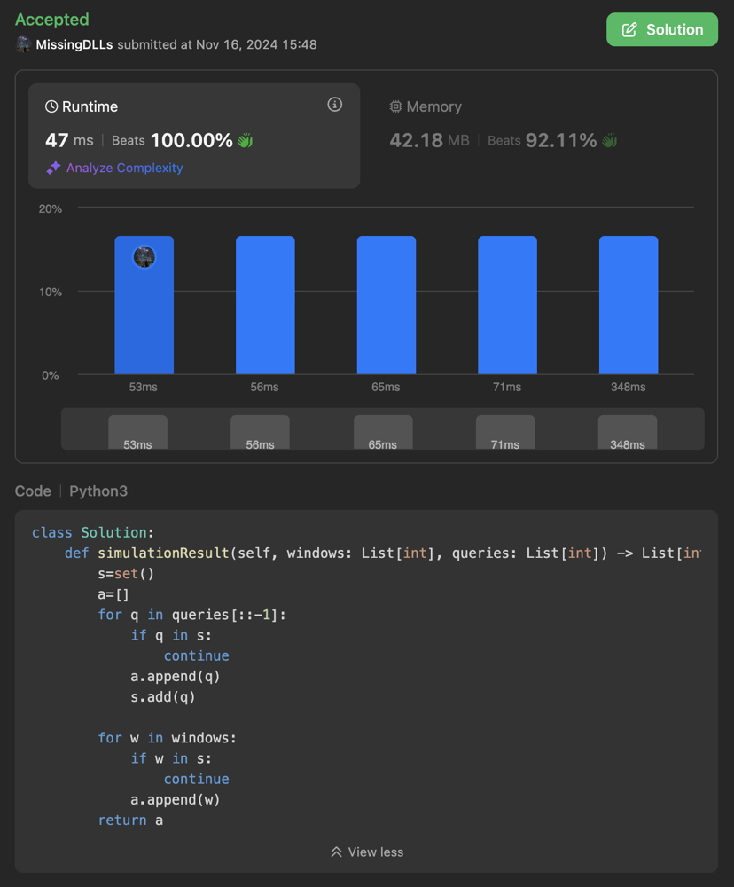

# Python3 O(N) Solution with hash set (100.00% Runtime)

**Author:** MissingDLLs
**Votes:** 0
**Link:** [https://leetcode.com/problems/alt-and-tab-simulation/solutions/6050196/](https://leetcode.com/problems/alt-and-tab-simulation/solutions/6050196/)

---

# Intuition
<!-- Describe your first thoughts on how to solve this problem. -->


# Approach
<!-- Describe your approach to solving the problem. -->
- Query array determines the final window configuration from top (in reversed order). Duplicates can be ignored.
- Append query elements (without duplicates) from backward and append window elements in order with ignoring elements exist in query.

# Complexity
- Time complexity: O(N)
<!-- Add your time complexity here, e.g. $$O(n)$$ -->

- Space complexity: O(N)
<!-- Add your space complexity here, e.g. $$O(n)$$ -->

# Code
If this solution is similar to yours or helpful, upvote me if you don't mind
```python3 []
class Solution:
    def simulationResult(self, windows: List[int], queries: List[int]) -> List[int]:
        s=set()
        a=[]
        for q in queries[::-1]:
            if q in s:
                continue
            a.append(q)
            s.add(q)

        for w in windows:
            if w in s:
                continue
            a.append(w)
        return a
```