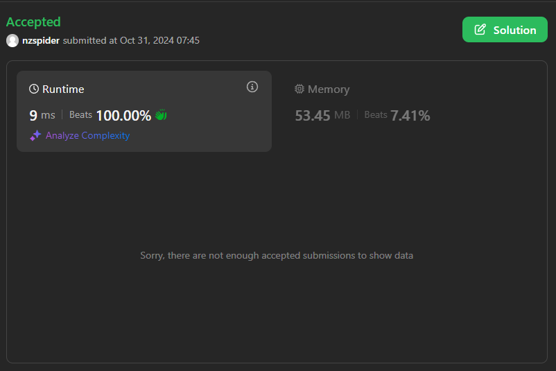

# 9ms dictionary solution | beats 100% runtime

**Author:** nzspider
**Votes:** 0
**Link:** [https://leetcode.com/problems/find-the-number-of-winning-players/solutions/5987612/](https://leetcode.com/problems/find-the-number-of-winning-players/solutions/5987612/)

---




# Code
```csharp []
public class Solution {
    public int WinningPlayerCount(int n, int[][] pick) {
        var dic = new Dictionary<int,Dictionary<int,int>>();
        for(int i=0;i<pick.Length;i++){
            if(!dic.ContainsKey(pick[i][0])){
                dic[pick[i][0]]=new Dictionary<int,int>();
            }
            if(!dic[pick[i][0]].ContainsKey(pick[i][1])){
                dic[pick[i][0]][pick[i][1]]=1;
            }
            else{
                dic[pick[i][0]][pick[i][1]]++;
            }
        }
        return dic.Where(d=>d.Value.Any(p=>p.Value>d.Key)).Count();
    }
}
```