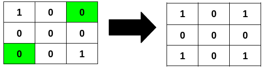
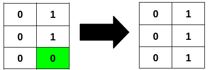

# [3239. Minimum Number of Flips to Make Binary Grid Palindromic I](https://leetcode.com/problems/minimum-number-of-flips-to-make-binary-grid-palindromic-i/)

| Category | Difficulty | Likes | Dislikes |
| :------: | :--------: | :---: | :------: |
| Algorithms | Medium | 80 | 10 |

**Tags:** [`array`](https://leetcode.com/tag/array), [`two-pointers`](https://leetcode.com/tag/two-pointers), [`matrix`](https://leetcode.com/tag/matrix)

## Description

You are given an `m x n` binary matrix `grid`.

A row or column is considered **palindromic** if its values read the same forward and backward.

You can **flip** any number of cells in `grid` from `0` to `1`, or from `1` to `0`.

Return the **minimum** number of cells that need to be flipped to make **either** all rows **palindromic** or all columns **palindromic**.

 

**Example 1:**

**Input:** grid = [[1,0,0],[0,0,0],[0,0,1]]

**Output:** 2

**Explanation:**

Flipping the highlighted cells makes all the rows palindromic.

**Example 2:**

**Input:** grid = [[0,1],[0,1],[0,0]]

**Output:** 1

**Explanation:**

Flipping the highlighted cell makes all the columns palindromic.

**Example 3:**

**Input:** grid = [[1],[0]]

**Output:** 0

**Explanation:**

All rows are already palindromic.

 

**Constraints:**

	- `m == grid.length`

	- `n == grid[i].length`

	- `1 <= m * n <= 2 * 10^5`

	- `0 <= grid[i][j] <= 1`

---

**Links:** [Submissions](https://leetcode.com/problems/minimum-number-of-flips-to-make-binary-grid-palindromic-i/) | [Solutions](https://leetcode.com/problems/minimum-number-of-flips-to-make-binary-grid-palindromic-i/)
