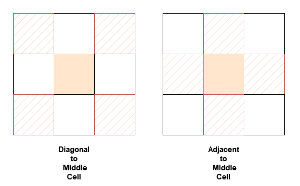
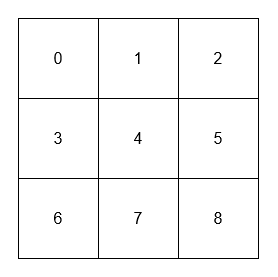

# [3242. Design Neighbor Sum Service](https://leetcode.com/problems/design-neighbor-sum-service/)

| Category | Difficulty | Likes | Dislikes |
| :------: | :--------: | :---: | :------: |
| Algorithms | Easy | 110 | 18 |

**Tags:** [`array`](https://leetcode.com/tag/array), [`hash-table`](https://leetcode.com/tag/hash-table), [`design`](https://leetcode.com/tag/design), [`matrix`](https://leetcode.com/tag/matrix), [`simulation`](https://leetcode.com/tag/simulation)

## Description

You are given a `n x n` 2D array `grid` containing **distinct** elements in the range `[0, n^2 - 1]`.

Implement the `NeighborSum` class:

	- `NeighborSum(int [][]grid)` initializes the object.

	- `int adjacentSum(int value)` returns the **sum** of elements which are adjacent neighbors of `value`, that is either to the top, left, right, or bottom of `value` in `grid`.

	- `int diagonalSum(int value)` returns the **sum** of elements which are diagonal neighbors of `value`, that is either to the top-left, top-right, bottom-left, or bottom-right of `value` in `grid`.

 

**Example 1:**

**Input:**

["NeighborSum", "adjacentSum", "adjacentSum", "diagonalSum", "diagonalSum"]

[[[[0, 1, 2], [3, 4, 5], [6, 7, 8]]], [1], [4], [4], [8]]

**Output:** [null, 6, 16, 16, 4]

**Explanation:**

****

	- The adjacent neighbors of 1 are 0, 2, and 4.

	- The adjacent neighbors of 4 are 1, 3, 5, and 7.

	- The diagonal neighbors of 4 are 0, 2, 6, and 8.

	- The diagonal neighbor of 8 is 4.

**Example 2:**

**Input:**

["NeighborSum", "adjacentSum", "diagonalSum"]

[[[[1, 2, 0, 3], [4, 7, 15, 6], [8, 9, 10, 11], [12, 13, 14, 5]]], [15], [9]]

**Output:** [null, 23, 45]

**Explanation:**

****

	- The adjacent neighbors of 15 are 0, 10, 7, and 6.

	- The diagonal neighbors of 9 are 4, 12, 14, and 15.

 

**Constraints:**

	- `3 <= n == grid.length == grid[0].length <= 10`

	- `0 <= grid[i][j] <= n^2 - 1`

	- All `grid[i][j]` are distinct.

	- `value` in `adjacentSum` and `diagonalSum` will be in the range `[0, n^2 - 1]`.

	- At most `2 * n^2` calls will be made to `adjacentSum` and `diagonalSum`.

---

**Links:** [Submissions](https://leetcode.com/problems/design-neighbor-sum-service/) | [Solutions](https://leetcode.com/problems/design-neighbor-sum-service/)
