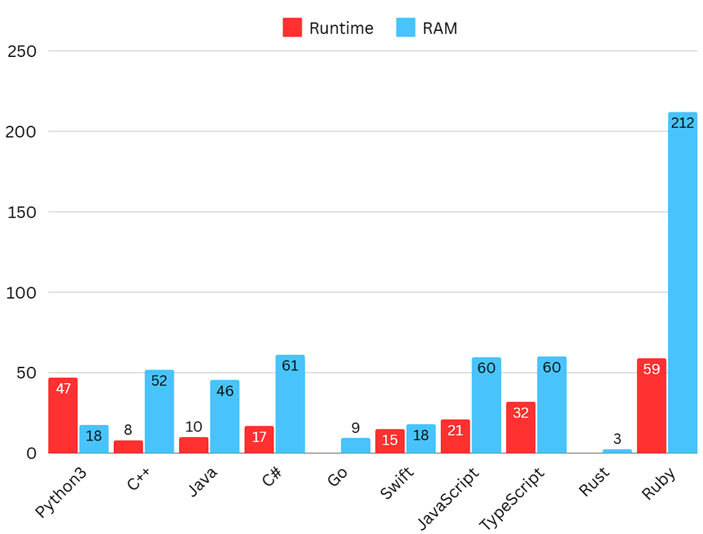
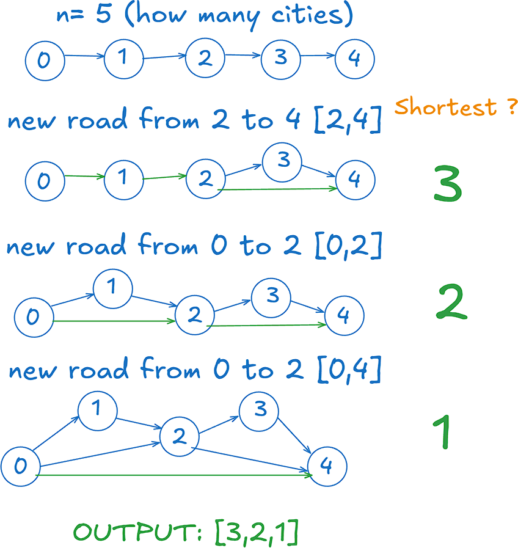

# ✅ Video | Beats 100% | Explained Step by Step

**Author:** Piotr_Maminski
**Votes:** 102
**Link:** [https://leetcode.com/problems/shortest-distance-after-road-addition-queries-i/solutions/6087071/](https://leetcode.com/problems/shortest-distance-after-road-addition-queries-i/solutions/6087071/)

---


https://youtu.be/zCeZOyACpUQ?si=GFLAnH6oTkAWYZMf

# #1 DFS - Depth-First Search (Beats 100% [[1]](https://leetcode.com/problems/shortest-distance-after-road-addition-queries-i/submissions/1463779811)[[2]](https://leetcode.com/problems/shortest-distance-after-road-addition-queries-i/submissions/1463783397)[[3]](https://leetcode.com/problems/shortest-distance-after-road-addition-queries-i/submissions/1463780488)[[4]](https://leetcode.com/problems/shortest-distance-after-road-addition-queries-i/submissions/1463782683)[[5]](https://leetcode.com/problems/shortest-distance-after-road-addition-queries-i/submissions/1463785385)[[6]](https://leetcode.com/problems/shortest-distance-after-road-addition-queries-i/submissions/1463790092)[[7]](https://leetcode.com/problems/shortest-distance-after-road-addition-queries-i/submissions/1463785385)[[8]](https://leetcode.com/problems/shortest-distance-after-road-addition-queries-i/submissions/1463787896)[[9]](https://leetcode.com/problems/shortest-distance-after-road-addition-queries-i/submissions/1463788904)[[10]](https://leetcode.com/problems/shortest-distance-after-road-addition-queries-i/submissions/1463789745))
```python3 []
class Solution:
    def updateDistances(self, graph, current, distances):
        newDist = distances[current] + 1
        
        for neighbor in graph[current]:
            if distances[neighbor] <= newDist:
                continue
                
            distances[neighbor] = newDist
            self.updateDistances(graph, neighbor, distances)
    
    def shortestDistanceAfterQueries(self, n: int, queries: List[List[int]]) -> List[int]:
        distances = [n - 1 - i for i in range(n)]
        
        graph = [[] for _ in range(n)]
        for i in range(n-1):
            graph[i + 1].append(i)
        
        answer = []
        
        for source, target in queries:
            graph[target].append(source)
            distances[source] = min(distances[source], distances[target] + 1)
            self.updateDistances(graph, source, distances)
            
            answer.append(distances[0])
        
        return answer
```
```cpp []
class Solution {
    void updateDistances(vector<vector<int>>& graph, int current, vector<int>& distances) {
        int newDist = distances[current] + 1;
        for (int neighbor : graph[current]) {
            if (distances[neighbor] <= newDist) continue;
            distances[neighbor] = newDist;
            updateDistances(graph, neighbor, distances);
        }
    }
public:
    vector<int> shortestDistanceAfterQueries(int n, vector<vector<int>>& queries) {
        vector<int> distances(n);
        for (int i = 0; i < n; ++i) {
            distances[i] = n - 1 - i;
        }
        
        vector<vector<int>> graph(n);
        for (int i = 0; i + 1 < n; ++i) {
            graph[i + 1].push_back(i);
        }
        
        vector<int> answer(queries.size());
        int queryIdx = 0;
        
        for (const auto& query : queries) {
            int source = query[0];
            int target = query[1];
            
            graph[target].push_back(source);
            distances[source] = min(distances[source], distances[target] + 1);
            updateDistances(graph, source, distances);
            
            answer[queryIdx++] = distances[0];
        }
        
        return answer;
    }
};
```
```java []
class Solution {
    private void updateDistances(List<List<Integer>> graph, int current, int[] distances) {
        int newDist = distances[current] + 1;
        
        for (int neighbor : graph.get(current)) {
            if (distances[neighbor] <= newDist) continue;
            
            distances[neighbor] = newDist;
            updateDistances(graph, neighbor, distances);
        }
    }
    
    public int[] shortestDistanceAfterQueries(int n, int[][] queries) {
        int[] distances = new int[n];
        for (int i = 0; i < n; ++i) {
            distances[i] = n - 1 - i;
        }
        
        List<List<Integer>> graph = new ArrayList<>();
        for (int i = 0; i < n; ++i) {
            graph.add(new ArrayList<>());
        }
        
        for (int i = 0; i + 1 < n; ++i) {
            graph.get(i + 1).add(i);
        }
        
        int[] answer = new int[queries.length];
        int queryIdx = 0;
        
        for (int[] query : queries) {
            int source = query[0];
            int target = query[1];
            
            graph.get(target).add(source);
            distances[source] = Math.min(distances[source], distances[target] + 1);
            updateDistances(graph, source, distances);
            
            answer[queryIdx++] = distances[0];
        }
        
        return answer;
    }
}
```
```csharp []
public class Solution {
    private void UpdateDistances(List<int>[] graph, int current, int[] distances) {
        int newDist = distances[current] + 1;
        
        foreach (int neighbor in graph[current]) {
            if (distances[neighbor] <= newDist) {
                continue;
            }
            
            distances[neighbor] = newDist;
            UpdateDistances(graph, neighbor, distances);
        }
    }
    
    public int[] ShortestDistanceAfterQueries(int n, int[][] queries) {
        int[] distances = new int[n];
        for (int i = 0; i < n; i++) {
            distances[i] = n - 1 - i;
        }
        
        List<int>[] graph = new List<int>[n];
        for (int i = 0; i < n; i++) {
            graph[i] = new List<int>();
        }
        
        for (int i = 0; i < n - 1; i++) {
            graph[i + 1].Add(i);
        }
        
        List<int> answer = new List<int>();
        
        foreach (var query in queries) {
            int source = query[0];
            int target = query[1];
            
            graph[target].Add(source);
            distances[source] = Math.Min(distances[source], distances[target] + 1);
            UpdateDistances(graph, source, distances);
            
            answer.Add(distances[0]);
        }
        
        return answer.ToArray();
    }
}
```
```golang []
func updateDistances(graph [][]int, current int, distances []int) {
    newDist := distances[current] + 1
    
    for _, neighbor := range graph[current] {
        if distances[neighbor] <= newDist {
            continue
        }
        
        distances[neighbor] = newDist
        updateDistances(graph, neighbor, distances)
    }
}

func shortestDistanceAfterQueries(n int, queries [][]int) []int {
    distances := make([]int, n)
    for i := range distances {
        distances[i] = n - 1 - i
    }
    
    graph := make([][]int, n)
    for i := 0; i < n-1; i++ {
        graph[i+1] = append(graph[i+1], i)
    }
    
    answer := make([]int, 0, len(queries))
    
    for _, query := range queries {
        source, target := query[0], query[1]
        graph[target] = append(graph[target], source)
        
        if distances[target]+1 < distances[source] {
            distances[source] = distances[target] + 1
        }
        
        updateDistances(graph, source, distances)
        answer = append(answer, distances[0])
    }
    
    return answer
}
```
```swift []
class Solution {
    func updateDistances(_ graph: [[Int]], _ current: Int, _ distances: inout [Int]) {
        let newDist = distances[current] + 1
        
        for neighbor in graph[current] {
            if distances[neighbor] <= newDist {
                continue
            }
            
            distances[neighbor] = newDist
            updateDistances(graph, neighbor, &distances)
        }
    }
    
    func shortestDistanceAfterQueries(_ n: Int, _ queries: [[Int]]) -> [Int] {
        var distances = (0..<n).map { n - 1 - $0 }
        
        var graph = Array(repeating: [Int](), count: n)
        for i in 0..<(n-1) {
            graph[i + 1].append(i)
        }
        
        var answer = [Int]()
        
        for query in queries {
            let source = query[0]
            let target = query[1]
            
            graph[target].append(source)
            distances[source] = min(distances[source], distances[target] + 1)
            updateDistances(graph, source, &distances)
            
            answer.append(distances[0])
        }
        
        return answer
    }
}
```
```javascript [JS]
// JavaScript

var updateDistances = function(graph, current, distances) {
    const newDist = distances[current] + 1;
    
    for (const neighbor of graph[current]) {
        if (distances[neighbor] <= newDist) {
            continue;
        }
        
        distances[neighbor] = newDist;
        updateDistances(graph, neighbor, distances);
    }
};

var shortestDistanceAfterQueries = function(n, queries) {
    const distances = Array(n).fill(0).map((_, i) => n - 1 - i);
    
    const graph = Array(n).fill(0).map(() => []);
    for (let i = 0; i < n-1; i++) {
        graph[i + 1].push(i);
    }
    
    const answer = [];
    
    for (const [source, target] of queries) {
        graph[target].push(source);
        distances[source] = Math.min(distances[source], distances[target] + 1);
        updateDistances(graph, source, distances);
        
        answer.push(distances[0]);
    }
    
    return answer;
};
```
```typescript [TS]
function shortestDistanceAfterQueries(n: number, queries: number[][]): number[] {
    const distances: number[] = Array(n).fill(0).map((_, i) => n - 1 - i);
    
    const graph: number[][] = Array(n).fill(0).map(() => []);
    for (let i = 0; i < n - 1; i++) {
        graph[i + 1].push(i);
    }
    
    const answer: number[] = [];
    
    function updateDistances(graph: number[][], current: number, distances: number[]): void {
        const newDist = distances[current] + 1;
        
        for (const neighbor of graph[current]) {
            if (distances[neighbor] <= newDist) {
                continue;
            }
            
            distances[neighbor] = newDist;
            updateDistances(graph, neighbor, distances);
        }
    }
    
    for (const [source, target] of queries) {
        graph[target].push(source);
        distances[source] = Math.min(distances[source], distances[target] + 1);
        updateDistances(graph, source, distances);
        
        answer.push(distances[0]);
    }
    
    return answer;
}
```
```rust []
impl Solution {
    fn update_distances(graph: &Vec<Vec<usize>>, current: usize, distances: &mut Vec<usize>) {
        let new_dist = distances[current] + 1;
        
        for &neighbor in &graph[current] {
            if distances[neighbor] <= new_dist {
                continue;
            }
            
            distances[neighbor] = new_dist;
            Self::update_distances(graph, neighbor, distances);
        }
    }

    pub fn shortest_distance_after_queries(n: i32, queries: Vec<Vec<i32>>) -> Vec<i32> {
        let n = n as usize;
        let mut distances: Vec<usize> = (0..n).map(|i| n - 1 - i).collect();
        
        let mut graph: Vec<Vec<usize>> = vec![Vec::new(); n];
        for i in 0..n-1 {
            graph[i + 1].push(i);
        }
        
        let mut answer = Vec::new();
        
        for query in queries {
            let source = query[0] as usize;
            let target = query[1] as usize;
            
            graph[target].push(source);
            distances[source] = distances[source].min(distances[target] + 1);
            Self::update_distances(&graph, source, &mut distances);
            
            answer.push(distances[0] as i32);
        }
        
        answer
    }
}
```
```ruby []
def update_distances(graph, current, distances)
    new_dist = distances[current] + 1
    
    graph[current].each do |neighbor|
        next if distances[neighbor] <= new_dist
        
        distances[neighbor] = new_dist
        update_distances(graph, neighbor, distances)
    end
end

def shortest_distance_after_queries(n, queries)
    distances = (0...n).map { |i| n - 1 - i }
    
    graph = Array.new(n) { [] }
    (0...n-1).each do |i|
        graph[i + 1] << i
    end
    
    answer = []
    
    queries.each do |source, target|
        graph[target] << source
        distances[source] = [distances[source], distances[target] + 1].min
        update_distances(graph, source, distances)
        
        answer << distances[0]
    end
    
    answer
end
```

- Complexity: Time O(n^2)  & Space O(n)


(less = better)


---

# #2 BFS - Breadth-First Search (from video)

```python3 []
class Solution:
    def shortestDistanceAfterQueries(self, n: int, queries: List[List[int]]) -> List[int]:
        adj = [[i + 1] for i in range(n)]

        def shortest_path():
            q = deque()
            q.append((0, 0))  # node, length
            visit = set()
            visit.add((0, 0))
            while q:
                cur, length = q.popleft()
                if cur == n - 1:
                    return length
                for nei in adj[cur]:
                    if nei not in visit:
                        q.append((nei, length + 1))
                        visit.add(nei)

        res = []
        for src, dst in queries:
            adj[src].append(dst)
            res.append(shortest_path())
        return res
```
```cpp []
class Solution {
public:
    vector<int> shortestDistanceAfterQueries(int n, vector<vector<int>>& queries) {
        vector<vector<int>> adj(n);
        for (int i = 0; i < n; i++) {
            adj[i].push_back(i + 1);
        }
        
        auto shortest_path = [&]() {
            queue<pair<int, int>> q;
            q.push({0, 0}); // node, length
            unordered_set<int> visit;
            visit.insert(0);
            
            while (!q.empty()) {
                auto [cur, length] = q.front();
                q.pop();
                
                if (cur == n - 1) return length;
                
                for (int nei : adj[cur]) {
                    if (visit.find(nei) == visit.end()) {
                        q.push({nei, length + 1});
                        visit.insert(nei);
                    }
                }
            }
            return -1;
        };
        
        vector<int> res;
        for (const auto& query : queries) {
            adj[query[0]].push_back(query[1]);
            res.push_back(shortest_path());
        }
        return res;
    }
};
```
```java []
class Solution {
    public int[] shortestDistanceAfterQueries(int n, int[][] queries) {
        List<List<Integer>> adj = new ArrayList<>();
        for (int i = 0; i < n; i++) {
            adj.add(new ArrayList<>());
            adj.get(i).add(i + 1);
        }
        
        List<Integer> resList = new ArrayList<>();
        for (int[] query : queries) {
            adj.get(query[0]).add(query[1]);
            resList.add(shortestPath(adj, n));
        }
        
        return resList.stream().mapToInt(Integer::intValue).toArray();
    }
    
    private int shortestPath(List<List<Integer>> adj, int n) {
        Queue<int[]> q = new LinkedList<>();
        q.offer(new int[]{0, 0}); // node, length
        Set<Integer> visit = new HashSet<>();
        visit.add(0);
        
        while (!q.isEmpty()) {
            int[] curr = q.poll();
            int cur = curr[0];
            int length = curr[1];
            
            if (cur == n - 1) return length;
            
            for (int nei : adj.get(cur)) {
                if (!visit.contains(nei)) {
                    q.offer(new int[]{nei, length + 1});
                    visit.add(nei);
                }
            }
        }
        return -1;
    }
}
```
```csharp []
public class Solution {
    public int[] ShortestDistanceAfterQueries(int n, int[][] queries) {
        List<List<int>> adj = new List<List<int>>();
        
        for (int i = 0; i < n; i++) {
            adj.Add(new List<int> { i + 1 });
        }
        
        List<int> res = new List<int>();
        foreach (var query in queries) {
            adj[query[0]].Add(query[1]);
            res.Add(ShortestPath(adj, n));
        }
        
        return res.ToArray();
    }
    
    private int ShortestPath(List<List<int>> adj, int n) {
        Queue<(int node, int length)> q = new Queue<(int, int)>();
        q.Enqueue((0, 0));
        HashSet<int> visit = new HashSet<int> { 0 };
        
        while (q.Count > 0) {
            var (cur, length) = q.Dequeue();
            
            if (cur == n - 1) return length;
            
            foreach (int nei in adj[cur]) {
                if (!visit.Contains(nei)) {
                    q.Enqueue((nei, length + 1));
                    visit.Add(nei);
                }
            }
        }
        return -1;
    }
}
```
```golang []
func shortestDistanceAfterQueries(n int, queries [][]int) []int {
    adj := make([][]int, n)
    for i := range adj {
        adj[i] = []int{i + 1}
    }
    
    shortestPath := func() int {
        q := [][]int{{0, 0}} // node, length
        visit := make(map[int]bool)
        visit[0] = true
        
        for len(q) > 0 {
            cur, length := q[0][0], q[0][1]
            q = q[1:]
            
            if cur == n-1 {
                return length
            }
            
            for _, nei := range adj[cur] {
                if !visit[nei] {
                    q = append(q, []int{nei, length + 1})
                    visit[nei] = true
                }
            }
        }
        return -1
    }
    
    res := make([]int, 0)
    for _, query := range queries {
        src, dst := query[0], query[1]
        adj[src] = append(adj[src], dst)
        res = append(res, shortestPath())
    }
    return res
}
```
```swift []
class Solution {
    func shortestDistanceAfterQueries(_ n: Int, _ queries: [[Int]]) -> [Int] {
        var adj = Array(repeating: [Int](), count: n)
        for i in 0..<n {
            adj[i] = [i + 1]
        }
        
        func shortestPath() -> Int {
            var queue = [(0, 0)] // node, length
            var visit = Set<Int>()
            visit.insert(0)
            var queueIndex = 0
            
            while queueIndex < queue.count {
                let (cur, length) = queue[queueIndex]
                queueIndex += 1
                
                if cur == n - 1 {
                    return length
                }
                
                for nei in adj[cur] {
                    if !visit.contains(nei) {
                        queue.append((nei, length + 1))
                        visit.insert(nei)
                    }
                }
            }
            return -1
        }
        
        var res = [Int]()
        for query in queries {
            let src = query[0], dst = query[1]
            adj[src].append(dst)
            res.append(shortestPath())
        }
        return res
    }
}
```
```javascript [JS]
// JavaScript

var shortestDistanceAfterQueries = function(n, queries) {
    const adj = Array.from({length: n}, (_, i) => [i + 1]);
    
    const shortestPath = () => {
        const q = [[0, 0]]; // node, length
        const visit = new Set();
        visit.add(0);
        
        while (q.length > 0) {
            const [cur, length] = q.shift();
            if (cur === n - 1) {
                return length;
            }
            
            for (const nei of adj[cur]) {
                if (!visit.has(nei)) {
                    q.push([nei, length + 1]);
                    visit.add(nei);
                }
            }
        }
    };
    
    const res = [];
    for (const [src, dst] of queries) {
        adj[src].push(dst);
        res.push(shortestPath());
    }
    
    return res;
};
```
```typescript [TS]
// TypeScript

function shortestDistanceAfterQueries(n: number, queries: number[][]): number[] {
    const adj: number[][] = Array(n).fill(0).map((_, i) => [i + 1]);
    
    const shortestPath = (): number => {
        const q: [number, number][] = [[0, 0]]; // node, length
        const visit = new Set<number>();
        visit.add(0);
        
        while (q.length > 0) {
            const [cur, length] = q.shift()!;
            
            if (cur === n - 1) {
                return length;
            }
            
            for (const nei of adj[cur]) {
                if (!visit.has(nei)) {
                    q.push([nei, length + 1]);
                    visit.add(nei);
                }
            }
        }
        return -1;
    };
    
    const res: number[] = [];
    for (const [src, dst] of queries) {
        adj[src].push(dst);
        res.push(shortestPath());
    }
    return res;
}
```
```rust []
use std::collections::{VecDeque, HashSet};

impl Solution {
    pub fn shortest_distance_after_queries(n: i32, queries: Vec<Vec<i32>>) -> Vec<i32> {
        let n = n as usize;
        let mut adj: Vec<Vec<i32>> = (0..n).map(|i| vec![(i + 1) as i32]).collect();
        
        let shortest_path = |adj: &Vec<Vec<i32>>| -> i32 {
            let mut q = VecDeque::new();
            q.push_back((0, 0)); // node, length
            let mut visit = HashSet::new();
            visit.insert(0);
            
            while let Some((cur, length)) = q.pop_front() {
                if cur == (n - 1) as i32 {
                    return length;
                }
                
                for &nei in &adj[cur as usize] {
                    if !visit.contains(&nei) {
                        q.push_back((nei, length + 1));
                        visit.insert(nei);
                    }
                }
            }
            -1
        };
        
        let mut res = Vec::new();
        for query in queries {
            let (src, dst) = (query[0] as usize, query[1]);
            adj[src].push(dst);
            res.push(shortest_path(&adj));
        }
        res
    }
}
```
```ruby []
def shortest_distance_after_queries(n, queries)
    adj = Array.new(n) { |i| [i + 1] }
    
    def shortest_path(adj, n)
        q = [[0, 0]]  # [node, length]
        visit = Set.new([0])
        
        while !q.empty?
            cur, length = q.shift
            return length if cur == n - 1
            
            adj[cur].each do |nei|
                if !visit.include?(nei)
                    q.push([nei, length + 1])
                    visit.add(nei)
                end
            end
        end
    end
    
    res = []
    queries.each do |src, dst|
        adj[src].push(dst)
        res.push(shortest_path(adj, n))
    end
    res
end
```
- Complexity: Time O(n^2) & Space O(n)


###  alternative : Dijkstra's algorithm

# Explanation


---

## Intuition




####  Task is to calculate these shortest paths after each new road is added and store them in an array.

- **If** n = 4, initially you need 3 steps to go from city 0 to city 3 **(0\u21921\u21922\u21923)**
- **If** a new road is built from city 0 to city 2, you might now need only 2 steps **(0\u21922\u21923)**
- **If** another road is built from city 1 to city 3, it doesn't help because you **still need 2 steps**


### #1 Approach (DFS)

##### 1. `updateDistances` Update distances after adding a new edge
1. Takes a graph, current node, and distances array as parameters
2. For each neighbor of current node, if we can improve its distance (make it smaller), we update it and recursively proces that neighbor
3. The new distance is always current node's distance **+ 1**


##### 2. `shortestDistanceAfterQueries`: Processes queries
1. Initializes distances array where each node i starts with distance **n-1** to node **0**
2. Creates initial directed graph where each node **i+1** connects to node **i**
3. For each query (source, target):
    - Adds new edge from target to source
    - Updates source's distance if needed based on target's distance
    - Recursively updates distances of nodes reachable from source
    - Records distance to node **0** in the answer


Done.


**UpVote** if you think it is helpful and will help others

---

## Graph Theory

- (IMO) the best explaining Video on graph from Google engineer.
https://youtu.be/09_LlHjoEiY?si=EKU-b9pAafWX1Wea


####  [Interview Questions and Answers Repository](https://github.com/RooTinfinite/Interview-questions-and-answers)


