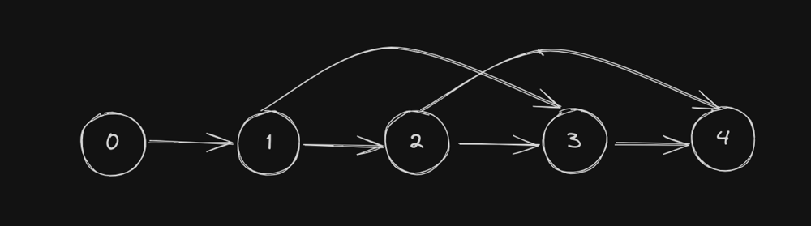

# Simple solution with only Unordered Map | Beats 100% | O(n) Time complexity

**Author:** vishnuvardhanpvs
**Votes:** 49
**Link:** [https://leetcode.com/problems/shortest-distance-after-road-addition-queries-ii/solutions/5583267/](https://leetcode.com/problems/shortest-distance-after-road-addition-queries-ii/solutions/5583267/)

---

# Approach
There are no two queries such that `queries[i][0] < queries[j][0] < queries[i][1] < queries[j][1].`
This condition is key to the below solution
This condition bascially means there will be no overlapping or intersecting paths
Example of ovelapping or intersecting paths: 
For n = 5 if we have paths below
1 to 3
2 to 4



If there are no overlapping or intersecting paths we can get rid of nodes in between path as it is guarnteed that no useful path will originate from the nodes we remove

# Complexity
Time: queries.length+ 2*n -> O(n)
- n to create map
- queries.length to loop queries
- n to remove entries for map

Space: O(n)

# Code
```
class Solution {
        public int[] shortestDistanceAfterQueries(int n, int[][] queries) {
        var ans = new int[queries.length];
        var map = new HashMap<Integer, Integer>();

        //Create a map to store the largest node reachable from a node
        //Initially all nodes will have only one node reachable i.e. the next node
        for (int i = 0; i < n - 1; i++) {
            map.put(i, i + 1);
        }

        for (int i = 0; i < queries.length; i++) {
            var u = queries[i][0];
            var v = queries[i][1];

            //Check if `u` node exists if it doesn't it means the node is already removed, so no point considering this query 
            //If `u` node exists but `v` node is less that the value of the map then this is not largest node reachable from u, so no point considering this query 
            if (!map.containsKey(u)||map.get(u) >= v) {
                ans[i] = map.size();
                continue;
            }

            //If `v` node is larger than the value of map then get rid off nodes between of `u` and `v`
            var j = map.get(u);
            while (j < v) {
                j = map.remove(j);
            }
            map.put(u, v);


            //We got rid off useless nodes so the size of map is answer 
            ans[i] = map.size();
        }
        
        return ans;
    }
}
```