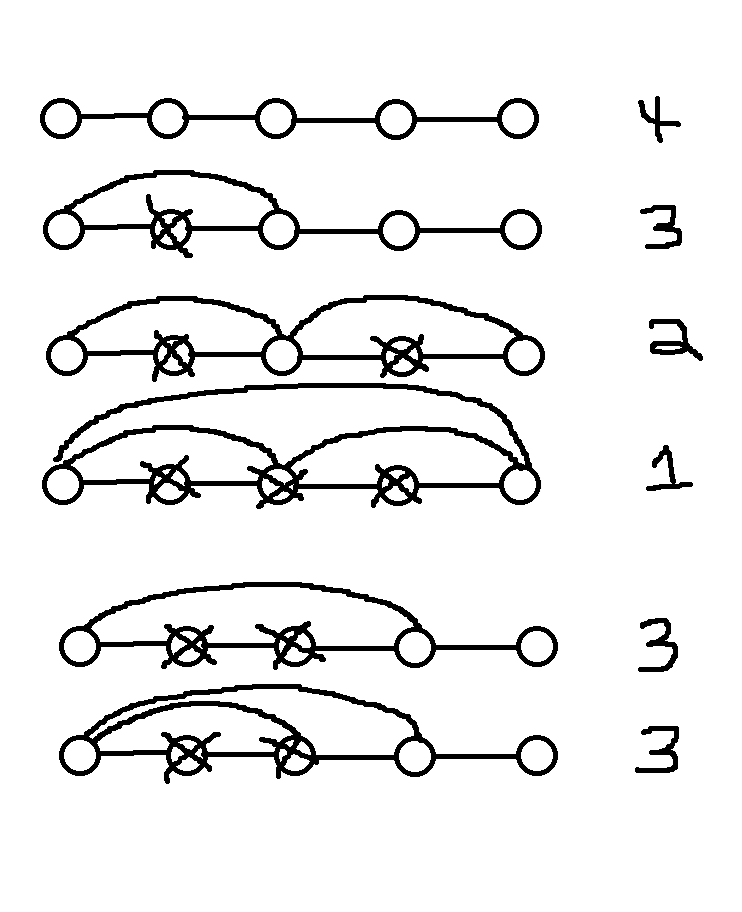

# Remove skippable nodes

**Author:** MoggleToggles
**Votes:** 1
**Link:** [https://leetcode.com/problems/shortest-distance-after-road-addition-queries-ii/solutions/5583251/](https://leetcode.com/problems/shortest-distance-after-road-addition-queries-ii/solutions/5583251/)

---

# Intuition
Because of the condition where no edges may criss-cross, we know that an edge will either extend the reach of a node or not. If an edge increases the maximum reach of a node, then we need to check every node between the source and destination (not inclusive) and remove them from further consideration. 

Each time a node is removed, the destination from start to finish decreases by one. 

# Diagram




# Code
```
import java.util.*

class Solution {
    fun shortestDistanceAfterQueries(n: Int, queries: Array<IntArray>): IntArray {
        var distanceToEnd = n - 1
        val remainingNodes = TreeSet<Int>()
        for (node in 0 until n) {
            remainingNodes.add(node)
        }

        val shortestDistances = IntArray(queries.size) { it }
        for (i in queries.indices) {
            val (source, dest) = queries[i]

            var nextNodeFromSource = remainingNodes.ceiling(source + 1)
            while (nextNodeFromSource != null && nextNodeFromSource < dest) {
                remainingNodes.remove(nextNodeFromSource)
                distanceToEnd--
                nextNodeFromSource = remainingNodes.ceiling(source + 1)
            }
            
            shortestDistances[i] = distanceToEnd
        }

        return shortestDistances
    }
}
```

Edit: Originally I had an adjacency list that I didn't need in hindsight