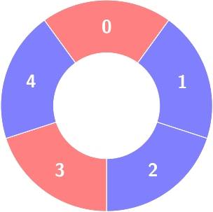
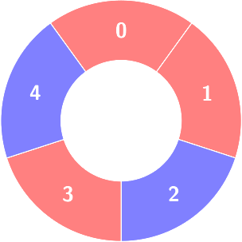
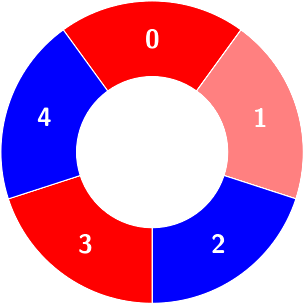
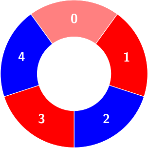
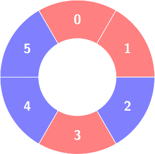
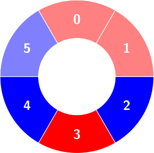

# [3245. Alternating Groups III](https://leetcode.com/problems/alternating-groups-iii/)

| Category | Difficulty | Likes | Dislikes |
| :------: | :--------: | :---: | :------: |
| Algorithms | Hard | 60 | 10 |

**Tags:** [`array`](https://leetcode.com/tag/array), [`binary-indexed-tree`](https://leetcode.com/tag/binary-indexed-tree), [`ordered-set`](https://leetcode.com/tag/ordered-set)

## Description

There are some red and blue tiles arranged circularly. You are given an array of integers `colors` and a 2D integers array `queries`.

The color of tile `i` is represented by `colors[i]`:

	- `colors[i] == 0` means that tile `i` is **red**.

	- `colors[i] == 1` means that tile `i` is **blue**.

An **alternating** group is a contiguous subset of tiles in the circle with **alternating** colors (each tile in the group except the first and last one has a different color from its adjacent tiles in the group).

You have to process queries of two types:

	- `queries[i] = [1, size_i]`, determine the count of **alternating** groups with size `size_i`.

	- `queries[i] = [2, index_i, color_i]`, change `colors[index_i]` to `color_i`.

Return an array `answer` containing the results of the queries of the first type *in order*.

**Note** that since `colors` represents a **circle**, the **first** and the **last** tiles are considered to be next to each other.

 

**Example 1:**

**Input:** colors = [0,1,1,0,1], queries = [[2,1,0],[1,4]]

**Output:** [2]

**Explanation:**

****

First query:

Change `colors[1]` to 0.

Second query:

Count of the alternating groups with size 4:

**Example 2:**

**Input:** colors = [0,0,1,0,1,1], queries = [[1,3],[2,3,0],[1,5]]

**Output:** [2,0]

**Explanation:**

First query:

Count of the alternating groups with size 3:

Second query: `colors` will not change.

Third query: There is no alternating group with size 5.

 

**Constraints:**

	- `4 `queries[i][0] == 1`: `queries[i].length == 2`, `3

---

**Links:** [Submissions](https://leetcode.com/problems/alternating-groups-iii/) | [Solutions](https://leetcode.com/problems/alternating-groups-iii/)
