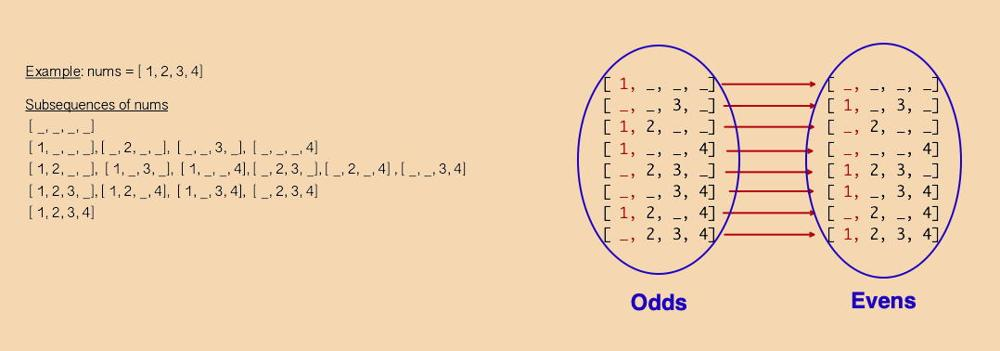

# Python 3 ||| 5 lines, mathematics || T/S: 97%, 75%

**Author:** Spaulding_
**Votes:** 4
**Link:** [https://leetcode.com/problems/number-of-subsequences-with-odd-sum/solutions/5603874/](https://leetcode.com/problems/number-of-subsequences-with-odd-sum/solutions/5603874/)

---

Here's the intuition:
- The problem reduces to counting both the odd elements and the even elements of `nums`, and then computing the answer, which is the number of subsequences that have an odd number of odds and any number of evens. 

- Thus, elementary number theory tells us that: 
```
      ans = (number of odd-odd sets) * (number of even sets)
```
 And, using combinatorics:

```
    (**)  number of odd-odd sets  = 2 ^(count of odd elements - 1), and 

              number of even sets = 2 ^(count of even elements)
```
Thus,
```
 ans = 2^(count of even elements) * 2^(count of odd elements - 1)
     = 2^(count of even elements + count of odd elements - 1)
     = 2^len(nums) -  1
```
(The exception to this formula is the case that `nums` has no odd numbers, in which case the answer is 0.)
____
And just for fun, here's a proof without words for `ans = 2^len(nums) -  1`:



_______
Here's the code:
```
class Solution:
    def subsequenceCount(self, nums: List[int], mod = 1_000_000_007) -> int:

        n = len(nums) 

        for num in nums:
            if num %2: break
        else: return 0 
        
        return pow(2, n-1, mod)
```
[https://leetcode.com/problems/number-of-subsequences-with-odd-sum/submissions/1378501664/](https://leetcode.com/problems/number-of-subsequences-with-odd-sum/submissions/1378501664/)

I could be wrong, but I think that time complexity is *O*(*M*) and space complexity is *O*(1), in which *N* ~ *min*(*index of first odd*, `len(nums)`).