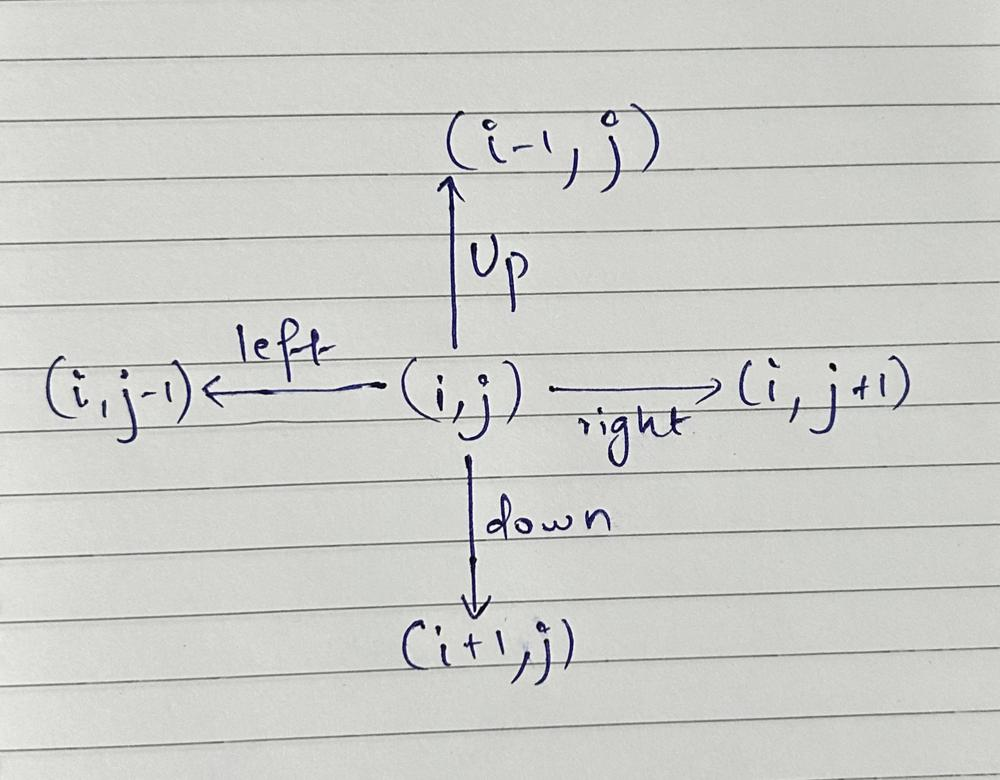

# Brute Force

**Author:** fahad_Mubeen
**Votes:** 13
**Link:** [https://leetcode.com/problems/snake-in-matrix/solutions/5619418/](https://leetcode.com/problems/snake-in-matrix/solutions/5619418/)

---

<!-- # Intuition -->
<!-- Describe your first thoughts on how to solve this problem. -->

# Approach
Follow the commands and update the coordinates accordingly starting $$from$$ (0, 0).

{:style='width:400px'}

# Complexity
- Time complexity: $$O(n)$$
<!-- Add your time complexity here, e.g. $$O(n)$$ -->

- Space complexity: $$O(1)$$
<!-- Add your space complexity here, e.g. $$O(n)$$ -->

# Code
```C++ []
class Solution {
public:
    int finalPositionOfSnake(int girdSize, vector<string>& commands) {
        int x = 0, y = 0, n = commands.size();
        for(int i = 0; i < n; i++){
            string s = commands[i];
            if(s == "UP"){
                x--;
            }
            else if(s == "DOWN"){
                x++;
            }
            else if(s == "RIGHT"){
                y++;
            }
            else{
                y--;
            }
        }
        return (x * girdSize) + y;
    }
};
```
```Java []
class Solution {
    public int finalPositionOfSnake(int gridSize, List<String> commands) {
        int x = 0, y = 0, n = commands.size();
        
        for (int i = 0; i < n; i++) {
            String command = commands.get(i);
            if (command.equals("UP")) {
                x--;
            } else if (command.equals("DOWN")) {
                x++;
            } else if (command.equals("RIGHT")) {
                y++;
            } else if (command.equals("LEFT")) {
                y--;
            }
        }
        
        return (x * gridSize) + y;
    }
}

```
```Python3 []
class Solution:
    def finalPositionOfSnake(self, gridSize: int, commands: List[str]) -> int:
        x, y = 0, 0
        for command in commands:
            if command == "UP":
                x -= 1
            elif command == "DOWN":
                x += 1
            elif command == "RIGHT":
                y += 1
            elif command == "LEFT":
                y -= 1
        
        return (x * gridSize) + y

```
