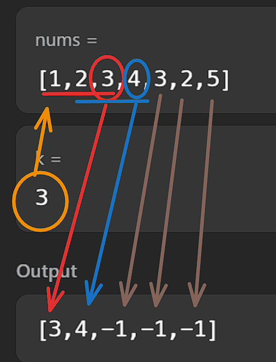
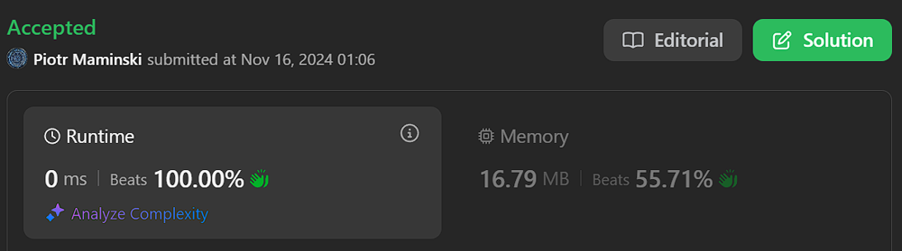
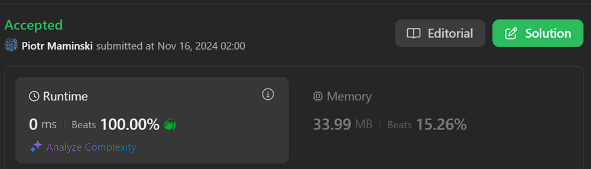

# ✅Beats 100% | Video, simple to understand | Explained Step by Step | 3 approaches

**Author:** Piotr_Maminski
**Votes:** 70
**Link:** [https://leetcode.com/problems/find-the-power-of-k-size-subarrays-i/solutions/6049232/](https://leetcode.com/problems/find-the-power-of-k-size-subarrays-i/solutions/6049232/)

---

https://youtu.be/67QUp_zOIFg?si=7hKuVK1pPGODvZQM


# #1 Sliding Window (from video, simplest, Beats 60-100%)

```python3 []
class Solution:
    def resultsArray(self, nums: List[int], k: int) -> List[int]:
        res = []
        l = 0
        consec_cnt = 1
        for r in range(len(nums)):
            if r > 0 and nums[r - 1] + 1 == nums[r]:
                consec_cnt += 1

            if r - l + 1 > k:
                if nums[l] + 1 == nums[l + 1]:
                    consec_cnt -= 1
                l += 1

            if r - l + 1 == k:
                res.append(nums[r] if consec_cnt == k else -1)
        return res
```
```cpp []
class Solution {
public:
    vector<int> resultsArray(vector<int>& nums, int k) {
        vector<int> res;
        int l = 0;
        int consec_cnt = 1;
        
        for (int r = 0; r < nums.size(); r++) {
            if (r > 0 && nums[r - 1] + 1 == nums[r]) {
                consec_cnt++;
            }
            
            if (r - l + 1 > k) {
                if (nums[l] + 1 == nums[l + 1]) {
                    consec_cnt--;
                }
                l++;
            }
            
            if (r - l + 1 == k) {
                res.push_back(consec_cnt == k ? nums[r] : -1);
            }
        }
        
        return res;
    }
};
```
```java []
class Solution {
    public int[] resultsArray(int[] nums, int k) {
            if (nums == null || nums.length < k) {
            return new int[0];
        }

        int arr[]=new int[nums.length-k+1];
        int i=0;
        int j=k-1;
        int a=0;
        while(j<nums.length){
            if(solved(nums,i,j)){
                arr[a]=nums[j];
            }
            else{
                arr[a]=-1;
            }
            i++;
            j++;
            a++;
        }
        return arr;
        
    }

    private boolean solved(int nums[],int start,int end){
        for(int i=start;i<end;i++){
            if(nums[i]+1!=nums[i+1]){
                return false;
            }
        }
        return true;
    }
}
```
```csharp []
public class Solution {
    public int[] ResultsArray(int[] nums, int k) {
        var res = new List<int>();
        int l = 0;
        int consecCnt = 1;
        
        for (int r = 0; r < nums.Length; r++) {
            if (r > 0 && nums[r - 1] + 1 == nums[r]) {
                consecCnt++;
            }
            
            if (r - l + 1 > k) {
                if (nums[l] + 1 == nums[l + 1]) {
                    consecCnt--;
                }
                l++;
            }
            
            if (r - l + 1 == k) {
                res.Add(consecCnt == k ? nums[r] : -1);
            }
        }
        
        return res.ToArray(); 
    }
}
```
```golang []
func resultsArray(nums []int, k int) []int {
    res := make([]int, 0)
    l := 0
    consecCnt := 1
    
    for r := 0; r < len(nums); r++ {
        if r > 0 && nums[r-1]+1 == nums[r] {
            consecCnt++
        }
        
        if r-l+1 > k {
            if nums[l]+1 == nums[l+1] {
                consecCnt--
            }
            l++
        }
        
        if r-l+1 == k {
            if consecCnt == k {
                res = append(res, nums[r])
            } else {
                res = append(res, -1)
            }
        }
    }
    
    return res
}
```
```swift []
class Solution {
    func resultsArray(_ nums: [Int], _ k: Int) -> [Int] {
        var res: [Int] = []
        var l = 0
        var consecCnt = 1
        
        for r in 0..<nums.count {
            if r > 0 && nums[r-1] + 1 == nums[r] {
                consecCnt += 1
            }
            
            if r - l + 1 > k {
                if nums[l] + 1 == nums[l + 1] {
                    consecCnt -= 1
                }
                l += 1
            }
            
            if r - l + 1 == k {
                res.append(consecCnt == k ? nums[r] : -1)
            }
        }
        
        return res
    }
}
```
```javascript [JS]
// JavaScript

var resultsArray = function(nums, k) {
    const res = [];
    let l = 0;
    let consecCnt = 1;
    
    for (let r = 0; r < nums.length; r++) {
        if (r > 0 && nums[r-1] + 1 === nums[r]) {
            consecCnt++;
        }
        
        if (r - l + 1 > k) {
            if (nums[l] + 1 === nums[l + 1]) {
                consecCnt--;
            }
            l++;
        }
        
        if (r - l + 1 === k) {
            res.push(consecCnt === k ? nums[r] : -1);
        }
    }
    
    return res;
};
```
```typescript [TS]
// TypeScript

function resultsArray(nums: number[], k: number): number[] {
    const res: number[] = [];
    let l: number = 0;
    let consecCnt: number = 1;
    
    for (let r = 0; r < nums.length; r++) {
        if (r > 0 && nums[r-1] + 1 === nums[r]) {
            consecCnt++;
        }
        
        if (r - l + 1 > k) {
            if (nums[l] + 1 === nums[l + 1]) {
                consecCnt--;
            }
            l++;
        }
        
        if (r - l + 1 === k) {
            res.push(consecCnt === k ? nums[r] : -1);
        }
    }
    
    return res;
}
```
```rust []
impl Solution {
    pub fn results_array(nums: Vec<i32>, k: i32) -> Vec<i32> {
        let mut res = Vec::new();
        let mut l = 0;
        let mut consec_cnt = 1;
        let k = k as usize;
        
        for r in 0..nums.len() {
            if r > 0 && nums[r-1] + 1 == nums[r] {
                consec_cnt += 1;
            }
            
            if r - l + 1 > k {
                if nums[l] + 1 == nums[l + 1] {
                    consec_cnt -= 1;
                }
                l += 1;
            }
            
            if r - l + 1 == k {
                res.push(if consec_cnt == k { nums[r] } else { -1 });
            }
        }
        
        res
    }
}
```
```ruby []
def results_array(nums, k)
    res = []
    l = 0
    consec_cnt = 1
    
    (0...nums.length).each do |r|
        if r > 0 && nums[r-1] + 1 == nums[r]
            consec_cnt += 1
        end
        
        if r - l + 1 > k
            if nums[l] + 1 == nums[l + 1]
                consec_cnt -= 1
            end
            l += 1
        end
        
        if r - l + 1 == k
            res.push(consec_cnt == k ? nums[r] : -1)
        end
    end
    
    res
end
```
- Complexy: Time O(n) & Space O(n)


# #2 Two Pointers + Sliding Window (almost all beats 100%)


```python3 []
from typing import List

class Solution:
    def resultsArray(self, nums: List[int], k: int) -> List[int]:
        """Find the Power of K-Size Subarrays"""
        # Skip if k is 1
        if k == 1:
            return nums
            
        n = len(nums)
        result = []
        left = 0
        right = 1
        
        while right < n:
            # Check if current sequence is not consecutive
            is_not_consecutive = nums[right] - nums[right-1] != 1
            
            if is_not_consecutive:
                # Mark invalid sequences
                while left < right and left + k - 1 < n:
                    result.append(-1)
                    left += 1
                left = right
            # Found valid k-length sequence
            elif right - left == k - 1:
                result.append(nums[right])
                left += 1
                
            right += 1
            
        return result
```
```cpp []
class Solution {
public:
    std::vector<int> resultsArray(std::vector<int>& nums, int k) {
        // Skip if k is 1
        if (k == 1) {
            return nums;
        }
        
        int n = nums.size();
        std::vector<int> result;
        int left = 0;
        int right = 1;
        
        while (right < n) {
            // Check if current sequence is not consecutive
            bool is_not_consecutive = nums[right] - nums[right-1] != 1;
            
            if (is_not_consecutive) {
                // Mark invalid sequences
                while (left < right && left + k - 1 < n) {
                    result.push_back(-1);
                    left++;
                }
                left = right;
            }
            // Found valid k-length sequence
            else if (right - left == k - 1) {
                result.push_back(nums[right]);
                left++;
            }
            
            right++;
        }
        
        return result;
    }
};
```
```java []
class Solution {
    /**
     * Find the Power of K-Size Subarrays 
     */
    public int[] resultsArray(int[] nums, int k) {
        // Skip if k is 1
        if (k == 1) {
            return nums;
        }
        
        int n = nums.length;
        List<Integer> resultList = new ArrayList<>();
        int left = 0;
        int right = 1;
        
        while (right < n) {
            // Check if current sequence is not consecutive
            boolean isNotConsecutive = nums[right] - nums[right-1] != 1;
            
            if (isNotConsecutive) {
                // Mark invalid sequences
                while (left < right && left + k - 1 < n) {
                    resultList.add(-1);
                    left++;
                }
                left = right;
            }
            // Found valid k-length sequence
            else if (right - left == k - 1) {
                resultList.add(nums[right]);
                left++;
            }
            
            right++;
        }
        
        // Convert ArrayList to int array
        int[] result = new int[resultList.size()];
        for (int i = 0; i < resultList.size(); i++) {
            result[i] = resultList.get(i);
        }
        return result;
    }
}
```
```csharp []
public class Solution {
    public int[] ResultsArray(int[] nums, int k) {
        if (k == 1) {
            return nums;
        }
        
        int n = nums.Length;
        List<int> result = new List<int>();
        int left = 0;
        int right = 1;
        
        while (right < n) {
            bool isNotConsecutive = nums[right] - nums[right-1] != 1;
            
            if (isNotConsecutive) {
                while (left < right && left + k - 1 < n) {
                    result.Add(-1);
                    left++;
                }
                left = right;
            }
            else if (right - left == k - 1) {
                result.Add(nums[right]);
                left++;
            }
            
            right++;
        }
        
        return result.ToArray();
    }
}
```
```golang []
func resultsArray(nums []int, k int) []int {
    if k == 1 {
        return nums
    }
    
    n := len(nums)
    result := make([]int, 0)
    left := 0
    right := 1
    
    for right < n {
        isNotConsecutive := nums[right] - nums[right-1] != 1
        
        if isNotConsecutive {
            for left < right && left + k - 1 < n {
                result = append(result, -1)
                left++
            }
            left = right
        } else if right - left == k - 1 {
            result = append(result, nums[right])
            left++
        }
        
        right++
    }
    
    return result
}

```
```swift []
class Solution {
    func resultsArray(_ nums: [Int], _ k: Int) -> [Int] {
        if k == 1 {
            return nums
        }
        
        let n = nums.count
        var result: [Int] = []
        var left = 0
        var right = 1
        
        while right < n {
            let isNotConsecutive = nums[right] - nums[right-1] != 1
            
            if isNotConsecutive {
                while left < right && left + k - 1 < n {
                    result.append(-1)
                    left += 1
                }
                left = right
            }
            else if right - left == k - 1 {
                result.append(nums[right])
                left += 1
            }
            
            right += 1
        }
        
        return result
    }
}

```
```javascript [JS]
// JavaScript

var resultsArray = function(nums, k) {
    // Skip if k is 1
    if (k === 1) return nums;
    
    const n = nums.length;
    const result = [];
    let left = 0;
    let right = 1;
    
    while (right < n) {
        // Check if current sequence is not consecutive
        const isNotConsecutive = nums[right] - nums[right-1] !== 1;
        
        if (isNotConsecutive) {
            // Mark invalid sequences
            while (left < right && left + k - 1 < n) {
                result.push(-1);
                left++;
            }
            left = right;
        }
        // Found valid k-length sequence
        else if (right - left === k - 1) {
            result.push(nums[right]);
            left++;
        }
        
        right++;
    }
    
    return result;
};
```
```typescript [TS]
// TypeScript

function resultsArray(nums: number[], k: number): number[] {
    if (k === 1) {
        return nums;
    }
    
    const n: number = nums.length;
    const result: number[] = [];
    let left: number = 0;
    let right: number = 1;
    
    while (right < n) {
        const isNotConsecutive: boolean = nums[right] - nums[right-1] !== 1;
        
        if (isNotConsecutive) {
            while (left < right && left + k - 1 < n) {
                result.push(-1);
                left++;
            }
            left = right;
        }
        else if (right - left === k - 1) {
            result.push(nums[right]);
            left++;
        }
        
        right++;
    }
    
    return result;
}

```
```rust []
impl Solution {
    pub fn results_array(nums: Vec<i32>, k: i32) -> Vec<i32> {
        if k == 1 {
            return nums;
        }
        
        let n = nums.len();
        let mut result = Vec::new();
        let mut left = 0;
        let mut right = 1;
        
        while right < n {
            let is_not_consecutive = nums[right] - nums[right-1] != 1;
            
            if is_not_consecutive {
                while left < right && left + k as usize - 1 < n {
                    result.push(-1);
                    left += 1;
                }
                left = right;
            }
            else if right - left == k as usize - 1 {
                result.push(nums[right]);
                left += 1;
            }
            
            right += 1;
        }
        
        result
    }
}

```
```ruby []
def results_array(nums, k)
    # Skip if k is 1
    return nums if k == 1
    
    n = nums.length
    result = []
    left = 0
    right = 1
    
    while right < n
        # Check if current sequence is not consecutive
        is_not_consecutive = nums[right] - nums[right-1] != 1
        
        if is_not_consecutive
            # Mark invalid sequences
            while left < right && left + k - 1 < n
                result.push(-1)
                left += 1
            end
            left = right
        # Found valid k-length sequence
        elsif right - left == k - 1
            result.push(nums[right])
            left += 1
        end
        
        right += 1
    end
    
    result
end
```
- Complexy: Time O(n) & Space O(n)


# #3 Monotonic Queue + Sliding Window


```python3 []
class Solution:
    def resultsArray(self, nums: List[int], k: int) -> List[int]:
        if k == 1:
            return nums
            
        n = len(nums)
        result = []
        window = deque()
        
        for i in range(n):
            # Remove elements outside window
            while window and i - window[0] >= k:
                window.popleft()
                
            # Check consecutive sequence
            if not window or nums[i] - nums[i-1] == 1:
                window.append(i)
            else:
                window.clear()
                window.append(i)
                
            # Add result when window size is k
            if i >= k-1:
                result.append(nums[i] if len(window) == k else -1)
                
        return result

```
```cpp []
class Solution {
public:
    vector<int> resultsArray(vector<int>& nums, int k) {
        if (k == 1) {
            return nums;
        }
        
        int n = nums.size();
        vector<int> result;
        deque<int> window;
        
        for (int i = 0; i < n; i++) {
            // Remove elements outside window
            while (!window.empty() && i - window.front() >= k) {
                window.pop_front();
            }
            
            // Check consecutive sequence
            if (window.empty() || nums[i] - nums[i-1] == 1) {
                window.push_back(i);
            } else {
                window.clear();
                window.push_back(i);
            }
            
            // Add result when window size is k
            if (i >= k-1) {
                result.push_back(window.size() == k ? nums[i] : -1);
            }
        }
        
        return result;
    }
};
```
```java []
class Solution {
    public int[] resultsArray(int[] nums, int k) {
        if (k == 1) {
            return nums.clone();
        }
        
        int n = nums.length;
        List<Integer> result = new ArrayList<>();
        Deque<Integer> window = new ArrayDeque<>();
        
        for (int i = 0; i < n; i++) {
            // Remove elements outside window
            while (!window.isEmpty() && i - window.peekFirst() >= k) {
                window.pollFirst();
            }
            
            // Check consecutive sequence
            if (window.isEmpty() || nums[i] - nums[i-1] == 1) {
                window.offerLast(i);
            } else {
                window.clear();
                window.offerLast(i);
            }
            
            // Add result when window size is k
            if (i >= k-1) {
                result.add(window.size() == k ? nums[i] : -1);
            }
        }
        
        return result.stream().mapToInt(Integer::intValue).toArray();
    }
}
```
```csharp []
public class Solution {
    public int[] ResultsArray(int[] nums, int k) {
        if (k == 1) return nums;
        
        int n = nums.Length;
        var result = new List<int>();
        var window = new Queue<int>();
        
        for (int i = 0; i < n; i++) {
            while (window.Count > 0 && i - window.Peek() >= k) {
                window.Dequeue();
            }
            
            if (window.Count == 0 || nums[i] - nums[i-1] == 1) {
                window.Enqueue(i);
            } else {
                window.Clear();
                window.Enqueue(i);
            }
            
            if (i >= k-1) {
                result.Add(window.Count == k ? nums[i] : -1);
            }
        }
        
        return result.ToArray();
    }
}
```
```golang []
func resultsArray(nums []int, k int) []int {
    if k == 1 {
        return nums
    }
    
    n := len(nums)
    result := make([]int, 0)
    window := make([]int, 0)
    
    for i := 0; i < n; i++ {
        for len(window) > 0 && i-window[0] >= k {
            window = window[1:]
        }
        
        if len(window) == 0 || nums[i]-nums[i-1] == 1 {
            window = append(window, i)
        } else {
            window = []int{i}
        }
        
        if i >= k-1 {
            if len(window) == k {
                result = append(result, nums[i])
            } else {
                result = append(result, -1)
            }
        }
    }
    
    return result
}
```
```swift []
class Solution {
    func resultsArray(_ nums: [Int], _ k: Int) -> [Int] {
        if k == 1 { return nums }
        
        let n = nums.count
        var result: [Int] = []
        var window: [Int] = []
        
        for i in 0..<n {
            while !window.isEmpty && i - window[0] >= k {
                window.removeFirst()
            }
            
            if window.isEmpty || nums[i] - nums[i-1] == 1 {
                window.append(i)
            } else {
                window.removeAll()
                window.append(i)
            }
            
            if i >= k-1 {
                result.append(window.count == k ? nums[i] : -1)
            }
        }
        
        return result
    }
}
```
```javascript [JS]
// JavaScript

var resultsArray = function(nums, k) {
    if (k === 1) return nums;
    
    const n = nums.length;
    const result = [];
    const window = [];
    
    for (let i = 0; i < n; i++) {
        while (window.length && i - window[0] >= k) {
            window.shift();
        }
        
        if (!window.length || nums[i] - nums[i-1] === 1) {
            window.push(i);
        } else {
            window.length = 0;
            window.push(i);
        }
        
        if (i >= k-1) {
            result.push(window.length === k ? nums[i] : -1);
        }
    }
    
    return result;
};
```
```typescript [TS]
// TypeScript

function resultsArray(nums: number[], k: number): number[] {
    if (k === 1) return nums;
    
    const n: number = nums.length;
    const result: number[] = [];
    const window: number[] = [];
    
    for (let i = 0; i < n; i++) {
        while (window.length && i - window[0] >= k) {
            window.shift();
        }
        
        if (!window.length || nums[i] - nums[i-1] === 1) {
            window.push(i);
        } else {
            window.length = 0;
            window.push(i);
        }
        
        if (i >= k-1) {
            result.push(window.length === k ? nums[i] : -1);
        }
    }
    
    return result;
}


```
```rust []
use std::collections::VecDeque;

impl Solution {
    pub fn results_array(nums: Vec<i32>, k: i32) -> Vec<i32> {
        if k == 1 { return nums; }
        
        let n = nums.len();
        let k = k as usize;
        let mut result = Vec::new();
        let mut window = VecDeque::new();
        
        for i in 0..n {
            while !window.is_empty() && i - window[0] >= k {
                window.pop_front();
            }
            
            if window.is_empty() || nums[i] - nums[i-1] == 1 {
                window.push_back(i);
            } else {
                window.clear();
                window.push_back(i);
            }
            
            if i >= k-1 {
                result.push(if window.len() == k { nums[i] } else { -1 });
            }
        }
        
        result
    }
}
```
```ruby []
def results_array(nums, k)
    return nums if k == 1
    
    n = nums.length
    result = []
    window = []
    
    (0...n).each do |i|
        while !window.empty? && i - window[0] >= k
            window.shift
        end
        
        if window.empty? || nums[i] - nums[i-1] == 1
            window.push(i)
        else
            window.clear
            window.push(i)
        end
        
        if i >= k-1
            result.push(window.length == k ? nums[i] : -1)
        end
    end
    
    result
end
```
- Complexy: Time O(n) & Space O(k)

# Bonus: #4 Short Bruteforce 


```python3 []
class Solution:
    def resultsArray(s, n: List[int], k: int) -> List[int]:
        return [n[i+k-1] if all(n[j+1] == n[j]+1 for j in range(i,i+k-1)) else -1 
                for i in range(len(n)-k+1)]
```

- Complexy: Time O(n*k) & Space O(n-k+1)

# Explanation
---

# Intuition

Problem asks us to look at all possible subarrays of size k in the input array and find their "power":

1. A subarray has "power" equal to its maximum element **IF**:

    - All numbers in it are **consecutive** (like 1,2,3 or 4,5,6)
    - They're in ascending order
2. If the numbers aren't consecutive or not in order, the power is -1

- If nums = [1,2,3,4] and k = 3
- We look at subarrays: [1,2,3] and [2,3,4]
- Both are consecutive and sorted
- So powers are [3,4] (**maximum of each subarray, result would include the last number of each valid sequence**)




## #2 Aproach: Two Pointers + Sliding Window


1. Initialize result array, `left=0`, `right=1` pointers for sliding window

2. Skip **if** `k=1`, **return** original array since all elements are valid

3. For the sliding window:

    - Check if current sequence breaks consecutiveness `(nums[right] - nums[right-1] != 1)`
    - If broken:
        - Fill **-1** for all invalid sequences in current window
        - Move left pointer to right to start fresh
    - If consecutive and window size reaches **k-1**:
        - Add **nums[right]** to result (last element of valid sequence)
        - Slide window by moving left pointer

Continue until right reaches end of array


Done. 

Upvote is just one click for U >__<

```java [PSEUDOCODE]
Algorithm FindPowerOfKSizeSubarrays(nums, k)
    // Input: nums - array of integers, k - size of subarrays
    // Output: array of results

    if k equals 1 then
        return nums
    endif

    n = length of nums
    result = empty array
    left = 0
    right = 1

    while right < n do
        // Check if sequence is not consecutive
        isNotConsecutive = (nums[right] - nums[right-1] \u2260 1)

        if isNotConsecutive then
            // Handle invalid sequences
            while left < right AND left + k - 1 < n do
                append -1 to result
                left = left + 1
            endwhile
            left = right
        else if right - left equals k - 1 then
            // Found valid k-length sequence
            append nums[right] to result
            left = left + 1
        endif

        right = right + 1
    endwhile

    return result
End Algorithm
```

---


# Most common Array Interview Problems
List based on my research (interviews, reddit, github) Probably not 100% accurate but very close to my recruitments. Leetcode Premium is probably more accurate [I don't have]


**Easy:** [[1. Two Sum]](https://leetcode.com/problems/two-sum/solutions/5999466/beats-100-explained-step-by-step-list-most-common-array-inverview) **(common warm-up)** [[121. Best Time to Buy and Sell Stock]](https://leetcode.com/discuss/topic/6027720/solution/) [[88. Merge Sorted Array]](https://leetcode.com/problems/merge-sorted-array/solutions/6031394/beats-100-explained-step-by-step-list-most-common-string-interview-problems) [[27. Remove Element]](https://leetcode.com/problems/remove-element/solutions/6031528/beats-100-explained-step-by-step-list-most-common-array-interview-problems) [[929. Unique Email Addresses]](https://leetcode.com/problems/unique-email-addresses/solutions/6031687/explained-step-by-step-video-list-most-common-array-interview-problems) 


**Medium/Hard:** [[15. 3Sum]](https://leetcode.com/problems/3sum?envType=problem-list-v2&envId=atbyk0mj) [[42. Trapping Rain Water]](https://leetcode.com/problems/trapping-rain-water?envType=problem-list-v2&envId=atbyk0mj) [[56. Merge Intervals]](https://leetcode.com/problems/merge-intervals?envType=problem-list-v2&envId=atbyk0mj) [[57. Insert Interval]](https://leetcode.com/problems/insert-interval?envType=problem-list-v2&envId=atbyk0mj) [[46. Permutations]](https://leetcode.com/problems/permutations?envType=problem-list-v2&envId=atbyk0mj) [[53. Maximum Subarray]](https://leetcode.com/problems/maximum-subarray?envType=problem-list-v2&envId=atbyk0mj) [[73. Set Matrix Zeroes]](https://leetcode.com/problems/set-matrix-zeroes?envType=problem-list-v2&envId=atbyk0mj) [[284. Peeking Iterator]](https://leetcode.com/problems/peeking-iterator?envType=problem-list-v2&envId=atbyk0mj)

####  [Interview Questions and Answers Repository](https://github.com/RooTinfinite/Interview-questions-and-answers)





