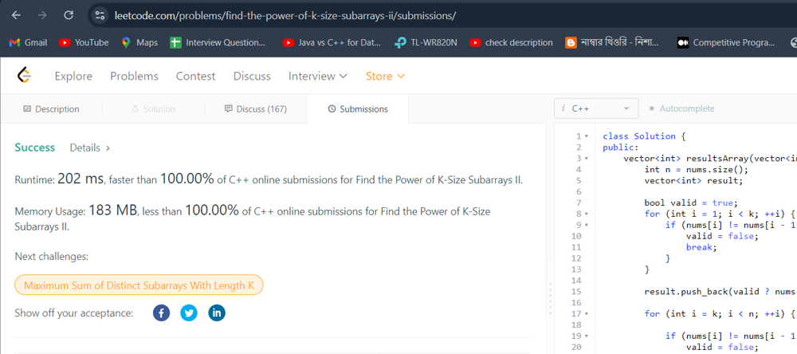

# Friendly Code &  ✅Simple Solution beat 100%✅ both space & time ✅

**Author:** Durjoybarua5327
**Votes:** 7
**Link:** [https://leetcode.com/problems/find-the-power-of-k-size-subarrays-ii/solutions/5651786/](https://leetcode.com/problems/find-the-power-of-k-size-subarrays-ii/solutions/5651786/)

---




# Python
```

class Solution:
    def resultsArray(self, nums: List[int], k: int) -> List[int]:
        n = len(nums)
        result = []
        
        valid = True
        for i in range(1, k):
            if nums[i] != nums[i - 1] + 1:
                valid = False
                break
        
        result.append(nums[k - 1] if valid else -1)
        
        for i in range(k, n):

            if nums[i] != nums[i - 1] + 1:
                valid = False

            if nums[i - k + 1] != nums[i - k] + 1:
                valid = True
                for j in range(i - k + 2, i + 1):
                    if nums[j] != nums[j - 1] + 1:
                        valid = False
                        break

            result.append(nums[i] if valid else -1)
        
        return result

```

# C++
```
class Solution {
public:
    vector<int> resultsArray(vector<int>& nums, int k) {
        int n = nums.size();
        vector<int> result;

        bool valid = true;
        for (int i = 1; i < k; ++i) {
            if (nums[i] != nums[i - 1] + 1) {
                valid = false;
                break;
            }
        }

        result.push_back(valid ? nums[k - 1] : -1);

        for (int i = k; i < n; ++i) {

            if (nums[i] != nums[i - 1] + 1) {
                valid = false;
            }

            if (nums[i - k + 1] != nums[i - k] + 1) {
                valid = true;
                for (int j = i - k + 2; j <= i; ++j) {
                    if (nums[j] != nums[j - 1] + 1) {
                        valid = false;
                        break;
                    }
                }
            }

            result.push_back(valid ? nums[i] : -1);
        }

        return result;
    }
};
```