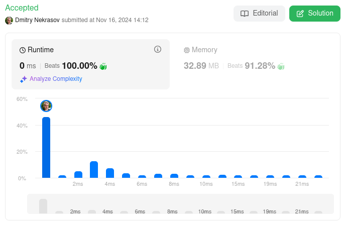

# [ C++ | Java | Kotlin ] Simple O(n) time solution, detailed explanation, 0ms, beats 100% 🚀

**Author:** DmitryNekrasov
**Votes:** 0
**Link:** [https://leetcode.com/problems/find-the-power-of-k-size-subarrays-ii/solutions/6050832/](https://leetcode.com/problems/find-the-power-of-k-size-subarrays-ii/solutions/6050832/)

---

# Intuition
The key insight is that we need to:
1. Check if a subarray of size k has consecutive elements (like [1,2,3] or [4,5,6])
2. If they are consecutive, take the maximum (which will be the last element)
3. If they're not consecutive, return -1

The smart part of the solution is that we don't need to check every element in each subarray. If we know elements are not consecutive somewhere, we can use that information.

# Approach
1. We use a sliding window of size k, but with a twist:
   * We keep track of where the last "break" in consecutiveness happened using `start`
   * If current number isn't consecutive with previous (nums[i] - nums[i-1] != 1), we update `start`

2. For each position i:
   * If nums[i] isn't consecutive with nums[i-1], we mark this as a new starting point
   * This means everything before this point can't be part of a valid consecutive sequence

3. Key optimization:
   * Instead of checking all k elements each time, we just need to know:
   * Is the distance from our last break point (start) to current position (i) at least k-1?
   * If yes, we have k consecutive numbers, so take nums[i]
   * If no, this window contains a break, so it should be -1

4. The result array is built position by position:
   * For each valid window, we put nums[i] (the maximum, since it's ascending)
   * All other positions were initialized as -1

Example:
```
nums = [1,2,3,4,6,7,8], k = 3

i=0: start=0 (beginning)
i=1: still consecutive
i=2: still consecutive, first window [1,2,3] -> power=3
i=3: still consecutive, window [2,3,4] -> power=4
i=4: not consecutive (4->6), start=4
i=5: consecutive after 6
i=6: consecutive, window [6,7,8] -> power=8
```

# Complexity
This solution is efficient with $$O(n)$$ time complexity as we only scan the array once and make constant-time decisions at each step.

# Code
```cpp []
class Solution {
public:
    vector<int> resultsArray(vector<int>& nums, int k) {
        int start = 0;
        int n = nums.size();
        vector<int> ans(n - k + 1, -1);
        for (int i = 0; i < n; i++) {
            if (i != 0 && nums[i] - nums[i - 1] != 1) {
                start = i;
            }
            if (i - start >= k - 1) {
                ans[i - k + 1] = nums[i];
            }
        }
        return ans;
    }
};
```
```java []
class Solution {
    public int[] resultsArray(int[] nums, int k) {
        int start = 0;
        int n = nums.length;
        int[] ans = new int[n - k + 1];
        Arrays.fill(ans, -1);
        for (int i = 0; i < n; i++) {
            if (i != 0 && nums[i] - nums[i - 1] != 1) {
                start = i;
            }
            if (i - start >= k - 1) {
                ans[i - k + 1] = nums[i];
            }
        }
        return ans;
    }
}
```
```kotlin []
class Solution {
    fun resultsArray(nums: IntArray, k: Int): IntArray {
        var start = 0
        val n = nums.size
        val ans = IntArray(n - k + 1) { -1 }
        for (i in 0..<n) {
            if (i != 0 && nums[i] - nums[i - 1] != 1) {
                start = i
            }
            if (i - start >= k - 1) {
                ans[i - k + 1] = nums[i]
            }
        }
        return ans
    }
}
```

