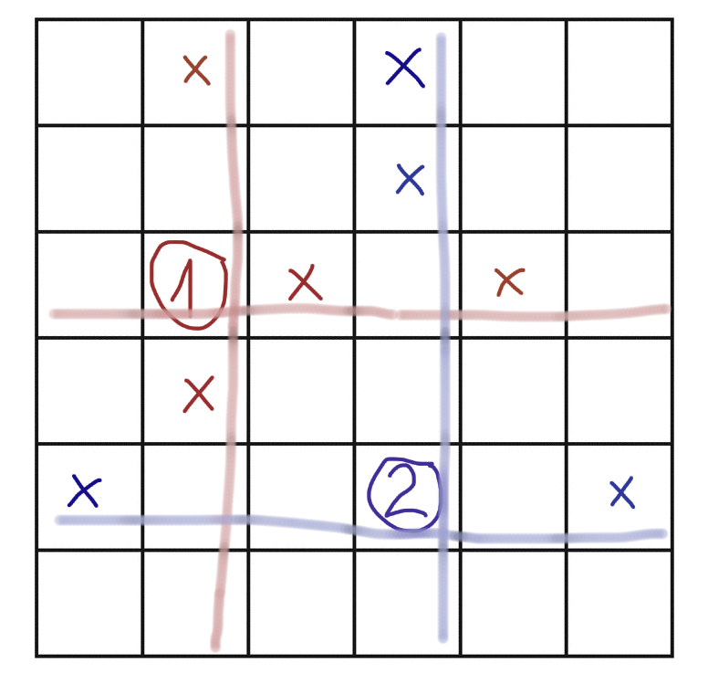

# Python || O(N*M) fully explained 🔥

**Author:** stomachion
**Votes:** 6
**Link:** [https://leetcode.com/problems/maximum-value-sum-by-placing-three-rooks-i/solutions/5658502/](https://leetcode.com/problems/maximum-value-sum-by-placing-three-rooks-i/solutions/5658502/)

---

[Same as [problem 3257](https://leetcode.com/problems/maximum-value-sum-by-placing-three-rooks-ii/solutions/5658475/python-onm-fully-explained)]

# Intuition
Select only from the relevant highest values. Placing a rook blocks the entire row and colum. By the time we place the third rook we must have the highest remaining value available, even if the highest two values in the row/colum may have been blocked. 

# Approach + Proof/Explanation

**1. We only care about the top 3 values in each row/column.**
After choosing 2 rooks, two values in each row/column are blocked. If we were to pick another value here, we would pick the highest remaining, which is part of the top 3.

*Note: It's okay to pick any cells in case of ties.* E.g. on a row with 7, 5, 5, 5, 5, so we pick 7 and 2 of the fives. By placing rooks we will block at most 2 values, so we will still have the highest remaining value (here if we block the 7 we pick any remaining five, if 7 is not blocked will pick it).

**2. We only care about values that are in the top 3 in both their row and column.**
As shown in part 1, if a value is out of the top 3, we will choose something else. So, to be relevant, the values should be in the top 3 in both the row and column.

**3. Why are 11 best values enough?**
In each row/column, we now have \u22643 (at most) useful values.
We choose the first rook: 1 value + blocks \u22642 same row and \u22642 same column values.
We choose the second rook: 1 value + blocks \u22642 extra same row value and \u22642 extra same column value.
So we choose 2 and can't use \u22648, so we pick the remaining best, which must be in the top 11.

Diagram for worst case scenario, 11 values needed:


Out of the 11 values we check all triplets without overlaps, or $$\\binom{3}{11}$$ cases.

# Complexity
- Time complexity:
$$O(N*M)$$

- Space complexity:
$$O(N+M)$$

# Code
```
class Solution:
    def maximumValueSum(self, board: List[List[int]]) -> int:
        m = len(board)
        n = len(board[0])
        rows = []
        for i in range(m):
            rows += nlargest(3, [(board[i][j], i, j) for j in range(n)])
        cols = []
        for j in range(n):
            cols += nlargest(3, [(board[i][j], i, j) for i in range(m)])
        vals = nlargest(11, set(rows) & set(cols))
        res = float("-inf")
        for x, y, z in combinations(vals, 3):
            if len({x[1], y[1], z[1]}) == 3 and len({x[2], y[2], z[2]}) == 3:
                res = max(res, x[0] + y[0] + z[0])
        return res
```

You can implement you own version for `heapq.nlargest()` using a min heap kept at the desired fixed size:

```
    def nlargest(k, arr):
        pq = []
        for v in arr:
            if len(pq) == k and v[0] > pq[0][0]:
                heapq.heappop(pq)
            if len(pq) < k:
                heapq.heappush(pq, v)
        return pq
```

To avoid the [`itertools.combinations`](https://docs.python.org/3/library/itertools.html#itertools.combinations), you can use 3 nested loops:

```
    for ix, x in enumerate(vals):
        for iy, y in enumerate(vals):
            if iy == ix:
                continue
            for iz, z in enumerate(vals):
                if iz == ix or iz == iy:
                    continue
                if len({x[1], y[1], z[1]}) == 3 and len({x[2], y[2], z[2]}) == 3:
                    res = max(res, x[0] + y[0] + z[0])
```
