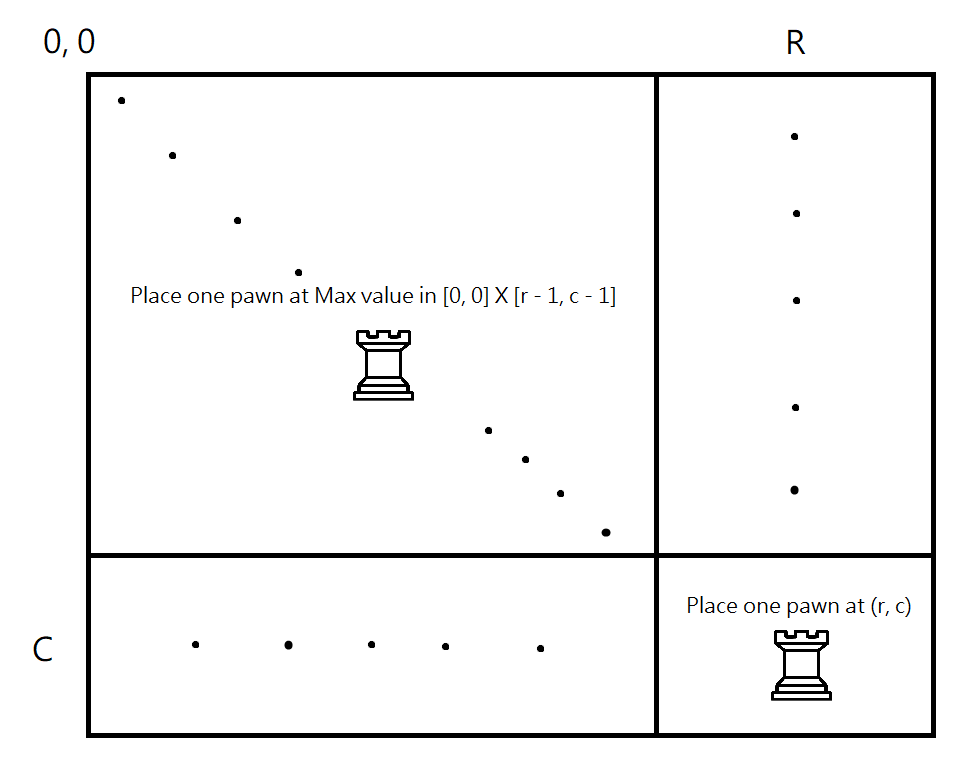
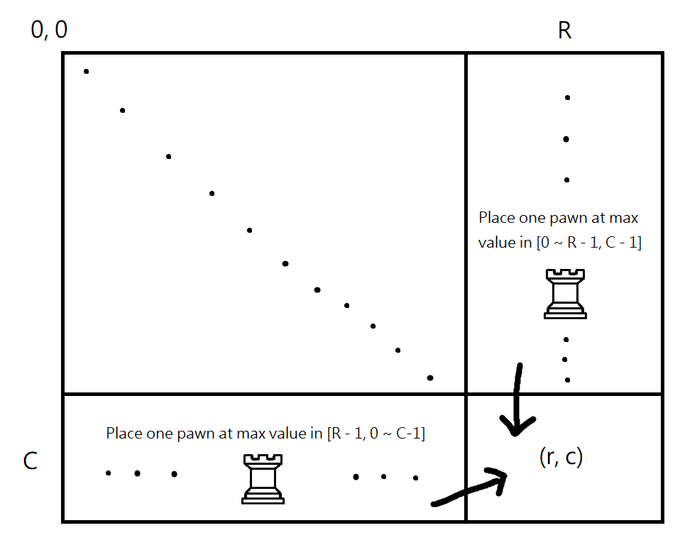
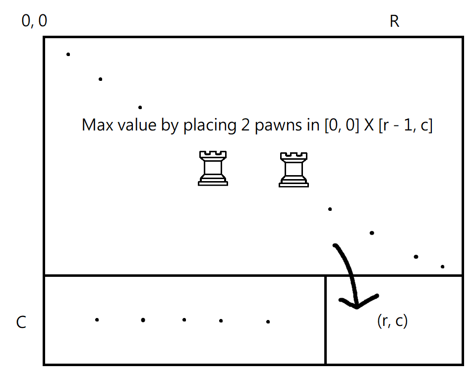
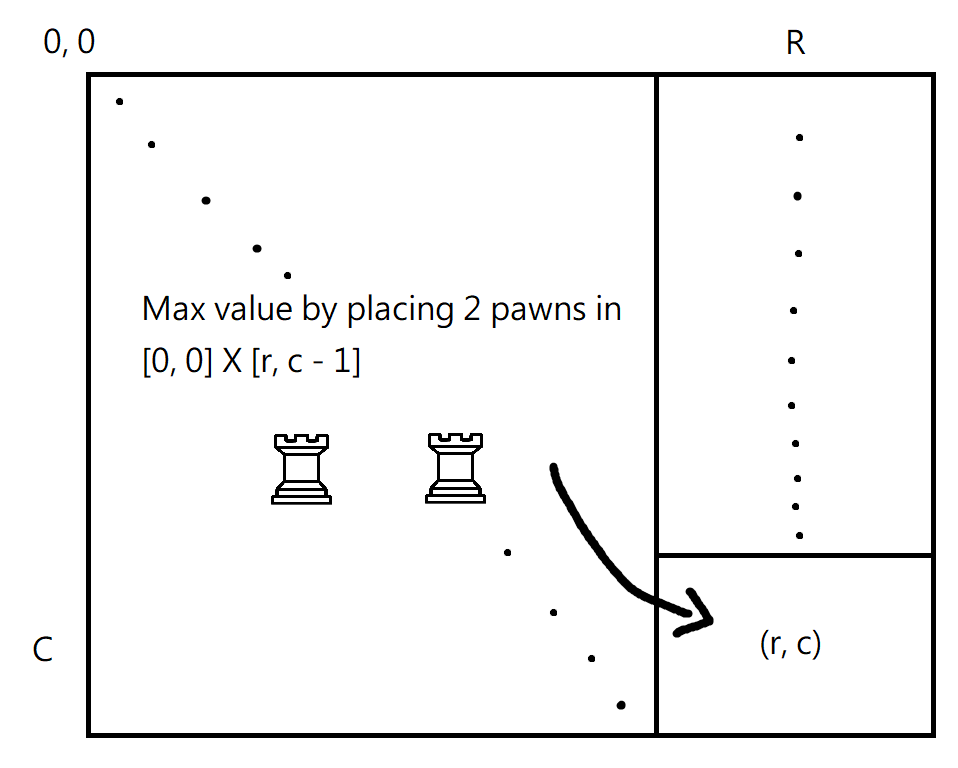
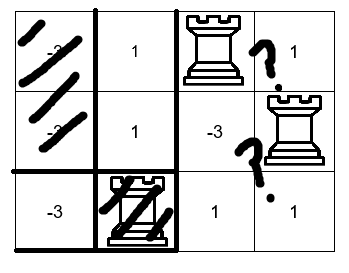

# C++ Dynamic Programming O(MN) with illustration

**Author:** Agritite
**Votes:** 4
**Link:** [https://leetcode.com/problems/maximum-value-sum-by-placing-three-rooks-ii/solutions/5651580/](https://leetcode.com/problems/maximum-value-sum-by-placing-three-rooks-ii/solutions/5651580/)

---

Start with 2 pawns:

Define `dp[r][c]` as the maximum value for placing 2 pawns in the range `[0, r] x [0, c]`,
then
```
dp[r][c] = max(
	board[r][c] + max(board[0][0]...board[r - 1][c - 1]),
	max(board[r][0]...board[r][c - 1]) +  max(board[0][c]...board[r - 1][c]),
	dp[r][c - 1],
	dp[r - 1][c]
);
```

Illustration:







Note that `max(board[0][0]...board[r - 1][c - 1])`, `max(board[r][0]...board[r][c - 1])`, and `max(board[0][c]...board[r - 1][c])` can all be precalculated in one pass.

Now, once we have our `dp` matrix, iterate through `board` again, and for every `(r, c)` we place a pawn on it, which means the max value for placing a pawn on `(r, c)` and two pawns in `[0, r - 1] x [0, c - 1]` is `val = board[r][c] + dp[r - 1][c - 1]`. Then, the max `val` is our answer...?

It's not, because there are some missing cases, such as example 1:

because we would only consider those above and to the left of our current point, but the best placement might be at the right of the current point;

but worry not; while we have iterated from top-left to bottom right `(0, 0) -> (r, c)`, all we need to do is to repeat the same thing three more times (start from building `dp`), from top-right to bottom-left `(0, c) -> (r, 0)`, bottom-left to top-right `(r, 0) -> (0, c)`, and then, bottom-right to top-left `(r, c) -> (0, 0)`, which will cover all the missing cases, because **some `(r, c)` is always going to be the top-rightmost/top-leftmost/bottom-rightmost/bottom-leftmost pawn for the maximum placement**. Finally, the maximum `val` is our answer.

Code:
```
class Solution {
public:
    long long maximumValueSum(std::vector<std::vector<int>> board)
	{
		const size_t R = board.size();
		const size_t C = board.front().size();

		long long ans = std::numeric_limits<long long>::min();
		std::vector<std::vector<int>> onemax(R, std::vector<int>(C)); // max(board[0][0]...board[r - 1][c - 1])
		std::vector<std::vector<int>> rmax(R, std::vector<int>(C)); // max(board[0][c]...board[r - 1][c])
		std::vector<std::vector<int>> cmax(R, std::vector<int>(C)); // max(board[r][0]...board[r][c - 1])
		std::vector<std::vector<int>> twomax(R, std::vector<int>(C)); // dp

		const auto flip_vertical = [&board, &R, &C]() { // flip board horizontally/vertically
			for (size_t r = 0; r < R / 2; r++) {
				for (size_t c = 0; c < C; c++) {
					std::swap(board[r][c], board[R - 1 - r][c]);
				}
			}
		};

		const auto flip_horizontal = [&board, &R, &C]() {
			for (size_t r = 0; r < R; r++) {
				std::reverse(board[r].begin(), board[r].end());
			}
		};

		const auto fn = [&board, &ans, &onemax, &rmax, &cmax, &twomax, &R, &C]() -> void {
			onemax[0][0] = rmax[0][0] = cmax[0][0] = board[0][0];
			for (size_t r = 1; r < R; r++) {
				rmax[r][0] = onemax[r][0] = std::max(board[r][0], onemax[r - 1][0]);
				cmax[r][0] = board[r][0];
			}
			for (size_t c = 1; c < C; c++) {
				cmax[0][c] = onemax[0][c] = std::max(board[0][c], onemax[0][c - 1]);
				rmax[0][c] = board[0][c];
			}
			for (size_t r = 1; r < R; r++) {
				for (size_t c = 1; c < C; c++) {
					std::array<int, 3> cand{onemax[r - 1][c], onemax[r][c - 1], board[r][c]};
					onemax[r][c] = *std::max_element(cand.cbegin(), cand.cend());
					rmax[r][c] = std::max(board[r][c], rmax[r - 1][c]);
					cmax[r][c] = std::max(board[r][c], cmax[r][c - 1]);
				}
			}

			for (size_t r = 0; r < R; r++) {
				twomax[r][0] = std::numeric_limits<int>::min(); // -2147483647 to indicate it's impossible to place 2 pawns
			}
			for (size_t c = 1; c < C; c++) {
				twomax[0][c] = std::numeric_limits<int>::min();
			}
			for (size_t r = 1; r < R; r++) {
				for (size_t c = 1; c < C; c++) {
					std::array<int, 4> cand{
						board[r][c] + onemax[r - 1][c - 1],
						cmax[r][c - 1] + rmax[r - 1][c],
						twomax[r][c - 1],
						twomax[r - 1][c]};
					twomax[r][c] = *std::max_element(cand.cbegin(), cand.cend());
				}
			}

			for (size_t r = 2; r < R; r++) {
				for (size_t c = 2; c < C; c++) {
					const long long v = board[r][c];
					const int t = twomax[r - 1][c - 1];
					if (t != std::numeric_limits<int>::min()) {
						ans = std::max(v + t, ans);
					}
				}
			}
		};

		fn(); // (0, 0) -> (r, c)
		flip_horizontal();
		fn(); // (0, c) -> (r, 0)
		flip_vertical();
		fn(); // (r, c) -> (0, 0)
		flip_horizontal();
		fn(); // (r, 0) -> (0, c) 

		return ans;
	}
};
```
Time Complexity: `O(M * N)`
Space Complexity: `O(M * N)`
