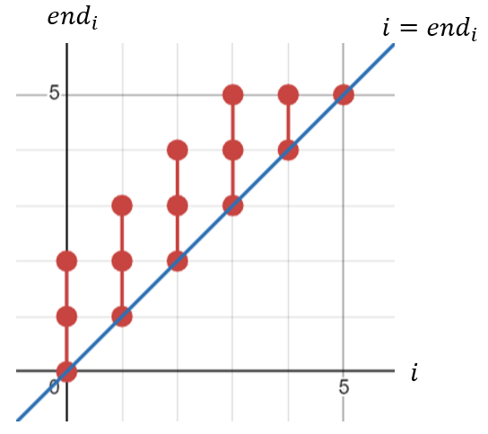
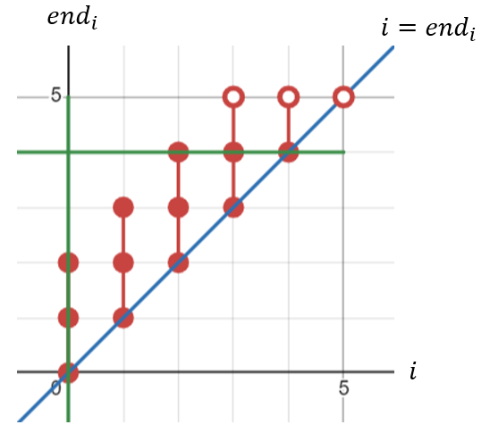
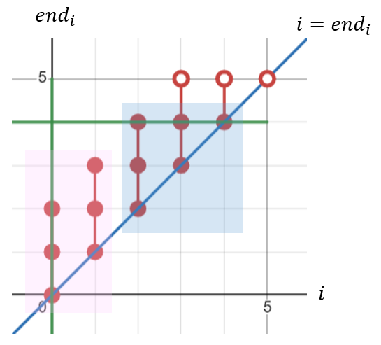

# [Java] O(n) sliding-window with explanation

**Author:** taroyeh
**Votes:** 4
**Link:** [https://leetcode.com/problems/count-substrings-that-satisfy-k-constraint-ii/solutions/5655450/](https://leetcode.com/problems/count-substrings-that-satisfy-k-constraint-ii/solutions/5655450/)

---

## Intuition

#### Find <i>end<sub>i</sub></i>

- Try to find feasible end for each start of the string, that is, for each `i`, 
  find its corresponding <b><i>end<sub>i</sub></i></b>, making substring between <b>[<i>i</i>, <i>end<sub>i</sub></i>]</b> satisfying the requirement of `k`
- For example: `s = "010101"`, `k = 1`, we can find <b><i>end<sub>i</sub></i></b> = `{2, 3, 4, 5, 5, 5}`
- And we can plot the points on the graph, like this:
  
- Instead of the nested for-loop approach which is O(n<sup>2</sup>), 
  we can use the <b>sliding-window</b> approace which is O(n)

#### Query

- We can easily count the points for a query `(start, end)` in the region surrounded by:
  - i <= <i>end<sub>i</sub></i>
  - i >= `start`
  - <i>end<sub>i</sub></i> <= `end`
- For example, for the query `(0, 4)`, we have:
  
- `3 + 3 + 3 + 2 + 1 = 12`

#### Threashold

- Actually, we can separate the points into 2 groups, like this:
  
- We can find a threshold `th` such that first <i>end<sub>i</sub></i> (from 0 to n-1) >= `end`
- There are different ways to find the `th`:
  - Checking every <i>end<sub>i</sub></i> for each `i` from 0 to n-1 one by one => O(n) 
  - Binary-search approach => O(logn) 
  - Pre-computed approach, use `thresholdEndWith` to keep values as:
    for each `i`, find minimum `j`, such that <i>end<sub>j</sub></i> >= `i`,
	`thresholdEndWith` can be computed by <b>sliding-window</b> approach
	=> O(1) 
- Since <i>end<sub>i</sub></i> is non-decreasing, for each `i >= th`, <i>end<sub>i</sub></i> >= `end`, 
  that is, <i>end<sub>i</sub></i> must be limited by `end` for each `i >= th`
- So the right (blue-background) part must be a triangle, 
  we can easily count the points with the mathematical formula

#### PreSum

- To count the points in the left (pink-background) part, 
  we can sum up every <i>end<sub>i</sub></i> where `start <= i < th` for each query
- But it is a O(n) approach for each query, that is to say it is a O(n<sup>2</sup>) approach for the solution
- A better way is the <b>PreSum</b>, the points in pink region can be done in O(1)

#### Main solution

- ```java
  long[] ans = new long[m];
  for (int i = 0; i < m; i++) {
      int[] q = queries[i];
      int th = Math.max(q[0], thresholdEndWith[q[1]]);
      if (q[0] < th) {
          // left (pink-background) part, by presum approach
          ans[i] = presum[th - 1] - (q[0] == 0 ? 0 : presum[q[0] - 1]);
      }
      // right (blue-background) part, by mathematical fomula
      ans[i] += (long)(q[1] - th + 2) * (q[1] - th + 1) / 2;
      return ans;
  }
  ```

## Complexity

Time complexity: O(N + M)
Space complexity for computing: O(N)
Space complexity for answer: O(M)

where `N` is the length of `s`, and `M` is the length of `queries`

## Source Code

```java
class Solution {
    public long[] countKConstraintSubstrings(String s, int k, int[][] queries) {
        int n = s.length(), m = queries.length;
        
        int[] data = new int[n];
        for (int i = 0; i < n; i++) {
            data[i] = s.charAt(i) - '0';
        }
        
        long pre = 0;
        long[] presum = new long[n];
        int[] thresholdEndWith = new int[n];
        int[] runningCounts = new int[2];
        for (int i = 0, j = 0; i < n; i++) {
            while (j < n) {
                runningCounts[data[j]]++;
                if (runningCounts[0] <= k || runningCounts[1] <= k) {
                    thresholdEndWith[j] = i;
                    j++;
                } else {
                    runningCounts[data[j]]--;
                    break;
                }
            }
            pre = presum[i] = pre + (j - i);
            runningCounts[data[i]]--;
        }
        
        long[] ans = new long[m];
        for (int i = 0; i < m; i++) {
            int[] q = queries[i];
            int th = Math.max(q[0], thresholdEndWith[q[1]]);
            if (q[0] < th) {
                // left (pink-background) part, by presum approach
                ans[i] = presum[th - 1] - (q[0] == 0 ? 0 : presum[q[0] - 1]);
            }
            // right (blue-background) part, by mathematical fomula
            ans[i] += (long)(q[1] - th + 2) * (q[1] - th + 1) / 2;
        }
        return ans;
    }
}
```
