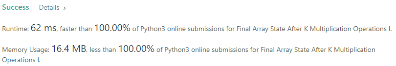

# 💢☠💫Easiest👾Faster✅💯 Lesser🧠 🎯 C++✅Python3🐍✅Java✅C✅Python🐍✅C#✅💥🔥💫Explained☠💥🔥 Beats 100

**Author:** Edwards310
**Votes:** 5
**Link:** [https://leetcode.com/problems/final-array-state-after-k-multiplication-operations-i/solutions/5688834/](https://leetcode.com/problems/final-array-state-after-k-multiplication-operations-i/solutions/5688834/)

---

# Intuition



```javascript []
//JavaScript Code
/**
 * @param {number[]} nums
 * @param {number} k
 * @param {number} multiplier
 * @return {number[]}
 */
var getFinalState = function(nums, k, multiplier) {
    while(k--){
        let ans = nums[0], idx = 0;
        for(let i = 0; i < nums.length; i++)
            if(nums[i] < ans){
                ans = nums[i];
                idx = i;
            }
        nums[idx] *= multiplier;
    }
    return nums
};
```
```C++ []
//C++ Code
// Start Of Edwards310's Template...
#pragma GCC optimize("O2")
#include <bits/stdc++.h>
using namespace std;
typedef vector<int> vi;

#define Rep1(i, n) FOR1(i, 1, n)
#define WHL(i, n) while (i < n)
#define ALL(v) v.begin(), v.end()
#define SORT(v) sort(ALL(v))
#define REVERSE(v) reverse(ALL(v))
#define mxe(v) max_element(ALL(v))
#define mie(v) min_element(ALL(v))

// End of Edwards310 Template
class Solution {
public:
    vi getFinalState(vector<int>& nums, int k, int multiplier) {
        while(k--){
            auto ele = mie(nums);
            *ele *= multiplier;
        }
        return nums;
    }
};
```
```Python3 []
#Python3 Code
class Solution:
    def getFinalState(self, nums: List[int], k: int, multiplier: int) -> List[int]:
        for _ in range(k):
            idx = nums.index(min(nums))
            nums[idx] *= multiplier
        return nums
            
```
```Java []
//Java Code
class Solution {
    public int[] getFinalState(int[] nums, int k, int multiplier) {
        int n = nums.length;
        while(k-- != 0){
            int ans = nums[0], idx = 0;
            for(int i = 0; i < n; i++){
                if(nums[i] < ans){
                    ans = nums[i];
                    idx = i;
                }
                    
            }
            nums[idx] *= multiplier;
        }
        return nums;
    }
}
```
```C []
//C Code
#define Rep(i, n) for(int i = 0; i < n; i++)
/**
 * Note: The returned array must be malloced, assume caller calls free().
 */
int* getFinalState(int* nums, int numsSize, int k, int multiplier, int* returnSize) {
    while(k--){
        int val = nums[0], idx = 0;
        Rep(i, numsSize)
            nums[i] < val ? (val = nums[i], idx = i) : 0;
        nums[idx] *= multiplier;
    }
    *returnSize = numsSize;
    return nums;
}
```
```Python []
#Python Code
class Solution(object):
    def getFinalState(self, nums, k, multiplier):
        """
        :type nums: List[int]
        :type k: int
        :type multiplier: int
        :rtype: List[int]
        """
        while k:
            idx = nums.index(min(nums))
            nums[idx] *= multiplier
            k -= 1
        return nums
```
```C# []
//C# Code
public class Solution {
    public int[] GetFinalState(int[] nums, int k, int multiplier) {
        int n = nums.Length;
        while(k-- != 0){
            int ans = nums[0], idx = 0;
            for(int i = 0; i < n; i++){
                if(nums[i] < ans){
                    ans = nums[i];
                    idx = i;
                }
                    
            }
            nums[idx] *= multiplier;
        }
        return nums;
    }
}
```

<!-- Describe your first thoughts on how to solve this problem. -->

# Approach
<!-- Describe your approach to solving the problem. -->

# Complexity
- Time complexity:
<!-- Add your time complexity here, e.g. $$O(n)$$ -->
     O(K * N)
- Space complexity:
<!-- Add your space complexity here, e.g. $$O(n)$$ -->
     O(1)
# Code

