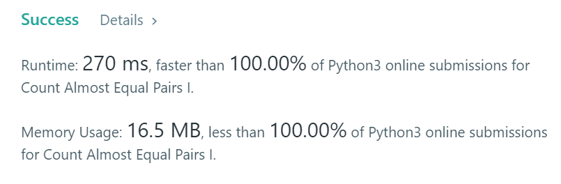

# [ Python ] ✅✅ Simple Python Solution | 100 % Faster | Brute Force✌👍

**Author:** ASHOK_KUMAR_MEGHVANSHI
**Votes:** 10
**Link:** [https://leetcode.com/problems/count-almost-equal-pairs-i/solutions/5686657/](https://leetcode.com/problems/count-almost-equal-pairs-i/solutions/5686657/)

---

# If You like the Solution, Please UpVote! \uD83D\uDD3C\uD83D\uDE4F
# Runtime: 270 ms, faster than 100.00% of Python3 online submissions for Count Almost Equal Pairs I.
# Memory Usage: 16.5 MB, less than 100.00% of Python3 online submissions for Count Almost Equal Pairs I.

	class Solution:
		def countPairs(self, nums: List[int]) -> int:

			result = 0

			for i in range(len(nums) - 1):

				for j in range(i + 1 , len(nums)):

					n1 = str(nums[i])
					n2 = str(nums[j])

					if len(n1) < len(n2):

						n1 = '0' * (len(n2) - len(n1)) + n1

					if len(n1) > len(n2):

						n2 = '0' * (len(n1) - len(n2)) + n2

					count = 0

					for index in range(len(n2)):

						if n1[index] != n2[index]:
							count = count + 1

					if count <= 2 and sorted(n1) == sorted(n2):

						result = result + 1

			return result
	
	Time Complexity : O(N^2)
	Space Complexity : O(1)
# Thank You \uD83E\uDD73\u270C\uD83D\uDC4D