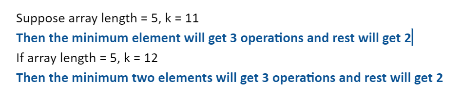
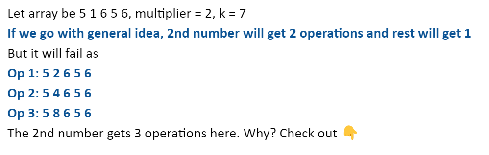

# Min Heap || Greedy

**Author:** Sparker_7242
**Votes:** 80
**Link:** [https://leetcode.com/problems/final-array-state-after-k-multiplication-operations-ii/solutions/5687003/](https://leetcode.com/problems/final-array-state-after-k-multiplication-operations-ii/solutions/5687003/)

---

# Intuition
The general idea is to divide the operations greedily among all indexes.

# Approach
Going through the general idea


But will this always work?




***Every number after getting an operation should not remain as the smallest. So we will have to achieve that state first.***

BY OBSERVATION
When all the elements get atleast an operation, we will achieve the above mentioned state. So we will first greedily assign them operation till all elements get atleast one operation.

Use **priority queue min heap** or **multiset** for that.

After this we can assign every index a number of operations through our initial general idea.

**What about such large value of k?**
The number of operations of each index may be huge due to this. **The optimal approach is achieved in log(n)** as the multiplier increases exponentially. Check out the function in the code. This is called **Exponentiation by Squaring**.

# Complexity
- Time complexity: O(nlogk)

- Space complexity: O(n)

# Code
```cpp []
const long long mod = 1000000007;

class Solution {
public:
    long long power_mod(long long base, long long exp, long long mod) {
    long long result = 1;
    
    while (exp > 0) {
        if (exp % 2 == 1) {
            result = (result * base) % mod;
        }
        base = (base * base) % mod;
        exp = exp / 2;
    }
    // this function multiplies a number by itself n times in O(logn)
    return result;
}
    vector<int> getFinalState(vector<int>& nums, int k, int multiplier) {
        if (multiplier == 1) return nums; // do not miss this!!
        priority_queue <pair<long long,long long>, vector<pair<long long,long long>>, greater<pair<long long,long long>>> pq;
        int n = nums.size();
        for (int i = 0; i < n; i++) pq.push({nums[i],i});
        unordered_map<int,int> m,m1;
        // m for storing number of operations at each index
        //m1 to know if all elements have got an operation
        while (1){
            if ((int)m1.size() == n || k == 0) break; // no more operations or state achieved
            long long x = pq.top().first, y = pq.top().second;
            pq.pop();
            x *= multiplier; pq.push({x,y});
            m1[y]++; k--;
        }
        vector<long long> v(n); // to avoid integer overflow
        // This vector will store the elements after ideal state is achieved
        while (!pq.empty()){
            long long x = pq.top().first, y = pq.top().second;
            v[y] = x;
            pq.pop();
        }
        int rep = k/n, md = k%n;
        for (int i = 0; i < n; i++) pq.push({v[i],i});
        // I had to push it again because I did not declare v initially due to contest pressure. Better to do that.
        while (!pq.empty()){
            int x = pq.top().second;
            m[x] = rep;
            if (md > 0)m[x]++,md--;
            // index x has been assigned its number of operations
            pq.pop();
        }
        // Now just compute every value while calling power_mod funtion
        for (int i = 0; i < n; i++){
            long long mlt = power_mod(multiplier, m[i],mod);
            v[i] = ((v[i]%mod)*(mlt%mod))%mod;
            nums[i] = v[i];
        }
        return nums;
    }
};
```
# **If you found it useful \uD83D\uDE34**

