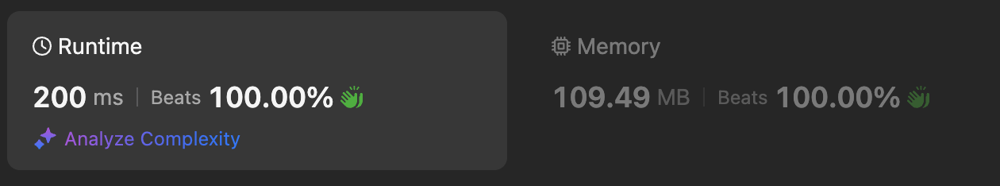

# Easy || Binary Search || simple solution || beat 100%

**Author:** Adishka15
**Votes:** 56
**Link:** [https://leetcode.com/problems/maximize-score-of-numbers-in-ranges/solutions/5753373/](https://leetcode.com/problems/maximize-score-of-numbers-in-ranges/solutions/5753373/)

---

# Intuition


<!-- Describe your first thoughts on how to solve this problem. -->
The problem revolves around distributing values in such a way that the difference between consecutive values remains feasible. Our goal is to maximize the minimum difference (mid) while ensuring that the next value does not exceed the original value plus the given range (d).

**Beat 100%**


# Approach
<!-- Describe your approach to solving the problem. -->
1. Sorting: Sort the start array to arrange the values in increasing order for easier binary search.

2. Binary Search: Use binary search to find the largest possible minimum difference (mid) between consecutive values. The search range for mid is from 0 to start.back() - start.front() + d.

3. Check Function: For each mid, check if we can place all values such that the difference between consecutive values is at least mid and doesn't exceed start[i] + d. Adjust the search range based on this check.


# Complexity
- Time complexity: O(n log n + n log(max_difference))
<!-- Add your time complexity here, e.g. $$O(n)$$ -->
 

- Space complexity:   O(1)
<!-- Add your space complexity here, e.g. $$O(n)$$ -->


# Code
```cpp []
class Solution {
public:

    bool check(const vector<int>& start, int d, int mid){
        long long  prev=start[0];
        for(int i=1 ; i<start.size(); i++){
            long long int next=max(prev+mid, static_cast<long long>(start[i]));
            if (next > start[i] + d) { 
                return false;
            }
            prev=next;
        }
        return true;
    }
    int maxPossibleScore(vector<int>& start, int d) {
        int n=start.size();
        sort(start.begin(), start.end());
        long long low=0, hi=start.back() - start.front() + d;
        
        long long ans=0;
        while(low<=hi){
            long long mid=(low+hi)/2;
            if(check(start, d, mid)){
                ans=mid;
                low=mid+1;
            }else{
                hi=mid-1;
            }
        }

        return ans;
    }
};
```


